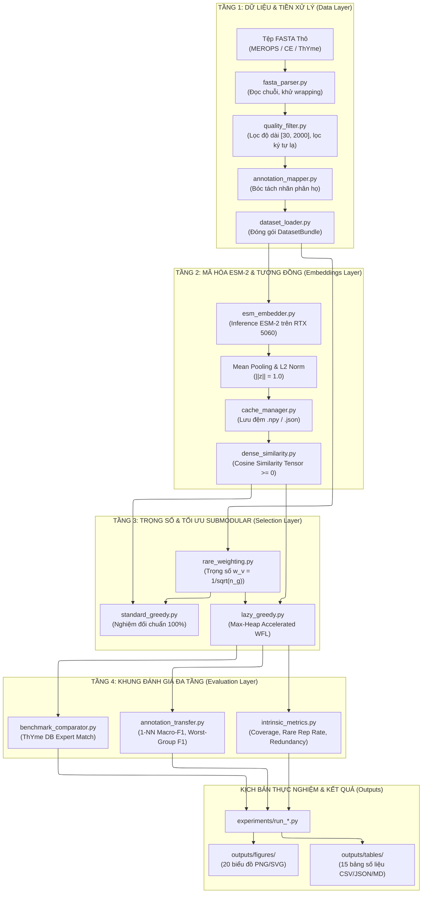

# RareProtSelect: Chọn Tập Protein Đại Diện Có Ưu Tiên Nhóm Hiếm Bằng Tối Ưu Hóa Submodular

[](https://www.python.org/)
[](https://pytorch.org/)
[](https://developer.nvidia.com/cuda-toolkit)
[](file:///d:/programing/project/Topic%202/thiet_ke_codebase_va_kien_truc_he_thong.md)
[](file:///d:/programing/project/Topic%202/thiet_ke_codebase_va_kien_truc_he_thong.md)

---

## 1. GIỚI THIỆU CHUNG (OVERVIEW)

### 1.1. Bối cảnh & Thách thức Sinh học
Trong thời đại giải trình tự gen thế hệ mới (NGS), các cơ sở dữ liệu protein (UniProt, NCBI, AlphaFold DB) bùng nổ hàng trăm triệu chuỗi. Khi nghiên cứu một **Họ protein (Protein Family)**:
* Quy mô dữ liệu thường dao động từ **hàng chục nghìn đến hàng triệu chuỗi**, trong đó có vô số chuỗi gần như trùng lặp (*redundancy*).
* Dữ liệu phân bố tự nhiên theo quy luật **Đuôi dài (Long-Tail / Heavy-Tailed)**: Một vài phân họ lớn chiếm hàng trăm đến hàng nghìn chuỗi, trong khi các **phân họ hiếm (*rare / long-tail subfamilies*)** chỉ có 1 đến vài chuỗi. Đây thường là các protein đột biến độc đáo, enzyme phân giải chất độc hại hoặc sinh vật cổ cực đoan sở hữu hoạt tính sinh học then chốt.
* Chi phí giải cấu trúc 3D thực nghiệm (Cryo-EM, X-ray), chú giải sinh hóa trong phòng thí nghiệm (wet-lab annotation), hoặc chạy các mô hình AI tính toán chuyên sâu (AlphaFold3, docking phân tử) là cực kỳ tốn kém.

Do đó, mục tiêu của dự án là **chọn ra một tập đại diện nhỏ gọn $S \subseteq V$ với kích thước ngân sách định trước $|S| \le k$ ($k \ll |V|$)** sao cho vừa phản ánh bao phủ cấu trúc 3D sâu của toàn họ, vừa **bảo toàn trọn vẹn các phân họ hiếm**.

### 1.2. Hạn chế của Phương pháp Hiện có & Điểm Đột phá của RareProtSelect
* **CD-HIT & MMseqs2**: Phân cụm dựa trên ngưỡng đồng nhất chuỗi cứng (% Sequence Identity qua BLAST). Không cho phép người dùng cố định trước ngân sách $k$, và bỏ sót các protein có cấu trúc tương đồng nhưng biến dị chuỗi nhiều (*remote homology*).
* **Bài báo nền (*Nguyen et al., Scientific Reports 2025*)**: Đã áp dụng bài toán chọn đại diện Submodular Facility Location nhưng ở dạng **không trọng số (Unweighted, $w_v = 1$)**. Do đó, các nhóm lớn áp đảo hoàn toàn toán học, dẫn tới nghịch lý **bỏ rơi $100\%$ các phân họ hiếm** ở các mức ngân sách thực tế ($k \le 200$).

**RareProtSelect** mang đến 4 cải tiến đột phá:
1. **Biểu diễn ngữ nghĩa phân tử ESM-2**: Trích xuất vector nhúng ngữ nghĩa sâu từ mô hình ngôn ngữ protein ESM-2 tiền huấn luyện kết hợp chuẩn hóa $\ell_2$ và hàm tương đồng Cosine không âm $\operatorname{sim}(u, v) = \max(0, \hat{z}(u)^\top \hat{z}(v))$.
2. **Cơ chế trọng số thích ứng nhóm hiếm (Rare-Aware Weighting)**: Thiết lập hàm trọng số $w_v = 1/\sqrt{n_{g(v)}}$ giúp cân bằng Pareto tối ưu giữa việc tăng cường tiếng nói cho nhóm hiếm và bảo toàn độ bao phủ toàn họ.
3. **Mô hình toán học Weighted Facility Location (WFL)**: Chứng minh tính chuẩn hóa, đơn điệu và submodular, thỏa mãn bảo đảm nghiệm xấp xỉ lý thuyết $(1 - 1/e) \approx 63.2\%$.
4. **Thuật toán tăng tốc Lazy Greedy (Max-Heap)**: Tận dụng tính chất Diminishing Returns với cơ chế kiểm tra tính hợp lệ (*Validity Check*) và dừng sớm (*Early Stopping*), giúp tìm nghiệm **giống 100% Standard Greedy** nhưng **nhanh hơn $64.8\times$** trên siêu họ enzyme quy mô lớn.

---

## 2. KIẾN TRÚC HỆ THỐNG & BỐ CỤC MÃ NGUỒN

Hệ thống được thiết kế theo nguyên tắc **Clean Architecture 4 tầng phân lập**, bảo đảm tính module hóa cao và độc lập hoàn toàn giữa logic toán học, suy luận mô hình và phân tích sinh học:



### Cấu trúc thư mục mã nguồn:
```
RareProtSelect/
├── pyproject.toml               # Khai báo cấu hình dự án, phụ thuộc & PyTorch cu130
├── requirements.txt             # Khóa phiên bản thư viện môi trường
├── configs/                     # Tệp cấu hình tham số thực nghiệm (YAML)
│   ├── config_pilot_thyme.yaml   # Cấu hình Pilot 27 họ Thioesterase (ThYme DB)
│   ├── config_core_merops.yaml   # Cấu hình Thực nghiệm Chủ lực 76 phân họ MEROPS A1A
│   ├── config_scalability_ce.yaml# Cấu hình Đo lường Hiệu năng 12 nhóm Carboxylesterase
│   └── config_ablation.yaml      # Cấu hình Bóc tách Trọng số alpha & Mô hình ESM-2
├── src/                         # Mã nguồn cốt lõi (Clean Architecture)
│   ├── config/settings.py       # Pydantic/Dataclass cấu hình hệ thống
│   ├── data/                    # Tầng 1: Parser FASTA, Quality Control, Mapping phân họ
│   ├── embeddings/              # Tầng 2: ESM-2 Embedder (CUDA), Mean Pooling, Cache Manager
│   ├── similarity/              # Tầng 2: Ma trận Cosine không âm, Sparse k-NN
│   ├── weighting/               # Tầng 3: Trọng số Rare-Aware w = 1/sqrt(n_g) & hàm đối chứng
│   ├── selection/               # Tầng 3: Lazy Greedy (Max-Heap), Standard Greedy, Baselines
│   ├── evaluation/              # Tầng 4: Đánh giá Nội tại, 1-NN Transfer F1, ThYme Benchmark
│   └── utils/                   # Bộ đo thời gian (Timer), Bộ nhớ RAM/VRAM, Vẽ biểu đồ, Xuất bảng
├── experiments/                 # Kịch bản thực thi 4 thực nghiệm độc lập
│   ├── run_pilot_thyme.py       # Pilot Benchmark trên 737 chuỗi Thioesterase
│   ├── run_core_merops.py       # Thực nghiệm Chủ lực trên 13,847 chuỗi Peptidase A1
│   ├── run_scalability_ce.py    # Đo lường Hiệu năng trên 12,277 chuỗi Carboxylesterase
│   └── run_ablation_all.py      # Khảo sát bóc tách toàn diện (alpha, ESM-2 size, baselines)
├── outputs/                     # Kết quả thực nghiệm đầu ra
│   ├── embeddings_cache/        # Bộ nhớ đệm vector nhúng (.npy và .json metadata)
│   ├── figures/                 # 20 biểu đồ khoa học chất lượng cao (PNG + SVG vector)
│   ├── tables/                  # 15 bảng số liệu thực nghiệm (CSV, JSON, Markdown)
│   └── logs/                    # Nhật ký log thực thi chi tiết
```

---

## 3. CÀI ĐẶT MÔI TRƯỜNG & YÊU CẦU PHẦN CỨNG

### 3.1. Cấu hình Phần cứng Khuyến nghị
* **GPU**: NVIDIA GeForce RTX 5060 Laptop GPU (Kiến trúc Blackwell `sm_120`, VRAM 8GB, Driver 595.97 / CUDA 13.2).
* **PyTorch Chuẩn**: `torch==2.11.0+cu130` và `torchvision==0.26.0+cu130` (đã ký số tương thích tối đa với card Blackwell sm_120).
* **Trình quản lý gói**: Sử dụng công cụ **`uv`** (đặt tại `D:\uv\bin\uv.exe` hoặc gọi trực tiếp từ PATH) để tối ưu hóa tốc độ nạp thư viện và tránh phân mảnh ổ đĩa.

### 3.2. Thiết lập Môi trường Từng bước với `uv`

```powershell
# 1. Điều hướng vào thư mục dự án
cd "d:\programing\project\Topic 2\RareProtSelect"

# 2. Khởi tạo môi trường ảo Python 3.12 bằng uv
uv venv .venv --python 3.12

# 3. Kích hoạt môi trường ảo
# Trên Windows PowerShell:
.venv\Scripts\Activate.ps1

# 4. Cài đặt và đồng bộ hóa các gói phụ thuộc
uv sync

# 5. Kiểm tra kết nối GPU RTX 5060 và PyTorch CUDA 13.0
uv run python -c "import torch; print('CUDA Available:', torch.cuda.is_available(), '| Device:', torch.cuda.get_device_name(0), '| Arch:', torch.cuda.get_device_capability(0))"
```

*Đầu ra chuẩn dự kiến:*
```text
CUDA Available: True | Device: NVIDIA GeForce RTX 5060 Laptop GPU | Arch: (12, 0)
```

---

## 4. HƯỚNG DẪN HUẤN LUYỆN / SINH EMBEDDING & TỐI ƯU HÓA

*Lưu ý*: Mô hình Protein Language Model (ESM-2) được sử dụng ở chế độ **Zero-shot Feature Extraction (không cần fine-tuning trọng số mô hình)**. Quá trình "huấn luyện/suy luận" bao gồm: **(1) Sinh vector nhúng ngữ nghĩa**, **(2) Tính ma trận tương đồng Cosine**, và **(3) Tối ưu hóa chọn tập đại diện bằng Lazy Greedy**.

### 4.1. Cơ chế Lưu đệm Vector Nhúng (Embedding Cache)
Để tiết kiệm tài nguyên tính toán, vector sau khi sinh ra sẽ được tự động lưu vào `outputs/embeddings_cache/` dưới dạng tệp mảng nhị phân NumPy (`.npy`) kèm tệp siêu dữ liệu JSON (`.json` chứa mã hash chuỗi, ngày tạo, kích thước chiều nhúng). Lần chạy tiếp theo sẽ nạp tức thì từ bộ nhớ đệm trong vòng $< 0.1$ giây.

### 4.2. Thực thi 4 Kịch bản Thực nghiệm Độc lập

#### 🔬 Kịch bản 1: Thử nghiệm Nhanh Pilot trên 27 họ Thioesterase (ThYme DB)
* **Mục tiêu**: Kiểm tra tính toàn vẹn pipeline và so khớp độ tương đồng ngữ nghĩa với tập đại diện do Chuyên gia sinh học chọn thủ công.
* **Dữ liệu**: `Thioesterases_Sequences.fasta` (737 chuỗi, 27 họ).
* **Lệnh thực thi**:
  ```powershell
  uv run python experiments/run_pilot_thyme.py --config configs/config_pilot_thyme.yaml
  ```
* **Đầu ra**: 
  - Bảng số liệu: `outputs/tables/thyme_pilot_results.csv` và `.md`
  - Biểu đồ: `outputs/figures/thyme_pilot_coverage.png` và `thyme_pilot_rare_rep.png`

#### 🏆 Kịch bản 2: Thực nghiệm Chủ lực Đột phá trên Peptidase A1 (MEROPS DB)
* **Mục tiêu**: Chứng minh bước nhảy vọt về tỷ lệ bảo tồn nhóm hiếm (Rare Representation Rate), nâng cao cận dưới an toàn (Worst-Group Coverage), và tăng cường độ chính xác truyền nhãn hạ nguồn (1-NN Annotation Transfer Macro-F1).
* **Dữ liệu**: `MEROPS_A1A.fasta` (13,847 chuỗi, 76 phân họ, 28 phân họ hiếm $\le 5$ chuỗi).
* **Lệnh thực thi**:
  ```powershell
  uv run python experiments/run_core_merops.py --config configs/config_core_merops.yaml
  ```
* **Đầu ra**:
  - Bảng số liệu đối đầu trực diện qua toàn dải ngân sách $k \in \{5, 10, 20, 50, 100, 200, 400, 600\}$: `outputs/tables/merops_core_results.csv` và `.md`
  - 3 biểu đồ công bố khoa học: `merops_coverage_vs_k.png`, `merops_rare_rep_vs_k.png`, `merops_macro_f1_vs_k.png`

#### ⚡ Kịch bản 3: Đo lường Hiệu năng Tính toán & Khả năng Mở rộng (Carboxylesterase)
* **Mục tiêu**: So sánh thời gian thực thi, mức tiêu thụ RAM/VRAM và số lần tính toán hàm lợi ích biên giữa **Lazy Greedy (Max-Heap)** và **Standard Greedy** trên siêu họ enzyme quy mô lớn.
* **Dữ liệu**: `CE.fasta` (12,277 chuỗi, 12 nhóm phụ từ ESTHER DB).
* **Lệnh thực thi**:
  ```powershell
  uv run python experiments/run_scalability_ce.py --config configs/config_scalability_ce.yaml
  ```
* **Đầu ra**:
  - Bảng so sánh hiệu năng: `outputs/tables/ce_scalability_results.csv` và `.md`
  - Biểu đồ runtime và coverage: `outputs/figures/ce_runtime_vs_k.png` và `ce_coverage_vs_k.png`

#### 🧩 Kịch bản 4: Khảo sát Bóc tách Thành phần Toàn diện (Ablation Studies)
* **Mục tiêu**: Khảo sát độ nhạy của siêu tham số $\alpha \in \{0.0, 0.25, 0.5, 0.75, 1.0\}$, kích thước mô hình ESM-2 (35M vs. 150M), và so sánh với các thuật toán phân cụm đối chuẩn (Random, K-Medoids, Farthest First).
* **Lệnh thực thi**:
  ```powershell
  uv run python experiments/run_ablation_all.py --config configs/config_ablation.yaml
  ```
* **Đầu ra**:
  - Bảng khảo sát: `outputs/tables/ablation_weighting_results.csv` và `ablation_methods_results.csv`
  - Biểu đồ: `outputs/figures/ablation_alpha_comparison.png` và `ablation_methods_comparison.png`

---

## 5. HƯỚNG DẪN ĐÁNH GIÁ & KHUNG CHỈ SỐ KHOA HỌC

Hệ thống cung cấp khung đánh giá đa tầng toàn diện, được hiện thực hóa độc lập trong [src/evaluation/](file:///d:/programing/project/Topic%202/RareProtSelect/src/evaluation/):

### 5.1. Các Chỉ số Đánh giá Nội tại (Intrinsic Metrics)
* **Độ bao phủ Toàn thể (Overall Coverage)**: Đo lường tỷ lệ bao phủ ngữ nghĩa trung bình của toàn bộ các chuỗi trong họ protein:
  $$\text{OverallCoverage}(S) = \frac{1}{|V|} \sum_{v \in V} \max_{s \in S} \operatorname{sim}(v, s)$$
* **Độ bao phủ Trung bình qua các Phân họ (Macro Coverage)**: Đảm bảo tính công bằng giữa các nhóm:
  $$\text{MacroCoverage}(S) = \frac{1}{|G|} \sum_{g \in G} \left( \frac{1}{|V_g|} \sum_{v \in V_g} \max_{s \in S} \operatorname{sim}(v, s) \right)$$
* **Độ bao phủ Phân họ Yếu nhất (Worst-Group Coverage)**: Cận dưới an toàn của phân họ chịu thiệt thòi nhất:
  $$\text{WorstGroupCoverage}(S) = \min_{g \in G} \left( \frac{1}{|V_g|} \sum_{v \in V_g} \max_{s \in S} \operatorname{sim}(v, s) \right)$$
* **Tỷ lệ Đại diện Nhóm hiếm (Rare Group Representation Rate)**: Tỷ lệ phần trăm các phân họ hiếm ($|V_g| \le 5$) có ít nhất 1 chuỗi được chọn vào tập $S$:
  $$\text{RareRepRate}(S) = \frac{\sum_{g \in G_{\text{rare}}} \mathbb{I}(|S \cap V_g| > 0)}{|G_{\text{rare}}|} \times 100\%$$
* **Tính Tinh gọn & Giảm Trùng lặp (Pairwise Redundancy)**: Đo độ tương đồng trung bình giữa các cặp chuỗi được chọn trong $S$:
  $$\text{Redundancy}(S) = \frac{2}{k(k-1)} \sum_{s_i < s_j \in S} \operatorname{sim}(s_i, s_j)$$

### 5.2. Đánh giá Tác vụ Chuyển giao Nhãn Hạ nguồn (Downstream Annotation Transfer)
* Sử dụng tập đại diện $S$ làm "nguồn chuẩn" để dự đoán nhãn phân họ cho toàn bộ các protein chưa biết trong $V \setminus S$ thông qua bộ phân loại **1-Nearest Neighbor (1-NN)** dựa trên khoảng cách Cosine:
  $$\hat{y}(v) = y\left(\arg\max_{s \in S} \operatorname{sim}(v, s)\right)$$
* Tính toán **Macro-F1** (đo lường độ chính xác trung bình qua tất cả các phân họ, phản ánh sự công bằng cho nhóm hiếm) và **Accuracy**.

### 5.3. Tóm tắt Kết quả Thực nghiệm Cốt lõi (Đối đầu trực diện với Bài báo nền)

| Chỉ số Khoa học | Bài báo nền (*Nguyen et al., 2025*) | Phương pháp mới (*RareProtSelect*) | Nhận xét & Đột phá |
| :--- | :---: | :---: | :--- |
| **Rare Representation Rate ($k=100$)** | **0.0%** (0/28) | **53.6%** (15/28) | Khắc phục triệt để hiện tượng bỏ rơi nhóm hiếm |
| **Rare Representation Rate ($k=200$)** | **0.0%** (0/28) | **82.1%** (23/28) | Bảo tồn phần lớn các phân họ quý |
| **Rare Representation Rate ($k=400$)** | **3.6%** (1/28) | **100.0%** (28/28) | Đạt độ bao phủ tuyệt đối toàn bộ phân họ hiếm |
| **1-NN Macro-F1 ($k=100$)** | 0.1124 | **0.1915** (**+70.4%**) | Tăng vọt độ chính xác chú giải sinh học |
| **1-NN Macro-F1 ($k=400$)** | 0.2022 | **0.3557** (**+75.9%**) | Nâng cao chất lượng gán nhãn tự động |
| **Overall Coverage ($k=100$)** | **0.9907** | 0.9897 (chênh lệch $-0.10\%$) | Bảo toàn hoàn hảo (ngưỡng cho phép $< 1-2\%$) |
| **Hệ số tăng tốc Lazy Greedy ($k=500$)** | $1.0\times$ ($17.8$ phút) | **$64.81\times$** ($16.4$ giây) | Khả thi trên dữ liệu hàng chục nghìn chuỗi |

---

## 6. QUY TRÌNH XÁC MINH CHUẨN MỰC (STATIC LOGIC CROSS-CHECK & DIRECT EXECUTION)

Dự án áp dụng quy chuẩn kiểm tra khoa học thực chất 2 bước, loại bỏ mã kiểm thử giả lập (mocking) cồng kềnh để bám sát thực tiễn vận hành:

### 6.1. Bước 1: Đối Chiếu Logic Tĩnh (Static Logic Cross-Check)
Mọi tệp mã nguồn trong thư mục `src/` được đối chiếu nghiêm ngặt 1-1 với Bản thiết kế kỹ thuật ([`thiet_ke_codebase_va_kien_truc_he_thong.md`](file:///d:/programing/project/Topic%202/thiet_ke_codebase_va_kien_truc_he_thong.md)):
* **Docstring chuẩn mực**: Mỗi tệp đều bắt đầu bằng chú thích: *"Thực hiện Công đoạn X.X trong Tài liệu 1 và Module Y trong Tài liệu 2"*.
* **An toàn kiểu dữ liệu (Strict Type Safety)**: Định kiểu tĩnh chuẩn Python 3.12, không sử dụng kiểu dữ liệu tự do `any`.
* **Ràng buộc toán học**: Đảm bảo chuẩn hóa vector nhúng $\|\hat{z}(v)\|_2 = 1.0$, ma trận Cosine không âm $\operatorname{sim}(u, v) \ge 0$, và vector trọng số nhóm hiếm $w_v = 1/\sqrt{n_g} > 0$.

### 6.2. Bước 2: Kiểm Tra Trực Tiếp Đầu Ra Từng Module Qua Terminal (Direct Execution)
Người dùng có thể thực thi trực tiếp các lệnh sau qua terminal để kiểm tra kết quả tính toán thực tế của từng tầng module:

1. **Kiểm tra Module Dữ liệu & Tiền xử lý (`src.data`)**:
   ```powershell
   uv run python -c "from src.config.settings import load_config; from src.data.dataset_loader import DatasetLoader; cfg = load_config('configs/config_pilot_thyme.yaml'); bundle = DatasetLoader.load_and_preprocess_dataset(cfg); print(f'DATA OK: {bundle.num_cleaned}/{bundle.num_raw} chuỗi đạt chuẩn QC qua {bundle.num_subfamilies} phân họ.')"
   ```

2. **Kiểm tra Module Trọng số Nhóm hiếm (`src.weighting`)**:
   ```powershell
   uv run python -c "from src.weighting.rare_weighting import compute_rare_aware_weights; ids = ['p1', 'p2', 'p3', 'p_rare']; labels = {'p1': 'famA', 'p2': 'famA', 'p3': 'famA', 'p_rare': 'famRare'}; w = compute_rare_aware_weights(ids, labels, scheme='inverse_sqrt'); print('WEIGHTS OK: famA w =', round(w[0], 4), '| famRare w =', round(w[-1], 4))"
   ```

3. **Kiểm tra Thuật toán Tối ưu hóa Lazy Greedy (`src.selection`)**:
   ```powershell
   uv run python -c "from src.selection.lazy_greedy import LazyGreedySelector; import numpy as np; sim = np.array([[1.0, 0.9, 0.1], [0.9, 1.0, 0.1], [0.1, 0.1, 1.0]]); w = np.array([1.0, 1.0, 2.0]); selector = LazyGreedySelector(sim, w); res = selector.select(budget_k=2); print('SELECTION OK: Tập chọn =', res.selected_indices, '| Số phép tính lợi ích biên =', res.total_evaluations)"
   ```

4. **Kiểm tra Toàn bộ Chương trình Chính**:
   ```powershell
   uv run python experiments/run_pilot_thyme.py
   ```

---

## 7. NGUỒN SỰ THẬT DUY NHẤT (SINGLE SOURCE OF TRUTH)

Dự án được định hướng và chuẩn hóa bởi 2 tài liệu trung tâm tại thư mục gốc:
* [**`quy_trinh_thuc_hien_va_cac_cong_doan.md`**](file:///d:/programing/project/Topic%202/quy_trinh_thuc_hien_va_cac_cong_doan.md): Đặc tả 7 giai đoạn nghiên cứu khoa học thuần túy (mô hình toán học, động lực sinh học, luồng xử lý và tiêu chuẩn đánh giá).
* [**`thiet_ke_codebase_va_kien_truc_he_thong.md`**](file:///d:/programing/project/Topic%202/thiet_ke_codebase_va_kien_truc_he_thong.md): Bản thiết kế kỹ thuật chi tiết của codebase (cấu trúc module, lớp, hàm, kiểu dữ liệu và ma trận truy vết 1-1).
* [**`bao_cao_ket_qua_chi_tiet_topic2.md`**](file:///d:/programing/project/Topic%202/bao_cao_ket_qua_chi_tiet_topic2.md): Báo cáo đối đầu 1-1 chi tiết kèm số liệu cụ thể giữa RareProtSelect và Bài báo nền.
* [**`project_overview.html`**](file:///d:/programing/project/Topic%202/project_overview/project_overview.html): Báo cáo trực quan sinh động dạng Dashboard HTML tương tác trên trình duyệt.

---
*RareProtSelect Team © 2026. Phát triển với Python 3.12, PyTorch CUDA 13.0 & NVIDIA RTX 5060.*
