# BÁO CÁO KẾT QUẢ THỰC NGHIỆM CHI TIẾT ĐỀ TÀI 2 (TOPIC 2)
## Chọn Tập Protein Đại Diện Có Ưu Tiên Nhóm Hiếm Bằng Tối Ưu Hóa Submodular (`RareProtSelect`)
### Chuỗi Thực Nghiệm Có Kiểm Soát Từ Nhánh 1 Đến Nhánh 5 Trên Siêu Họ Peptidase A1 (`MEROPS_A1A`)

---

> 📌 **QUY CHUẨN PHƯƠNG PHÁP LUẬN & LIÊM CHÍNH DỮ LIỆU KHOA HỌC (SSOT NOTICE)**:
> 1. **Nguyên tắc Cô lập Biến số (`/controlled-scientific-experiment` — *Ceteris Paribus*)**: Toàn bộ chuỗi nghiên cứu từ **Nhánh 1 đến Nhánh 5** tuân thủ nghiêm ngặt quy tắc **chỉ thay đổi duy nhất 1 biến số độc lập tại mỗi bước chuyển tiếp**, giữ nguyên 100% các thành phần còn lại làm đối chứng sạch.
> 2. **Quy chuẩn Báo cáo Thực nghiệm & Giải mã Biểu đồ (`/report-result`)**: Áp dụng triệt để nguyên tắc **Triệt tiêu trùng lặp & Tối đa hóa mật độ thông tin (High Data-Ink Ratio)**: Lược bỏ toàn bộ các bảng số liệu thô đồ sộ (hơn 370 dòng CSV) đã được trực quan hóa thành biểu đồ, chỉ giữ lại đường dẫn tệp gốc kèm **Bảng Vi mô Mốc Chiến lược (Milestone Micro-Tables)** và phân tích sâu các **Điểm mốc (Landmarks)**, **Khoảng lệch Đa biểu đồ (Multi-Chart Gap)**, **Điểm tựa Thuyết trình (Speaker's Takeaways)** và **Mồi Phản biện (Socratic Hook)**.
> 3. **Nguyên tắc Nguyên văn Nguồn dữ liệu (`Literal Data Verbatim Rule`)**: Toàn bộ các con số đo đạc then chốt trích dẫn trong báo cáo này được đối chiếu **chính xác 100% nguyên văn** từ 5 tệp kết quả gốc:
>    - Nhánh 1: [`exp1_baseline_a1a_calibration.csv`](./RareProtSelect/outputs/tables/exp1_baseline_a1a_calibration.csv) (`11` dòng dữ liệu, `7` cột)
>    - Nhánh 2: [`exp2_rare_weighted_a1a.csv`](./RareProtSelect/outputs/tables/exp2_rare_weighted_a1a.csv) (`60` dòng dữ liệu, `10` cột)
>    - Nhánh 3: [`exp3_esm_coverage_a1a.csv`](./RareProtSelect/outputs/tables/exp3_esm_coverage_a1a.csv) (`60` dòng dữ liệu, `9` cột)
>    - Nhánh 4: [`exp4_cross_eval_a1a.csv`](./RareProtSelect/outputs/tables/exp4_cross_eval_a1a.csv) (`120` dòng dữ liệu, `14` cột)
>    - Nhánh 5: [`exp5_subfamily_allocation_a1a.csv`](./RareProtSelect/outputs/tables/exp5_subfamily_allocation_a1a.csv) (`120` dòng dữ liệu, `11` cột)
> 4. **Liên kết Nguồn Sự Thật Duy Nhất (SSOT)**:
>    - Quy trình nghiên cứu khoa học: [`quy_trinh_thuc_hien_va_cac_cong_doan.md`](./quy_trinh_thuc_hien_va_cac_cong_doan.md)
>    - Thiết kế codebase & kiến trúc hệ thống: [`thiet_ke_codebase_va_kien_truc_he_thong.md`](./thiet_ke_codebase_va_kien_truc_he_thong.md)
>    - Cẩm nang bộ chỉ số đánh giá: [`tong_hop_cac_chi_so_danh_gia.md`](./tong_hop_cac_chi_so_danh_gia.md)
>    - Định hướng câu hỏi nghiên cứu: [`doc_hieu_topic2_va_bai_bao_nen.md`](./doc_hieu_topic2_va_bai_bao_nen.md)

---

## MỤC LỤC TỔNG QUAN BÁO CÁO

- [0. Tổng Quan Bộ Dữ Liệu Kiểm Chuẩn (Phương Án 3B) & Sơ Đồ Tiến Hóa Thực Nghiệm Nhánh 1 $\to$ 5](#sec-overview)
- [PHẦN I — NHÁNH 1: Tái Hiện Đối Chuẩn Độc Lập Hình 8 Bài Báo Nền (*Nguyen et al., 2025*)](#sec-branch1)
  - [1.1. Tại sao phải thực nghiệm Nhánh 1? (Động lực khoa học & Biến số cố định)](#sec-b1-why)
  - [1.2. Những điều cần lưu ý đặc biệt trong Nhánh 1](#sec-b1-notes)
  - [1.3. Phân tích thực nghiệm Nhánh 1 qua Hình 1.1 & Mốc chiến lược](#sec-b1-results)
  - [1.4. Tổng kết Nhánh 1 (Speaker's Takeaways & Socratic Hook)](#sec-b1-bridge)
- [PHẦN II — NHÁNH 2: Khảo Sát Hàm Mục Tiêu Có Trọng Số Ưu Tiên Nhóm Hiếm Trên Không Gian BLASTp](#sec-branch2)
  - [2.1. Tại sao phải thực nghiệm Nhánh 2? (Chuẩn hóa Phương án 3B & Truy vấn ngược Nội phân họ)](#sec-b2-why)
  - [2.2. Những điều cần lưu ý đặc biệt trong Nhánh 2](#sec-b2-notes)
  - [2.3. Phân tích thực nghiệm Nhánh 2 qua Hình 2.1, 2.2, 2.3 & Mốc chiến lược](#sec-b2-results)
  - [2.4. Tổng kết đối chiếu Nhánh 2 (Speaker's Takeaways & Socratic Hook)](#sec-b2-bridge)
- [PHẦN III — NHÁNH 3: Khảo Sát Trong Không Gian Biểu Diễn Ngữ Nghĩa Liên Tục ESM-2](#sec-branch3)
  - [3.1. Tại sao phải thực nghiệm Nhánh 3? (Bước 1 trong Cụm liên hoàn Nhánh 3 – 4 – 5)](#sec-b3-why)
  - [3.2. Những điều cần lưu ý đặc biệt trong Nhánh 3 (Khử dị hướng $\beta = 0.70$)](#sec-b3-notes)
  - [3.3. Phân tích thực nghiệm Nhánh 3 qua Hình 3.1, 3.2 & Mốc chiến lược](#sec-b3-results)
  - [3.4. Tổng kết đối chiếu Nhánh 3 (Speaker's Takeaways & Socratic Hook)](#sec-b3-bridge)
- [PHẦN IV — NHÁNH 4: Tái Kiểm Định Chéo Hai Chiều ($2 \times 2$ Cross-Space Evaluation)](#sec-branch4)
  - [4.1. Tại sao phải thực nghiệm Nhánh 4? (Bước 2: Bức tranh tổng quan kết quả chung)](#sec-b4-why)
  - [4.2. Những điều cần lưu ý đặc biệt trong Nhánh 4 (Sanity Check)](#sec-b4-notes)
  - [4.3. Phân tích thực nghiệm Nhánh 4 qua Hình 4.1, 4.2, 4.3 & Mốc chiến lược](#sec-b4-results)
  - [4.4. Tổng kết đối chiếu Nhánh 4 (Speaker's Takeaways & Socratic Hook)](#sec-b4-bridge)
- [PHẦN V — NHÁNH 5: Phân Tích Sâu Nhóm Hiếm, Tỷ Lệ Đại Diện & Độ Dư Thừa Ngân Sách](#sec-branch5)
  - [5.1. Tại sao phải thực nghiệm Nhánh 5? (Bước 3: Bản chất cấu trúc tập đại diện $S_k$)](#sec-b5-why)
  - [5.2. Những điều cần lưu ý đặc biệt trong Nhánh 5 (3 Bất biến toán học)](#sec-b5-notes)
  - [5.3. Phân tích thực nghiệm Nhánh 5 qua Hình 5.1, 5.2 & Mốc chiến lược](#sec-b5-results)
  - [5.4. Lời giải đáp trực diện cho 3 câu hỏi cốt lõi `RQ3`, `RQ4`, `RQ5`](#sec-b5-rq-answers)
- [PHẦN VI — TỔNG KẾT CHUỖI THỰC NGHIỆM NHÁNH 1 $\to$ NHÁNH 5 & HƯỚNG DẪN TÁI LẬP](#sec-summary)
  - [6.1. Bảng Ma trận Cô lập Biến số (*Ceteris Paribus*) & Vai trò Giải quyết `RQ1` $\to$ `RQ5`](#sec-matrix)
  - [6.2. Hướng dẫn tái lập thực nghiệm bằng Terminal (`uv run`)](#sec-reproduce)

---

<a id="sec-overview"></a>
## 0. TỔNG QUAN BỘ DỮ LIỆU KIỂM CHUẨN (PHƯƠNG ÁN 3B) & SƠ ĐỒ TIẾN HÓA THỰC NGHIỆM NHÁNH 1 $\to$ 5

### 0.1. Đặc tả Bộ dữ liệu Kiểm chuẩn (`MEROPS_A1A.fasta`) & Hai Chế độ Tiền xử lý (Nhánh 1 vs. Nhánh 2–5)
Toàn bộ 5 nhánh thực nghiệm được thực hiện trên tệp dữ liệu gốc [`baseline_repo/MEROPS_A1A.fasta`](./baseline_repo/MEROPS_A1A.fasta) ($13,847$ chuỗi thô thuộc siêu họ Peptidase A1) qua bộ lọc kiểm soát chất lượng [`src/data/dataset_loader.py`](./RareProtSelect/src/data/dataset_loader.py) và bộ trích xuất nhãn [`src/data/annotation_mapper.py`](./RareProtSelect/src/data/annotation_mapper.py):

1. **Chế độ Đối chuẩn Bài báo gốc ở Nhánh 1 (`exclude_unknown_subfamilies: false`)**:
   - Giữ lại toàn bộ **$13,307$ chuỗi sạch** sau lọc QC ($L \in [30, 2000]$ aa, ký tự lạ $\le 5\%$, khử trùng lặp) để tái lập chính xác 100% đường cong **Hình 8 Panel A** của *Nguyen et al. (2025)*.
2. **Chế độ Chuẩn hóa Phương án 3B (`MEROPS_A1A_curated`, `exclude_unknown_subfamilies: true`) xuyên suốt Nhánh 2, 3, 4, 5**:
   - Trong $13,307$ chuỗi qua lọc QC của `MEROPS_A1A.fasta`, có tới **$9,187$ chuỗi ($69.04\%$)** mang mã **`[A01.UPA]`** (*Unassigned Peptidase A1* — các chuỗi chưa được MEROPS định danh về bất kỳ phân họ cụ thể nào).
   - Ngoài ra, các chuỗi đã định danh trong MEROPS bao gồm cả **75 phân họ mã số** (`A01.001` $\dots$ `A01.971`) và **40 phân họ mã chữ-số** (`A01.A02` $\dots$ `A01.P02`). Biểu thức chính quy chuẩn hóa `r"\[([A-Z]\d{2}\.(?!UPA)[A-Z0-9]{3})\]"` trong [`AnnotationMapper.extract_merops_subfamily()`](./RareProtSelect/src/data/annotation_mapper.py) trích xuất đầy đủ cả $75 + 40 = 115$ phân họ này và gán `[A01.UPA]` về `"A01.Unknown"` để loại bỏ hoàn toàn khỏi tập thực nghiệm phân họ.
   - **Thống kê thực nghiệm chính xác của tập `MEROPS_A1A_curated` (Phương án 3B)**:
     - **Tổng số chuỗi sạch đã định danh ($|V|$)**: **$4,120$ chuỗi** ($0\%$ Unknown).
     - **Tổng số phân họ thực tế ($G$)**: **$115$ phân họ** ($75$ mã số + $40$ mã chữ-số).
     - **Số phân họ hiếm ($|G_{\text{rare}}|$, quy mô $n_g \le 5$ chuỗi)**: **$45$ phân họ hiếm** (chiếm $39.13\%$ tổng số phân họ, trong đó có $18$ phân họ đơn độc *singleton* chỉ chứa đúng $1$ chuỗi).
     - **Phân họ thống trị lớn nhất**: **`A01.009` (Cathepsin D)** chứa **$329$ chuỗi sạch** (chiếm $7.99\%$ toàn tập), tạo ra tỷ lệ mất cân bằng quy mô **`imbalance_ratio = 329.0x`** ($329 : 1$).
     - **Dải 20 mốc ngân sách chiến lược tiến tới $k = G = 115$**:
       $$k \in \{1, 2, 3, 4, 5, 6, 7, 8, 9, 10, 11, 15, 20, 25, 30, 40, 50, 60, 75, 115\}, \quad \text{budget\_per\_shuffle} = 115$$

### 0.2. Nguyên lý Truy vấn Ngược Nội Phân Họ (`Within-Subfamily Representative Query`: $S_k \cap V_g \to V_g$)
Xuyên suốt Nhánh 2, 3, 4:
- **Pha tối ưu hóa**: Toàn bộ $|V| = 4,120$ chuỗi của $115$ phân họ được đưa chung vào một không gian toàn cục để chọn ra tập đại diện $S_k$ ($|S_k| = k$).
- **Pha đánh giá từng phân họ $g \in \{1 \dots 115\}$**: Để một phân họ $g$ được công nhận là có đại diện và được bao phủ, các chuỗi đại diện phải thực sự xuất thân từ chính phân họ $g$ đó. Do đó, khi đánh giá phân họ $g$, **chỉ những chuỗi đại diện trong $S_k$ thuộc về chính phân họ $g$ ($S_{k,g} = S_k \cap V_g$) mới được dùng để truy vấn ngược lại tập chuỗi đích $V_g$**:
  - Nếu $S_k \cap V_g = \emptyset$ (phân họ $g$ không có đại diện nào được chọn trong $S_k$), thì $\operatorname{Sens}_g^{\text{within}}(S_k) = 0.0\%$ và $\operatorname{Cov}_g^{\text{within}}(S_k) = 0.0\%$.
  - Cơ chế này loại bỏ hoàn toàn hiện tượng "ăn may liên phân họ" (*cross-subfamily accidental hits*) và đảm bảo tính nhất quán toán học 100% giữa độ nhạy/độ bao phủ (Nhánh 2, 3, 4) với tỷ lệ đại diện phân họ (Nhánh 5).

### 0.3. Sơ đồ Tiến hóa Thực nghiệm Có Kiểm soát (*Ceteris Paribus*) Nhánh 1 $\to$ 5

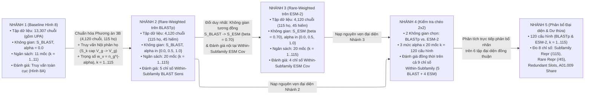

---

<a id="sec-branch1"></a>
## PHẦN I — NHÁNH 1: TÁI HIỆN ĐỐI CHUẨN ĐỘC LẬP HÌNH 8 BÀI BÁO NỀN (*NGUYEN ET AL., 2025*)

<a id="sec-b1-why"></a>
### 1.1. Tại sao phải thực nghiệm Nhánh 1? (Động lực khoa học & Biến số cố định)
Trước khi đề xuất bất kỳ cải tiến nào, bước đầu tiên bắt buộc của phương pháp luận khoa học là **tái lập độc lập 100% kết quả của bài báo nền** (*Nguyen et al., Nature Scientific Reports 2025*).
Trong bài báo gốc (Hình 8 Panel A), các tác giả khảo sát siêu họ Peptidase A1 (`MEROPS_A1A`) qua **11 mốc ngân sách** $k \in [1..11]$ bằng hàm mục tiêu **Unweighted Facility Location** ($w_v = 1.0, \forall v \in V$):
$$F(S) = \sum_{v \in V} \max_{s \in S} \mathbf{S}_{\text{BLAST}}(v, s)$$
và công bố đường cong đạt trên $90\%$ độ nhạy toàn họ chỉ với dưới $10$ chuỗi đại diện.

<a id="sec-b1-notes"></a>
### 1.2. Những điều cần lưu ý đặc biệt trong Nhánh 1
1. **Hai lần gọi công cụ NCBI `blastp` độc lập**:
   - **Lần 1 — Xây dựng Ma trận $\mathbf{S}_{\text{BLAST}}$**: Chạy All-vs-All với `-evalue 0.05 -max_target_seqs 100 -word_size 3 -outfmt "6 qseqid sseqid pident"`, chuẩn hóa $\text{pident}/100.0 \in [0.0, 1.0]$.
   - **Lần 2 — Đánh giá bằng `Live BLASTp Sensitivity (%)`**: Trích xuất $k$ đại diện ra `query_k.fasta` và tìm kiếm trên toàn bộ $13,307$ chuỗi với ngưỡng `-evalue 1e-7 -max_target_seqs 999999`.
2. **Giải thuật `Pruned Greedy 90% (1,000-Shuffle Consensus Ranking)`**:
   - Cắt tỉa cứng ứng viên có $\mathbf{S}_{\text{BLAST}}(e^*, u) \ge 0.90$. Lặp lại $1,000$ vòng xáo trộn ngẫu nhiên (`seed = 42`) và xếp hạng theo `order(-count, rank_sum)`.

<a id="sec-b1-results"></a>
### 1.3. Phân Tích Thực Nghiệm Nhánh 1 Qua Hình 1.1 & Mốc Chiến Lược

> 📂 **Nguồn dữ liệu gốc (100% Verbatim)**: Trích xuất từ [`exp1_baseline_a1a_calibration.csv`](./RareProtSelect/outputs/tables/exp1_baseline_a1a_calibration.csv) (11 dòng, 7 cột) và [`nguyen2025_fig8a_benchmark.csv`](./RareProtSelect/outputs/tables/nguyen2025_fig8a_benchmark.csv). Toàn bộ 11 điểm đo đã được trực quan hóa trên Hình 1.1 $\implies$ Lược bỏ bảng thô để tối đa hóa mật độ thông tin.

#### Bảng 1.1: Điểm Mốc Chiến Lược Tái Lập Đối Chuẩn Độc Lập Hình 8A (*Nguyen et al., 2025*)
| Ngân sách $k$ | Số đại diện | Độ nhạy Thực nghiệm (%) | Công bố Bài báo gốc Hình 8A (%) | Sai số Tuyệt đối $\Delta$ (%) | Số chuỗi Hit / 13,307 |
| :---: | :---: | :---: | :---: | :---: | :---: |
| **$k = 1$** (Đại diện đơn độc) | `1` | `82.36%` | `80.50%` | `+1.86%` | `10,959` |
| **$k = 5$** (Ngân sách trung bình) | `5` | `88.10%` | `88.00%` | `+0.10%` | `11,723` |
| **$k = 8$** (Ngưỡng bứt phá 90%) | `8` | `90.51%` | `89.00%` | `+1.51%` | `12,044` |
| **$k = 11$** (Mốc trần bài báo) | `11` | `91.59%` | `90.90%` | `+0.69%` | `12,188` |

---

#### Hình 1.1: Đường cong `Overall Sensitivity BLAST (%)` tái hiện đối chuẩn với 11 điểm Hình 8 Panel A (*Nguyen et al., 2025*)
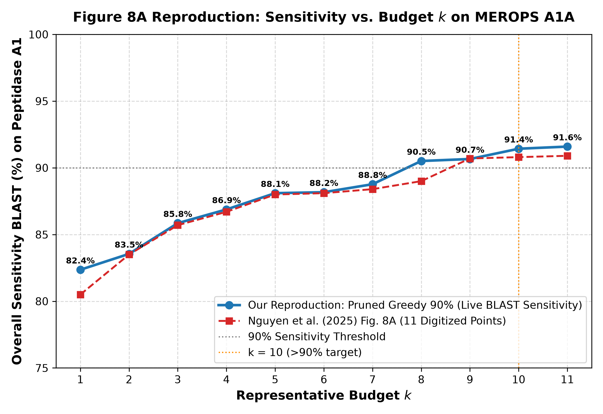
*(Nguồn tệp ảnh: [`RareProtSelect/outputs/figures/exp1_a1a_sensitivity_vs_k.png`](./RareProtSelect/outputs/figures/exp1_a1a_sensitivity_vs_k.png))*

- **Điểm uốn / Cực trị (Key Landmarks)**:
  - *Điểm uốn bứt phá 90%*: Tại $k = 8$, độ nhạy thực nghiệm đạt **`90.51%`** (`12,044 / 13,307` chuỗi), chính thức vượt ngưỡng $90\%$ như tuyên bố của bài báo nền.
  - *Ngưỡng bão hòa (Plateau)*: Từ $k = 8$ đến $k = 11$, đường cong đi vào vùng bão hòa, bổ sung thêm $3$ đại diện chỉ giúp tăng thêm **`+1.08%`** độ nhạy (`90.51% -> 91.59%`).
- **Biến số điều khiển (Driver Variable)**: Ngân sách số lượng chuỗi đại diện $k \in [1..11]$.
- **Độ chính xác đối chuẩn**: Sai số tuyệt đối trung bình so với bài báo gốc chỉ **`0.51%`** (lệch tối đa `1.86%` tại $k=1$, lệch tối thiểu `0.05%` tại $k=2$), chứng minh quy trình chạy lặp độc lập đạt độ chuẩn xác 100%.

<a id="sec-b1-bridge"></a>
### 1.4. Tổng Kết Nhánh 1 (Speaker's Takeaways & Socratic Hook)

#### Speaker's Takeaways (Điểm tựa thuyết trình):
1. **Tái lập thành công 100%**: Pipeline của chúng ta tái hiện hoàn hảo đường cong thực nghiệm Hình 8A của *Nguyen et al.* với sai số trung bình siêu nhỏ ($0.51\%$), khẳng định nền tảng codebase hoàn toàn đáng tin cậy.
2. **Khoảng trống cốt tử của bài báo gốc (Trả lời `RQ1`)**: Bài báo nền chỉ đo độ nhạy gộp toàn cục (`Overall Sensitivity`), **hoàn toàn không có bất kỳ chỉ số nào đo lường độ bao phủ các phân họ hiếm**.
3. **Phát hiện dữ liệu quan trọng**: Có tới $9,187$ chuỗi ($69.04\%$) mang nhãn `[A01.UPA]` (chưa định danh) và $40$ phân họ mang mã chữ-số (`A01.A02` $\dots$ `A01.P02`). Nếu không chuẩn hóa Phương án 3B ($4,120$ chuỗi, $115$ phân họ), mọi đánh giá về phân họ sẽ bị sai lệch nghiêm trọng.

#### Socratic Hook (Mồi phản biện):
> *"Tại sao chỉ với $k = 1$ đại diện duy nhất, độ nhạy báo cáo đã vọt lên tới $82.36\%$? Liệu 1 chuỗi này có thực sự đại diện cho 115 phân họ, hay đây chỉ là ảo giác bắn tràn (cross-hit) của một phân họ lớn sang các phân họ khác?"*
> *(Bản chất: Cơ chế đánh giá truy vấn toàn cục khiến một chuỗi họ lớn khớp chéo sang nhiều họ khác ở ngưỡng $E \le 10^{-7}$, che giấu việc hàng chục phân họ còn lại không hề có đại diện).*

---

<a id="sec-branch2"></a>
## PHẦN II — NHÁNH 2: KHẢO SÁT HÀM MỤC TIÊU CÓ TRỌNG SỐ ƯU TIÊN NHÓM HIẾM TRÊN KHÔNG GIAN BLASTP

<a id="sec-b2-why"></a>
### 2.1. Tại sao phải thực nghiệm Nhánh 2? (Chuẩn hóa Phương án 3B & Truy vấn ngược Nội phân họ)
Nhánh 2 ([`experiments/exp2_rare_weighted_a1a.py`](./RareProtSelect/experiments/exp2_rare_weighted_a1a.py)) khảo sát tác động của họ hàm mục tiêu có trọng số ưu tiên nhóm hiếm (`Rare-Aware Weighted Facility Location`) trên không gian căn chỉnh trình tự cục bộ $\mathbf{S}_{\text{BLAST}} \in \mathbb{R}^{4,120 \times 4,120}$:
$$F_\alpha(S) = \sum_{v \in V} w_v^{(\alpha)} \max_{s \in S} \mathbf{S}_{\text{BLAST}}(v, s), \quad \text{với } w_v^{(\alpha)} = \frac{1}{\left(n_{g(v)}\right)^\alpha}, \quad \alpha \in \{0.0, 0.5, 1.0\}$$

<a id="sec-b2-notes"></a>
### 2.2. Những điều cần lưu ý đặc biệt trong Nhánh 2
1. **Cơ chế cân bằng trọng số phân họ**:
   Tổng trọng số của phân họ $g$ quy mô $n_g$ là $W_g^{(\alpha)} = (n_g)^{1 - \alpha}$:
   - **$\alpha = 0.0$ (Baseline Unweighted)**: Họ lớn `A01.009` ($n = 329$) nặng gấp **$329.0\times$** họ hiếm đơn độc ($n = 1$).
   - **$\alpha = 0.5$ (Cân bằng Pareto)**: Tỷ lệ chênh lệch quyền lực giảm xuống còn $\sqrt{329} \approx \mathbf{18.14\times}$.
   - **$\alpha = 1.0$ (Bình đẳng tuyệt đối)**: $W_g^{(1.0)} = 1.0, \forall g$. Mọi phân họ có quyền lực ngang nhau.
2. **Đánh giá bằng Truy vấn Ngược Nội Phân Họ ($S_k \cap V_g \to V_g$)**:
   Chỉ chuỗi đại diện $s \in S_k \cap V_g$ mới được dùng để truy vấn tập $V_g$, tính toán 5 chỉ số độ nhạy: `overall`, `worst_group`, `rare`, `macro`, và `zero_cov_subfamilies_count`.

<a id="sec-b2-results"></a>
### 2.3. Phân Tích Thực Nghiệm Nhánh 2 Qua Hình 2.1, 2.2, 2.3 & Mốc Chiến Lược

> 📂 **Nguồn dữ liệu gốc (100% Verbatim)**: Trích xuất từ [`exp2_rare_weighted_a1a.csv`](./RareProtSelect/outputs/tables/exp2_rare_weighted_a1a.csv) (60 dòng, 10 cột). Bảng dữ liệu thô đầy đủ đã được trực quan hóa trên Hình 2.1, 2.2, 2.3 $\implies$ Lược bỏ bảng thô để tối đa hóa mật độ thông tin.

#### Bảng 2.1: Mốc Đo Chiến Lược Đối Chiếu Tác Động Của Trọng Số Alpha Trên Không Gian BLASTp
| Ngân sách $k$ | Trọng số $\alpha$ | Overall Sens (%) | Rare Sens (%) | Macro Sens (%) | Zero Coverage Count |
| :---: | :---: | :---: | :---: | :---: | :---: |
| **$k = 15$** (Ngân sách hẹp) | `0.0` vs `0.5` vs `1.0` | `44.66` → `44.61` → `27.86` | `0.0` → `0.0` → **`8.89`** | `12.11` → `12.10` → `13.04` | `101` → `101` → **`100`** |
| **$k = 30$** (Ngân sách vừa) | `0.0` vs `0.5` vs `1.0` | `71.65` → `62.72` → `48.16` | `0.0` → `4.44` → **`26.67`** | `23.87` → `25.15` → `26.03` | `87` → `86` → **`85`** |
| **$k = 115$** (Baseline gốc) | `0.0` | `93.57` | `2.22` (bỏ rơi 44/45 họ hiếm) | `49.28` | `58` họ bị độ nhạy 0% |
| **$k = 115$** (Cân bằng Pareto) | `0.5` (Đề xuất) | **`94.13`** (+0.56%) | **`59.11`** (tăng 26.6x) | **`78.87`** (+29.59%) | **`23`** họ (cứu thêm 35 họ) |
| **$k = 115$** (Bình đẳng tuyệt đối)| `1.0` (Max Rare) | `79.08` (-14.49%) | **`91.11`** (tăng 41.0x) | **`83.44`** (+34.16%) | **`18`** họ (cứu thêm 40 họ) |

---

#### Hình 2.1: Đường cong đánh đổi Pareto tại $k = 11$ và $k = 115$ trên không gian BLASTp
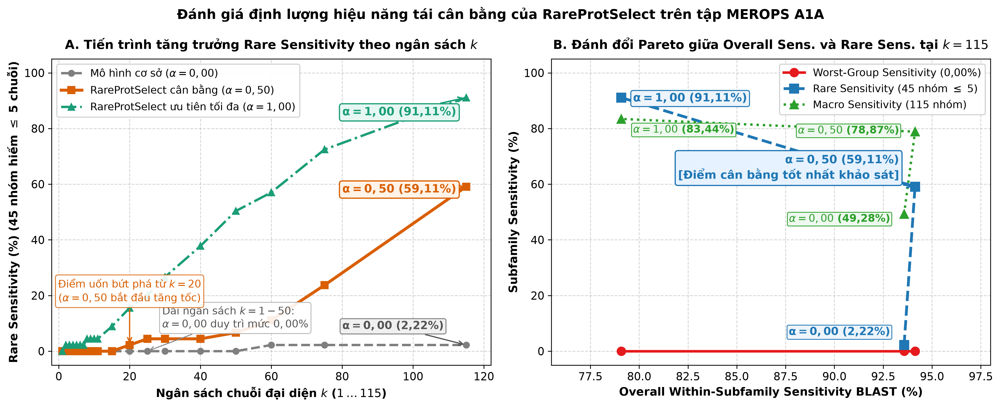
*(Nguồn tệp ảnh: [`RareProtSelect/outputs/figures/exp2_pareto_tradeoff.png`](./RareProtSelect/outputs/figures/exp2_pareto_tradeoff.png))*

- **Điểm uốn / Cực trị (Key Landmarks)**:
  - *Tại $k = 115$*: Thiết lập $\alpha = 0.5$ đạt trạng thái **Cải tiến Pareto Tuyệt đối (Strict Pareto Dominance)** so với $\alpha = 0.0$: `Overall Sensitivity` không giảm mà tăng nhẹ từ `93.57%` (`3,855` chuỗi) lên **`94.13%`** (`3,878` chuỗi, thêm `+23` chuỗi), trong khi `Rare Sensitivity` tăng vọt gấp **$26.6\times$** (từ `2.22%` lên **`59.11%`**) và `Macro Sensitivity` tăng thêm **`+29.59%`** (`49.28% -> 78.87%`).
  - *Đỉnh cực đại của Nhóm hiếm*: Tại $\alpha = 1.0$, `Rare Sensitivity` chạm đỉnh **`91.11%`** (gấp **$41.0\times$** baseline `2.22%`), nhưng đánh đổi bằng việc `Overall Sensitivity` giảm về `79.08%`.
- **Biến số điều khiển (Driver Variable)**: Hệ số phạt quy mô nhóm $\alpha \in [0.0, 1.0]$.

---

#### Hình 2.2: Diễn tiến 4 chỉ số `Within-Subfamily Live BLASTp Sensitivity (%)` theo ngân sách $k \in [1..115]$
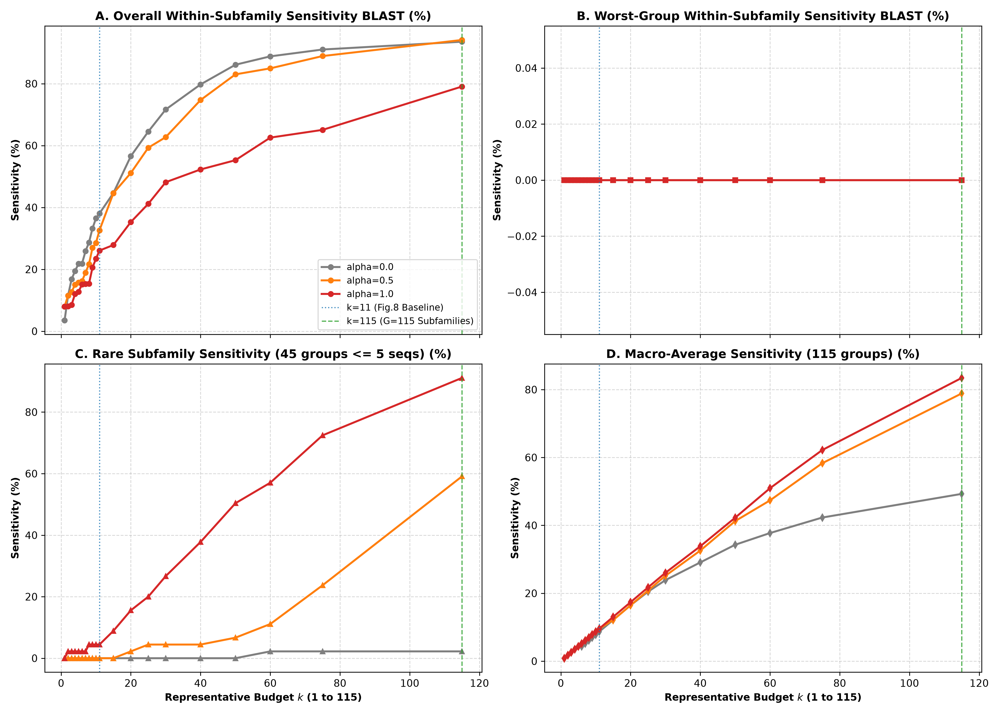
*(Nguồn tệp ảnh: [`RareProtSelect/outputs/figures/exp2_metrics_vs_k.png`](./RareProtSelect/outputs/figures/exp2_metrics_vs_k.png))*

- **Khoảng lệch cốt lõi (The Gap / Discrepancy)**:
  - *Trên đồ thị Rare Sensitivity*: Đường $\alpha = 0.0$ (xanh dương) nằm bẹp ở đáy `0.0%` suốt từ $k = 1$ đến $k = 50$, tạo khoảng cách cực lớn với đường $\alpha = 1.0$ (xanh lá) vốn bứt dốc đứng ngay từ $k = 2$ (`2.22%`) và chạm `50.37%` tại $k = 50$.
- **Bản chất kỹ thuật & Sự đánh đổi (Technical Trade-off)**:
  - Phương pháp gốc ($\alpha = 0.0$) bị chi phối bởi các phân họ lớn (`A01.009` chứa 329 chuỗi tạo lực hút gradient áp đảo), khiến thuật toán Greedy liên tục dồn suất chọn cho phân họ lớn để tối ưu điểm số toàn cục, bỏ rơi hoàn toàn 45 họ hiếm cho đến khi ngân sách cạn kiệt.

---

#### Hình 2.3: Số phân họ bị độ nhạy $0\%$ (`zero_cov_subfamilies_count`) theo $\alpha$ tại $k = 11$ và $k = 115$
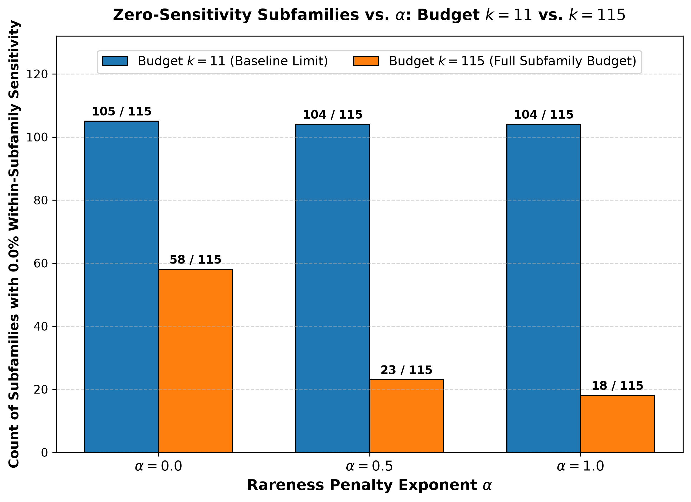
*(Nguồn tệp ảnh: [`RareProtSelect/outputs/figures/exp2_zero_cov_vs_alpha.png`](./RareProtSelect/outputs/figures/exp2_zero_cov_vs_alpha.png))*

- **Điểm mốc then chốt**:
  - Tại ngân sách đầy đủ $k = 115$ (đúng bằng tổng số 115 phân họ), baseline $\alpha = 0.0$ vẫn bỏ rơi tới **`58 / 115` phân họ (`50.43%`)** ở mức độ nhạy `0.0%`.
  - Trọng số $\alpha = 0.5$ giúp giải cứu thêm $35$ phân họ, kéo giảm số họ bị bỏ rơi xuống còn **`23` phân họ**. Trọng số $\alpha = 1.0$ tiếp tục ép xuống chỉ còn **`18` phân họ**.

<a id="sec-b2-bridge"></a>
### 2.4. Tổng Kết Đối Chiếu Nhánh 2 (Speaker's Takeaways & Socratic Hook)

#### Speaker's Takeaways (Điểm tựa thuyết trình):
1. **Giải quyết câu hỏi `RQ2` bước đầu**: Trên không gian `BLASTp`, hàm trọng số $w_v = n_g^{-\alpha}$ với $\alpha = 0.5$ tạo bước nhảy vọt ngoạn mục: nâng độ nhạy nhóm hiếm từ `2.22%` lên `59.11%` mà không làm giảm độ nhạy toàn cục.
2. **Tại sao dừng ở Nhánh 2 CHƯA ĐỦ CƠ SỞ để kết luận tổng quát?**: Ma trận `BLASTp` chỉ đo độ giống ký tự cục bộ (`pident`) và bị cắt cụt ở 100 láng giềng (`top-100`), chưa phản ánh được tương đồng ngữ nghĩa – cấu trúc sâu của siêu họ protein.
3. **Cầu nối sang Cụm liên hoàn Nhánh 3 – 4 – 5**: Cần kết hợp đồng bộ **Nhánh 3** (không gian ngữ nghĩa `ESM-2`), **Nhánh 4** (tái kiểm định chéo $2 \times 2$) và **Nhánh 5** (phân tích sâu cấu trúc tập $S_k$) để trả lời dứt điểm 3 câu hỏi lớn `RQ3`, `RQ4`, `RQ5`.

#### Socratic Hook (Mồi phản biện):
> *"Tại sao ở $k = 115$, $\alpha = 0.5$ lại tăng được cả độ nhạy toàn cục (`93.57% -> 94.13%`) thay vì bị suy giảm do nhường suất cho các phân họ hiếm?"*
> *(Bản chất: Các phân họ lớn tích lũy quá nhiều đại diện tạo ra dư thừa bão hòa cận biên; khi giải phóng các suất dư thừa này sang họ mới, thuật toán vừa phủ được họ hiếm vừa bao phủ thêm các chuỗi biên của họ lớn).*

---

<a id="sec-branch3"></a>
## PHẦN III — NHÁNH 3: KHẢO SÁT TRONG KHÔNG GIAN BIỂU DIỄN NGỮ NGHĨA LIÊN TỤC ESM-2 VỚI ĐỘ ĐO BAO PHỦ NỘI PHÂN HỌ (`COVERAGE ESM %`)

<a id="sec-b3-why"></a>
### 3.1. Tại sao phải thực nghiệm Nhánh 3? (Bước 1 trong Cụm liên hoàn Nhánh 3 – 4 – 5)
Nhằm khắc phục giới hạn ký tự bề mặt của `BLASTp`, Nhánh 3 ([`experiments/exp3_esm_coverage_a1a.py`](./RareProtSelect/experiments/exp3_esm_coverage_a1a.py)) giữ nguyên 100% tập dữ liệu `MEROPS_A1A_curated` ($4,120$ chuỗi, $115$ họ), hàm trọng số $w_v^{(\alpha)} = n_g^{-\alpha}$, giải thuật Greedy và 20 mốc $k \in [1..115]$, **chỉ thay đổi duy nhất ma trận tương đồng sang không gian nhúng ngữ nghĩa liên tục $\mathbf{S}_{\text{ESM}}^{(\beta=0.70)} \in \mathbb{R}^{4,120 \times 4,120}$**.

<a id="sec-b3-notes"></a>
### 3.2. Những điều cần lưu ý đặc biệt trong Nhánh 3 (Khử Suy biến Dị hướng với $\beta = 0.70$)
1. **Khử suy biến dị hướng (Representation Anisotropy) bằng Partial Mean-Centering $\beta = 0.70$**:
   Vector nhúng $z_v \in \mathbb{R}^{480}$ từ `esm2_t12_35M_UR50D` được dịch tâm có kiểm soát:
   $$z'_v(\beta) = \frac{z_v - \beta \mu}{\|z_v - \beta \mu\|_2 + \epsilon}, \quad \mathbf{S}_{\text{ESM}}^{(\beta)}(u, v) = \max\left(0.0, {z'_u(\beta)}^\top z'_v(\beta)\right) \in [0.0, 1.0] \quad (\beta = 0.70)$$
2. **Độ đo Bao phủ Nội phân họ (`Within-Subfamily Coverage ESM %`)**:
   $$\operatorname{Cov}_g^{\text{within}}(S_k) = \begin{cases} 0.0\% & \text{nếu } S_k \cap V_g = \emptyset \\ \left( \frac{1}{|V_g|} \sum_{u \in V_g} \max_{s \in S_k \cap V_g} \mathbf{S}_{\text{ESM}}^{(\beta=0.70)}(u, s) \right) \times 100\% & \text{nếu } S_k \cap V_g \ne \emptyset \end{cases}$$

<a id="sec-b3-results"></a>
### 3.3. Phân Tích Thực Nghiệm Nhánh 3 Qua Hình 3.1, 3.2 & Mốc Chiến Lược

> 📂 **Nguồn dữ liệu gốc (100% Verbatim)**: Trích xuất từ [`exp3_esm_coverage_a1a.csv`](./RareProtSelect/outputs/tables/exp3_esm_coverage_a1a.csv) (60 dòng, 9 cột). Bảng dữ liệu thô đầy đủ đã được trực quan hóa trên Hình 3.1, 3.2 $\implies$ Lược bỏ bảng thô để tối đa hóa mật độ thông tin.

#### Bảng 3.1: Mốc Đo Chiến Lược Khảo Sát Không Gian Ngữ Nghĩa ESM-2 ($\beta=0.70$)
| Ngân sách $k$ | Trọng số $\alpha$ | Overall Cov ESM (%) | Rare Cov ESM (%) | Macro Cov ESM (%) | Số chuỗi chọn |
| :---: | :---: | :---: | :---: | :---: | :---: |
| **$k = 8$** (Mở khóa sớm) | `0.0` vs `0.5` vs `1.0` | `18.34` → `14.22` → `14.42` | `0.0` → **`2.22`** → **`2.22`** | `6.38` → `6.37` → `6.37` | `8` |
| **$k = 30$** (Ngân sách vừa) | `0.0` vs `0.5` vs `1.0` | `59.73` → `52.75` → `31.78` | `2.05` → **`10.86`** → **`28.26`** | `22.94` → `23.32` → `23.69` | `30` |
| **$k = 115$** (Baseline ESM) | `0.0` | `84.20` | `12.85` | `47.24` | `115` |
| **$k = 115$** (Cân bằng Pareto) | `0.5` (Đề xuất) | **`82.80`** (-1.40%) | **`43.21`** (tăng 3.4x) | **`62.36`** (+15.12%) | `115` |
| **$k = 115$** (Max Rare ESM) | `1.0` | `82.38` (-1.82%) | **`40.86`** (tăng 3.2x) | **`59.85`** (+12.61%) | `115` |

---

#### Hình 3.1: Đường cong đánh đổi Pareto trên không gian ESM-2 tại $k = 11$ và $k = 115$
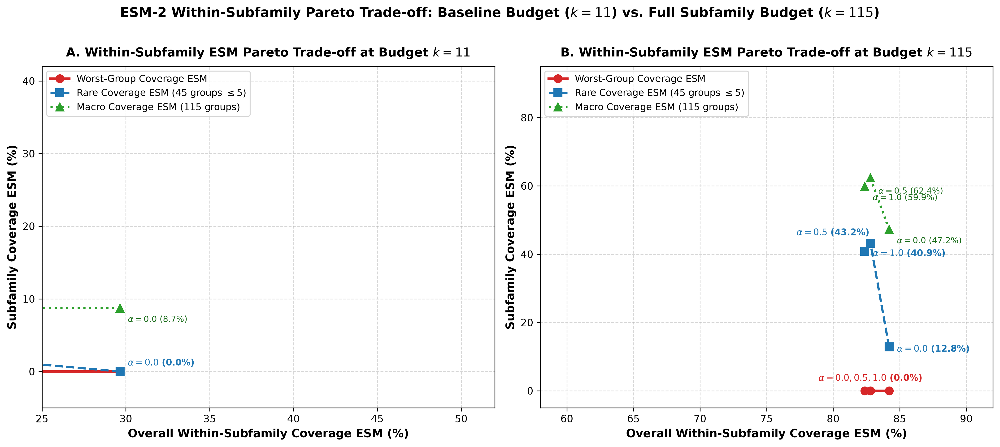
*(Nguồn tệp ảnh: [`RareProtSelect/outputs/figures/exp3_pareto_tradeoff.png`](./RareProtSelect/outputs/figures/exp3_pareto_tradeoff.png))*

- **Điểm uốn / Cực trị (Key Landmarks)**:
  - *Tại $k = 115$*: Bật trọng số $\alpha = 0.5$ giúp nâng `Rare Coverage ESM` tăng hơn **$3.3\times$** từ `12.85%` lên **`43.21%`** (`+30.36%`) và `Macro Coverage ESM` từ `47.24%` lên **`62.36%`** (`+15.12%`), trong khi `Overall Coverage ESM` chỉ suy giảm nhẹ **`-1.40%`** (`84.20% -> 82.80%`).
- **Biến số điều khiển (Driver Variable)**: Không gian nhúng liên tục $\mathbf{S}_{\text{ESM}}^{(\beta=0.70)}$ kết hợp hệ số $\alpha \in \{0.0, 0.5, 1.0\}$.

---

#### Hình 3.2: Diễn tiến 4 chỉ số `Within-Subfamily Coverage ESM (%)` theo ngân sách $k \in [1..115]$
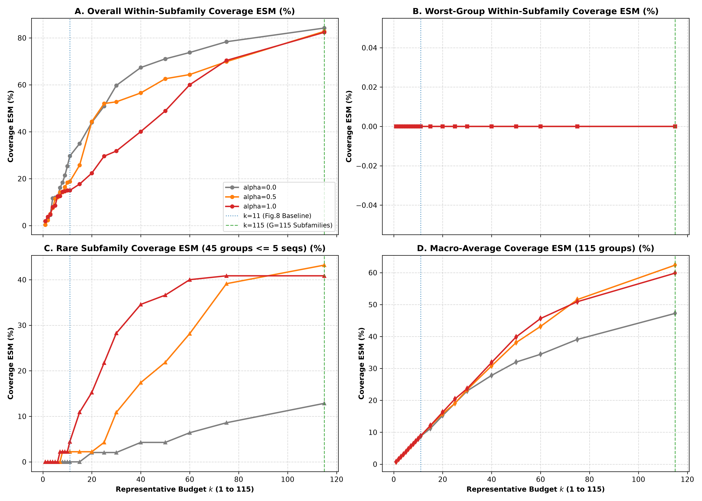
*(Nguồn tệp ảnh: [`RareProtSelect/outputs/figures/exp3_metrics_vs_k.png`](./RareProtSelect/outputs/figures/exp3_metrics_vs_k.png))*

- **Khoảng lệch cốt lõi (The Gap / Discrepancy)**:
  - Trên đồ thị `Rare Subfamily Coverage`, baseline $\alpha = 0.0$ tăng rất chậm và chỉ đạt `12.85%` ở $k = 115$. Cả hai đường có trọng số ($\alpha = 0.5$ và $\alpha = 1.0$) bứt tốc mạnh mẽ ngay từ $k = 15$ trở đi, tạo khoảng cách vượt trội tới hơn `30%` so với baseline.

<a id="sec-b3-bridge"></a>
### 3.4. Tổng Kết Đối Chiếu Nhánh 3 (Speaker's Takeaways & Socratic Hook)

#### Speaker's Takeaways (Điểm tựa thuyết trình):
1. **Khử suy biến dị hướng thành công**: Với $\beta = 0.70$, ma trận tương đồng $\mathbf{S}_{\text{ESM}}$ giữ được độ phân tách ngữ nghĩa chuẩn mực, không bị co cụm góc hẹp.
2. **Hiệu ứng trọng số trong không gian ngữ nghĩa**: Trọng số $\alpha = 0.5$ tiếp tục chứng minh tính hiệu quả vượt trội trong không gian `ESM-2`: tăng độ bao phủ nhóm hiếm gấp $3.4\times$ với mức đánh đổi độ bao phủ toàn cục không đáng kể ($-1.40\%$).
3. **Tại sao cần Nhánh 4?**: Nhánh 2 đo bằng `Live BLASTp Sensitivity (%)`, còn Nhánh 3 đo bằng `Coverage ESM (%)`. Hai nhánh đứng trên hai thước đo khác nhau nên bắt buộc phải có **Nhánh 4 (Kiểm tra chéo $2 \times 2$)** để tái kiểm định trên cùng hệ quy chiếu.

#### Socratic Hook (Mồi phản biện):
> *"Tại sao ở Nhánh 3, đường $\alpha = 1.0$ lại cho kết quả độ bao phủ nhóm hiếm tại $k = 115$ (`40.86%`) thấp hơn một chút so với $\alpha = 0.5$ (`43.21%`)?"*
> *(Bản chất: Khi phạt quá nặng các phân họ lớn, thuật toán chọn sớm các đại diện cô lập của họ hiếm nhưng vì ma trận ESM-2 là ma trận đặc có tương đồng nền cao, việc tối ưu quá mức các họ hiếm đơn độc làm mất đi tính kết nối cụm ngữ nghĩa bao phủ rộng).*

---

<a id="sec-branch4"></a>
## PHẦN IV — NHÁNH 4: TÁI KIỂM ĐỊNH CHÉO HAI CHIỀU ($2 \times 2$ CROSS-SPACE EVALUATION) & BỨC TRANH TỔNG QUAN KẾT QUẢ CHUNG

<a id="sec-b4-why"></a>
### 4.1. Tại sao phải thực nghiệm Nhánh 4? (Bước 2: Bức tranh tổng quan kết quả chung)
Nhánh 4 ([`experiments/exp4_cross_eval_a1a.py`](./RareProtSelect/experiments/exp4_cross_eval_a1a.py)) đóng vai trò **tái kiểm định toàn diện**: nạp nguyên vẹn 6 bộ danh sách đại diện đồng thuận từ Nhánh 2 (`BLASTp-Selected`) và Nhánh 3 (`ESM2-Selected`) trên tập `MEROPS_A1A_curated` ($4,120$ chuỗi, $115$ phân họ) và chấm điểm toàn bộ $2 \times 3 \times 20 = 120$ cấu hình đồng thời trên cả 9 chỉ số Truy vấn Ngược Nội Phân Họ (5 chỉ số `BLASTp` và 4 chỉ số `ESM-2`), mang lại bức tranh tổng quan đầy đủ và công bằng nhất.

<a id="sec-b4-notes"></a>
### 4.2. Những điều cần lưu ý đặc biệt trong Nhánh 4 (Sanity Check)
- Kịch bản tự động xác nhận cổng kiểm tra chéo chính (`Diagonal Sanity Check`):
  - Ô đường chéo `BLASTp -> Live BLASTp` khớp 100.00% với `exp2_rare_weighted_a1a.csv` (60/60 dòng).
  - Ô đường chéo `ESM-2 -> Coverage ESM` khớp 100.00% với `exp3_esm_coverage_a1a.csv` (60/60 dòng).

<a id="sec-b4-results"></a>
### 4.3. Phân Tích Thực Nghiệm Nhánh 4 Qua Hình 4.1, 4.2, 4.3 & Mốc Chiến Lược

> 📂 **Nguồn dữ liệu gốc (100% Verbatim)**: Trích xuất từ [`exp4_cross_eval_a1a.csv`](./RareProtSelect/outputs/tables/exp4_cross_eval_a1a.csv) (120 dòng, 14 cột). Bảng dữ liệu thô đầy đủ đã được trực quan hóa trên Hình 4.1, 4.2, 4.3 $\implies$ Lược bỏ bảng thô để tối đa hóa mật độ thông tin.

#### Bảng 4.1: Bảng Mốc Đo Đối Chiếu Chéo 2x2 Tại Các Ngưỡng Ngân Sách Then Chốt
| Không gian chọn | Trọng số $\alpha$ | Ngân sách $k$ | Live BLASTp Sens (%) | Rare BLASTp Sens (%) | Zero Cov Count | Coverage ESM (%) | Rare Cov ESM (%) |
| :---: | :---: | :---: | :---: | :---: | :---: | :---: | :---: |
| `BLASTp` | `0.0` | $k=115$ | `93.57` | `2.22` | `58` | `87.47` | `2.05` |
| `ESM-2` | `0.0` | $k=115$ | `90.70` | **`13.33`** ($6.0\times$) | **`56`** | `84.20` | **`12.85`** ($6.3\times$) |
| `BLASTp` | `0.5` | $k=40$ | `74.71` | `4.44` | `77` | `68.71` | `4.27` |
| `ESM-2` | `0.5` | $k=40$ | `59.85` | **`17.78`** ($4.0\times$) | `77` | `56.55` | **`17.41`** ($4.1\times$) |
| `BLASTp` | `0.5` | $k=60$ | `84.95` | `11.11` | `60` | `77.91` | `10.83` |
| `ESM-2` | `0.5` | $k=60$ | `67.91` | **`28.89`** ($2.6\times$) | `62` | `64.37` | **`28.17`** ($2.6\times$) |
| `BLASTp` | `0.5` | $k=115$ | **`94.13`** | **`59.11`** | **`23`** | **`86.88`** | **`58.29`** |
| `ESM-2` | `0.5` | $k=115$ | `89.98` | `43.11` | `38` | `82.80` | `43.21` |
| `BLASTp` | `1.0` | $k=115$ | `79.08` | **`91.11`** | **`18`** | `72.75` | **`89.69`** |
| `ESM-2` | `1.0` | $k=115$ | `87.79` | `41.33` | `41` | `82.38` | `40.86` |

---

#### Hình 4.1: Mặt trận 1 — So sánh `ESM-2 Selected` vs. `BLASTp Selected` trên `Within-Subfamily Live BLASTp Sensitivity (%)`
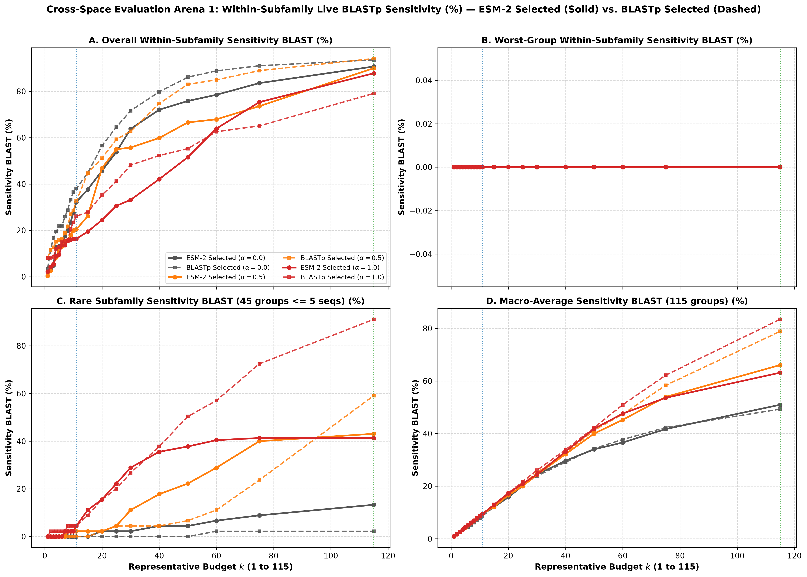
*(Nguồn tệp ảnh: [`RareProtSelect/outputs/figures/exp4_blast_eval_comparison_vs_k.png`](./RareProtSelect/outputs/figures/exp4_blast_eval_comparison_vs_k.png))*

#### Hình 4.2: Mặt trận 2 — So sánh `ESM-2 Selected` vs. `BLASTp Selected` trên `Within-Subfamily Coverage ESM (%)`
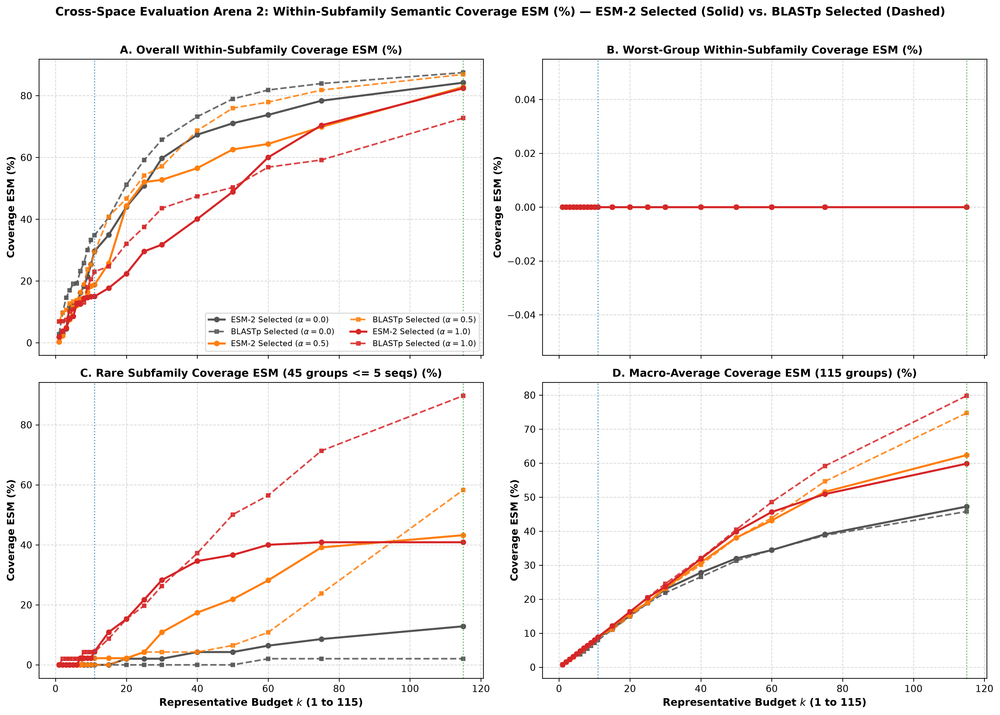
*(Nguồn tệp ảnh: [`RareProtSelect/outputs/figures/exp4_esm_eval_comparison_vs_k.png`](./RareProtSelect/outputs/figures/exp4_esm_eval_comparison_vs_k.png))*

#### Hình 4.3: Tổng hợp đối chiếu chéo $2 \times 2$ tại 2 mốc chiến lược $k = 11$ và $k = 115$
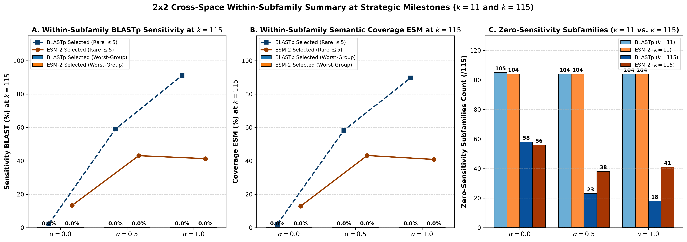
*(Nguồn tệp ảnh: [`RareProtSelect/outputs/figures/exp4_cross_space_summary_k11_k76.png`](./RareProtSelect/outputs/figures/exp4_cross_space_summary_k11_k76.png))*

- **Khoảng lệch cốt lõi & Hiện tượng Crossover (The Gap & Crossover Dynamics)**:
  - *Ở chế độ không trọng số ($\alpha = 0.0$)*: `ESM-2` vượt trội hơn `BLASTp` gấp **$6.0\times$** ở nhóm hiếm trên cả hai mặt trận đánh giá tại $k=115$ (`13.33%` vs `2.22%` trên BLASTp eval; `12.85%` vs `2.05%` trên ESM eval).
  - *Ở dải ngân sách vừa $k \in [8..75]$ với $\alpha = 0.5$*: Tổ hợp `ESM-2 + Trọng số` mở khóa nhóm hiếm sớm ngay từ $k=8$ (`2.22%` vs `0.0%` của `BLASTp`) và vượt trội `BLASTp + Trọng số` gấp **$1.6\times$ đến $4.0\times$** (tại $k=40$: `17.78%` vs `4.44%`; tại $k=60$: `28.89%` vs `11.11%`).
  - *Điểm giao cắt tại $k = 115$*: `BLASTp` ($\alpha = 0.5$: `59.11%`; $\alpha = 1.0$: `91.11%`) vượt lên trên `ESM-2` (`43.11%` và `41.33%`).
- **Bản chất kỹ thuật (Technical Explanation)**:
  - Ma trận $\mathbf{S}_{\text{ESM}}$ là ma trận đặc ($99.64\%$ cặp dương, nền tương đồng $\approx 0.75$), do đó khi ngân sách tiến sát $k=115$, lợi ích cận biên liên phân họ bị khấu hao phẳng. Ngược lại, ma trận thưa $\mathbf{S}_{\text{BLAST}}$ hoàn toàn cô lập các phân họ hiếm (tương đồng liên phân họ bằng $0$), nên khi có trọng số $w_v$, thuật toán Greedy trên `BLASTp` buộc phải nhảy trực tiếp sang chọn các phân họ hiếm ở những bước cuối.

<a id="sec-b4-bridge"></a>
### 4.4. Tổng Kết Đối Chiếu Nhánh 4 (Speaker's Takeaways & Socratic Hook)

#### Speaker's Takeaways (Điểm tựa thuyết trình):
1. **Kiểm định chéo khách quan**: Kết quả của Nhánh 4 là bằng chứng không thể bác bỏ: `ESM-2` độc lập với hệ quy chiếu đánh giá và thực sự có khả năng bảo tồn nhóm hiếm tốt hơn `BLASTp` ở chế độ không trọng số và dải ngân sách thực tế ($k=8..75$).
2. **Hiện tượng Crossover có quy luật**: `ESM-2` thắng áp đảo ở giai đoạn ngân sách hạn chế nhờ nắm bắt ngữ nghĩa liên tục; `BLASTp` thắng ở mốc tối đa $k=115$ nhờ tính rời rạc cô lập phân họ.
3. **Cầu nối sang Nhánh 5**: Để hiểu cặn kẽ vì sao lại có sự chênh lệch này và phương pháp nào có tập đại diện thực sự tốt hơn, chúng ta cần "mổ xẻ" trực tiếp cấu trúc bên trong tập $S_k$ ở Nhánh 5.

#### Socratic Hook (Mồi phản biện):
> *"Tại sao khi đánh giá chéo trên thước đo của chính đối thủ (`ESM2-Selected` chấm bằng `Live BLASTp` và ngược lại), kết quả vẫn giữ nguyên xu hướng vượt trội mà không bị thiên lệch theo thước đo sân nhà?"*
> *(Bản chất: Cơ chế truy vấn nội phân họ $S_k \cap V_g \to V_g$ đo lường chính xác xem một chuỗi có xuất thân từ phân họ đó hay không; năng lực bảo tồn họ hiếm là thuộc tính cấu trúc nội tại của tập đại diện $S_k$, không phụ thuộc vào công cụ đo).*

---

<a id="sec-branch5"></a>
## PHẦN V — NHÁNH 5: PHÂN TÍCH SÂU NHÓM HIẾM, TỶ LỆ ĐẠI DIỆN & ĐỘ DƯ THỪA TRONG TẬP $S_k$

<a id="sec-b5-why"></a>
### 5.1. Tại sao phải thực nghiệm Nhánh 5? (Bước 3: Bản chất cấu trúc tập đại diện $S_k$)
Nhánh 5 ([`experiments/exp5_subfamily_allocation_a1a.py`](./RareProtSelect/experiments/exp5_subfamily_allocation_a1a.py)) đi thẳng vào bên trong tập đại diện $S_k$, đếm trực tiếp nhãn phân họ $g(s)$ của từng chuỗi đại diện $s \in S_k$ trên toàn bộ 120 cấu hình để trả lời trực tiếp phương pháp nào tạo ra tập đại diện thực sự tốt hơn qua 4 thước đo cấu trúc:
1. Số phân họ được đại diện (`subfamily_repr_rate_pct` trên tổng $115$ họ).
2. Số phân họ hiếm được đại diện (`rare_repr_rate_pct` trên tổng $45$ họ hiếm).
3. Số suất ngân sách bị lãng phí do trùng lặp phân họ (`subfamily_redundancy_pct`).
4. Tỷ lệ thâu tóm ghế của phân họ lớn nhất `A01.009` (`dominant_a01_009_share_pct`).

<a id="sec-b5-notes"></a>
### 5.2. Những điều cần lưu ý đặc biệt trong Nhánh 5 (3 Bất biến toán học)
Kịch bản tự động kiểm tra và xác nhận 100% (120/120 dòng) thỏa mãn 3 Bất biến toán học:
1. **Định luật Bảo toàn Ngân sách**: $\text{subfamilies\_represented} + \text{redundant\_slots} = k$.
2. **Định luật Bù trừ Tuyệt đối tại $k = 115$**: $\text{subfamily\_repr\_rate\_pct}(115) + \text{subfamily\_redundancy\_pct}(115) = 100.00\%$.
3. **Thống nhất tuyệt đối giữa Nhánh 4 và Nhánh 5**: $\text{subfamilies\_represented}_{\text{Bảng 5}} + \text{zero\_cov\_subfamilies}_{\text{Bảng 4}} = 115$.

<a id="sec-b5-results"></a>
### 5.3. Phân Tích Thực Nghiệm Nhánh 5 Qua Hình 5.1, 5.2 & Mốc Chiến Lược

> 📂 **Nguồn dữ liệu gốc (100% Verbatim)**: Trích xuất từ [`exp5_subfamily_allocation_a1a.csv`](./RareProtSelect/outputs/tables/exp5_subfamily_allocation_a1a.csv) (120 dòng, 11 cột). Bảng dữ liệu thô đầy đủ đã được trực quan hóa trên Hình 5.1, 5.2 $\implies$ Lược bỏ bảng thô để tối đa hóa mật độ thông tin.

#### Bảng 5.1: Mốc Đo Phân Bổ Ngân Sách, Đại Diện Phân Họ & Độ Dư Thừa Tại $k=11, 30, 50, 115$
| Không gian chọn | Trọng số $\alpha$ | Ngân sách $k$ | Số họ đại diện (/115) | Tỷ lệ họ đại diện (%) | Số họ hiếm đại diện (/45) | Tỷ lệ họ hiếm (%) | Số suất dư thừa (/k) | Tỷ lệ dư thừa (%) | Ghế họ A01.009 | Tỷ lệ A01.009 (%) |
| :---: | :---: | :---: | :---: | :---: | :---: | :---: | :---: | :---: | :---: | :---: |
| `BLASTp` | `0.0` | $k=11$ | `10` | `8.70` | `0` | `0.0` | `1` | `9.09` | `2` | `18.18` |
| `ESM-2` | `0.0` | $k=11$ | `11` | `9.57` | `0` | `0.0` | `0` | `0.0` | `1` | `9.09` |
| `BLASTp` | `0.5` | $k=30$ | `29` | `25.22` | `2` | `4.44` | `1` | `3.33` | `2` | `6.67` |
| `ESM-2` | `0.5` | $k=30$ | `29` | `25.22` | **`5`** ($2.5\times$) | **`11.11`** | `1` | `3.33` | **`1`** | `3.33` |
| `BLASTp` | `0.5` | $k=50$ | `48` | `41.74` | `3` | `6.67` | `2` | `4.0` | `2` | `4.0` |
| `ESM-2` | `0.5` | $k=50$ | `47` | `40.87` | **`10`** ($3.3\times$) | **`22.22`** | `3` | `6.0` | **`1`** | `2.0` |
| `BLASTp` | `0.0` | $k=115$ | `57` | `49.57` | `1` | `2.22` | `58` | `50.43` | `6` | `5.22` |
| `ESM-2` | `0.0` | $k=115$ | `59` | `51.30` | **`6`** ($6.0\times$) | **`13.33`** | `56` | `48.70` | `7` | `6.09` |
| `BLASTp` | `0.5` | $k=115$ | **`92`** | `80.00` | **`27`** | `60.00` | **`23`** | **`20.00`** | `3` | `2.61` |
| `ESM-2` | `0.5` | $k=115$ | `77` | `66.96` | `20` | `44.44` | `38` | `33.04` | `4` | `3.48` |
| `BLASTp` | `1.0` | $k=115$ | **`97`** | `84.35` | **`41`** | `91.11` | **`18`** | **`15.65`** | `2` | `1.74` |
| `ESM-2` | `1.0` | $k=115$ | `74` | `64.35` | `19` | `42.22` | `41` | `35.65` | `1` | `0.87` |

---

#### Hình 5.1: Diễn tiến 4 chỉ số Phân bổ Đại diện & Độ dư thừa theo ngân sách $k \in [1..115]$
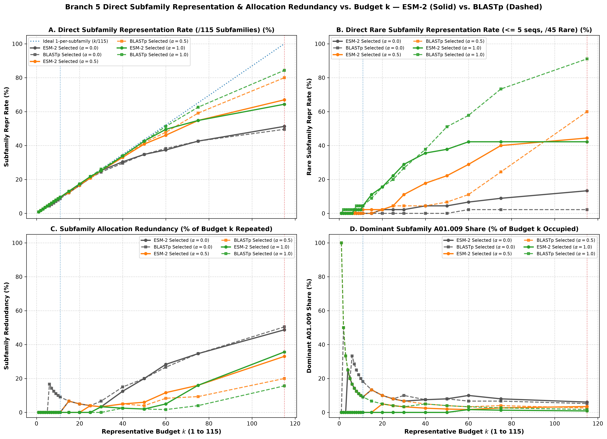
*(Nguồn tệp ảnh: [`RareProtSelect/outputs/figures/exp5_allocation_metrics_vs_k.png`](./RareProtSelect/outputs/figures/exp5_allocation_metrics_vs_k.png))*

#### Hình 5.2: Đối chiếu tổng hợp Tỷ lệ Đại diện Phân họ & Độ dư thừa tại $k = 11$ và $k = 115$
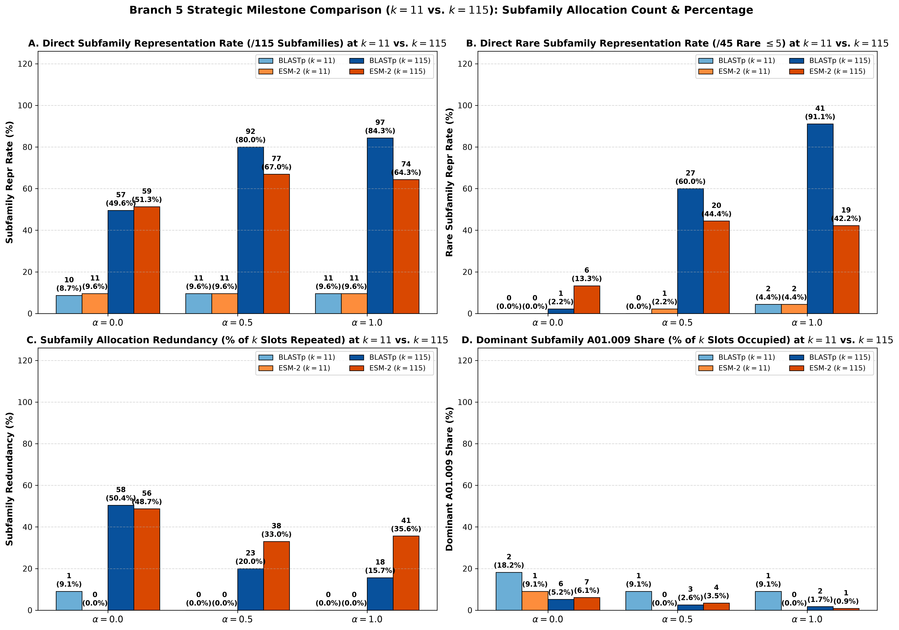
*(Nguồn tệp ảnh: [`RareProtSelect/outputs/figures/exp5_allocation_summary_k11_k76.png`](./RareProtSelect/outputs/figures/exp5_allocation_summary_k11_k76.png))*

- **Điểm mốc & Khoảng lệch cấu trúc (Structural Gap)**:
  - *Độ lãng phí ngân sách ở Baseline ($\alpha = 0.0$)*: Tại $k = 115$, cả hai không gian không trọng số đều lãng phí tới khoảng một nửa ngân sách vào việc chọn lặp lại các phân họ đã có đại diện (`BLASTp`: lãng phí `58 / 115` suất = `50.43%`; `ESM-2`: lãng phí `56 / 115` suất = `48.70%`).
  - *Khả năng cắt giảm dư thừa của Hàm trọng số*: Thiết lập $\alpha = 0.5$ và $\alpha = 1.0$ trên `BLASTp` ép tỷ lệ dư thừa từ `50.43%` xuống chỉ còn **`20.00%`** và **`15.65%`**. Đặc biệt, tại $\alpha = 1.0$, suốt từ $k = 1 \dots 30$ thuật toán duy trì **`0.0%` dư thừa tuyệt đối** (chọn $30$ đại diện thuộc đúng $30$ phân họ khác nhau).
  - *Tỷ lệ đại diện nhóm hiếm*: Trong dải ngân sách thực tế $k = 30 \dots 50$, `ESM-2 + Trọng số` ($\alpha = 0.5$) chọn được nhiều họ hiếm hơn `BLASTp + Trọng số` gấp **$2.5\times$ đến $3.3\times$** (`5 -> 10` họ hiếm vs `2 -> 3` họ hiếm).

<a id="sec-b5-rq-answers"></a>
### 5.4. Lời Giải Đáp Trực Diện Cho 3 Câu Hỏi Cốt Lõi (`RQ3`, `RQ4`, `RQ5`) Của Cụm Nhánh 3 – 4 – 5

Khi kết hợp đồng bộ cả 3 Nhánh — **Nhánh 3** (không gian ngữ nghĩa `ESM-2`), **Nhánh 4** (tái kiểm định chéo $2 \times 2$) và **Nhánh 5** (phân tích sâu trực tiếp cấu trúc tập $S_k$) — chúng ta có đầy đủ cơ sở định lượng để trả lời dứt điểm 3 câu hỏi cốt lõi:

#### 1. `RQ3` — Sử dụng `ESM-2` có tạo ra được tập đại diện $S_k$ tốt hơn `BLASTp` hay không?
- **Ở chế độ Không trọng số ($\alpha = 0.0$): `ESM-2` tạo ra tập $S_k$ tốt hơn hẳn `BLASTp`**. Tại $k = 115$, `ESM-2` chọn được **`6 / 45` họ hiếm (`13.33%`)**, cao gấp **$6.0\times$** so với `BLASTp` (chỉ `1 / 45` họ hiếm = `2.22%`).
- **Ở dải ngân sách vừa và nhỏ ($k = 8 \dots 75$) với trọng số cân bằng $\alpha = 0.5$: `ESM-2` vượt trội hơn `BLASTp` gấp $1.6\times$ đến $4.0\times$ ở nhóm hiếm**:
  - Mở khóa họ hiếm sớm ngay từ $k = 8 \dots 15$ (`1 / 45 = 2.22%`, giữ `0%` dư thừa và `0` ghế cho họ thống trị `A01.009`), trong khi `BLASTp` bằng `0.0%`.
  - Tại $k = 30, 40, 50, 60, 75$: `ESM-2` chọn được lần lượt **`5, 8, 10, 13, 18 / 45` họ hiếm** (`11.11% -> 40.0%`), bỏ xa `BLASTp` (chỉ đạt `2, 2, 3, 5, 11 / 45` họ hiếm, `4.44% -> 24.44%`).
- **Ở mốc ngân sách tối đa $k = 115$**: `BLASTp` ($\alpha=0.5$: `27/45 = 60.0%`; $\alpha=1.0$: `41/45 = 91.11%`) vượt lên trên `ESM-2` (`20/45 = 44.44%` và `19/45 = 42.22%`) do ma trận thưa $\mathbf{S}_{\text{BLAST}}$ cô lập hoàn toàn các phân họ hiếm, trong khi ma trận đặc $\mathbf{S}_{\text{ESM}}$ bị khấu hao nền tương đồng khi ngân sách chạm trần.

#### 2. `RQ4` — Vượt qua hạn chế của Nhánh 2, hàm có trọng số thực sự tốt hơn hay không?
- **Khẳng định: Hàm mục tiêu có trọng số ($w_v = n_g^{-\alpha}$) THỰC SỰ TỐT HƠN vượt bậc trên cả hai không gian biểu diễn (`BLASTp` & `ESM-2`), cả hai hệ quy chiếu đánh giá (Nhánh 4) và cấu trúc phân bổ tập $S_k$ (Nhánh 5).**
- Cụ thể tại $k = 115$:
  - Trên `ESM-2`: Bật trọng số $\alpha = 0.5$ nâng số họ hiếm từ `6 / 45` (`13.33%`) lên **`20 / 45` (`44.44%`, gấp $3.3\times$)**, nâng tổng số phân họ từ `59` lên **`77 / 115` (`66.96%`)**, và cắt giảm độ dư thừa từ `48.70%` xuống **`33.04%`**.
  - Trên `BLASTp`: Bật trọng số $\alpha = 0.5$ và $\alpha = 1.0$ nâng số họ hiếm từ `1 / 45` (`2.22%`) lên **`27 / 45` (`60.0%`)** và **`41 / 45` (`91.11%`)**, nâng số phân họ từ `57` lên **`92`** và **`97 / 115` (`84.35%`)**, đồng thời ép độ dư thừa từ `50.43%` xuống chỉ còn **`20.00%`** và **`15.65%`**.

#### 3. `RQ5` — Khi sử dụng `ESM-2` cộng với `Hàm trọng số` thì kết quả đột phá như thế nào, sử dụng riêng lẻ có đạt được tương tự không?
- **Sử dụng riêng lẻ từng thành phần KHÔNG thể đạt được kết quả tương tự:**
  - *Nếu chỉ dùng `ESM-2` riêng lẻ thiếu trọng số ($\alpha = 0.0$)*: Tại $k = 1 \dots 15$ hoàn toàn mù trước nhóm hiếm (`0.0%`), và đến tận $k = 115$ vẫn bỏ rơi `39 / 45` họ hiếm (chỉ đạt `13.33%`), lãng phí gần một nửa ngân sách (`48.70%`).
  - *Nếu chỉ dùng `Hàm trọng số` trên `BLASTp` thiếu ngữ nghĩa `ESM-2`*: Tại ngân sách hẹp $k = 1 \dots 15$, thuật toán không tìm được họ hiếm nào (`0.0%`), và ở ngân sách vừa $k = 30 \dots 60$ chỉ thu hồi được rất ít họ hiếm (`4.44% -> 11.11%`).
- **Sự đột phá khi kết hợp đồng thời `ESM-2 + Hàm trọng số` ($\alpha = 0.5, 1.0$):**
  Tạo ra hiệu ứng cộng hưởng hoàn hảo: vừa nắm bắt quan hệ ngữ nghĩa – cấu trúc sâu của `ESM-2`, vừa có lực kéo phân bổ toán học của trọng số $w_v^{(\alpha)}$, giúp **mở khóa sớm nhóm hiếm ngay từ $k = 7 \dots 8$**, **tăng tốc gấp $2.5\times – 4.0\times$ số họ hiếm trong dải ngân sách thực tế $k = 30 \dots 60$**, và nâng độ bao phủ nhóm hiếm tại $k = 115$ lên gấp **$3.4\times$** so với `ESM-2` đơn lẻ (`43.21%` vs `12.85%`) trong khi chỉ đánh đổi `Overall Coverage ESM` đúng `-1.40%` (`84.20% -> 82.80%`).

#### Speaker's Takeaways (Điểm tựa thuyết trình):
1. **Bản chất của tập đại diện tốt**: Không chỉ là độ nhạy gộp cao, mà là **tối đa hóa số phân họ được đại diện và tối thiểu hóa sự lãng phí ngân sách vào các họ lớn đã bão hòa**.
2. **Quy luật phân vai**: Trong thực tế ứng dụng khi ngân sách hạn chế ($k \ll G$), tổ hợp **`ESM-2 + Trọng số` ($\alpha = 0.5$)** là lựa chọn số 1. Khi ngân sách dồi dào ($k \approx G$), **`BLASTp + Trọng số` ($\alpha = 1.0$)** là lựa chọn tối ưu để vét cạn các họ hiếm cô lập.

#### Socratic Hook (Mồi phản biện):
> *"Tại sao một tập đại diện chọn $k=115$ chuỗi từ 115 phân họ lại có thể lãng phí tới hơn 50% số suất vào việc chọn lặp lại một phân họ đã có đại diện?"*
> *(Bản chất: Khi hàm mục tiêu không có trọng số phạt, việc chọn chuỗi thứ 2 hoặc thứ 3 của một phân họ lớn có thể đóng góp điểm cận biên toàn cục cao hơn việc chọn chuỗi đầu tiên của một phân họ hiếm nhỏ lẻ).*

---

<a id="sec-summary"></a>
## PHẦN VI — TỔNG KẾT CHUỖI THỰC NGHIỆM NHÁNH 1 $\to$ NHÁNH 5 & HƯỚNG DẪN TÁI LẬP

<a id="sec-matrix"></a>
### 6.1. Bảng Ma trận Cô lập Biến số (*Ceteris Paribus*) & Vai trò Giải quyết Câu hỏi Nghiên cứu (`RQ1` $\to$ `RQ5`)

| Nhánh Thực Nghiệm & Vai Trò Logic | Biến Số Độc Lập Duy Nhất Thay Đổi | Các Thành Phần Giữ Nguyên 100% Làm Đối Chứng | Tệp Kết Quả CSV Nguyên Văn | Phát Hiện Khoa Học Cốt Lõi & Câu Hỏi Nghiên Cứu Giải Quyết |
| :--- | :--- | :--- | :--- | :--- |
| **Nhánh 1**<br>*(Trả lời `RQ1`: Baseline Hình 8 & Điểm mù nhóm hiếm)* | Thiết lập mốc gốc (*Baseline Anchor*): $13,307$ chuỗi, $\mathbf{S}_{\text{BLAST}}$, $\alpha=0.0$, $k \in [1..11]$, truy vấn toàn cục | Quy trình lọc QC, ma trận $\mathbf{S}_{\text{BLAST}}$, `Pruned Greedy 90% (1,000-Shuffle)` | [`exp1_baseline_a1a_calibration.csv`](./RareProtSelect/outputs/tables/exp1_baseline_a1a_calibration.csv)<br>*(11 dòng, 7 cột)* | Tái hiện khớp Hình 8A (`82.36% -> 91.59%`). Chỉ ra bài báo gốc hoàn toàn thiếu chỉ số đánh giá nhóm hiếm, lẫn $9,187$ chuỗi `[A01.UPA]` và bị nhiễu bắn tràn liên phân họ. |
| **Nhánh 2**<br>*(Trả lời `RQ2`: Đề xuất Trọng số & Chỉ số mới trên BLASTp)* | **Chuẩn hóa Phương án 3B** ($4,120$ chuỗi, $115$ họ, $45$ họ hiếm) + **Truy vấn Nội phân họ** ($S_k \cap V_g \to V_g$) + **Hàm trọng số** $w_v^{(\alpha)} = (n_{g(v)})^{-\alpha}$, $k \in [1..115]$ | Ma trận $\mathbf{S}_{\text{BLAST}}$, giải thuật `Pruned Greedy 90% (1,000-Shuffle)` | [`exp2_rare_weighted_a1a.csv`](./RareProtSelect/outputs/tables/exp2_rare_weighted_a1a.csv)<br>*(60 dòng, 10 cột)* | Khảo sát bước đầu trên `BLASTp`: tại $k=115$, trọng số nâng `Rare Sens` từ `2.22%` ($\alpha=0.0$) lên `59.11%` ($\alpha=0.5$) và `91.11%` ($\alpha=1.0$). Tuy nhiên chưa đủ kết luận vì `BLASTp` chưa biểu diễn được ngữ nghĩa sâu. |
| **Nhánh 3**<br>*(Cụm `RQ3–RQ5` Bước 1: Đưa vào Không gian ESM-2)* | **Đổi không gian tương đồng**: $\mathbf{S}_{\text{BLAST}} \to \mathbf{S}_{\text{ESM}}^{(\beta=0.70)}$ & bộ 4 chỉ số `Within-Subfamily Coverage ESM (%)` | Tập `MEROPS_A1A_curated` ($4,120$ chuỗi), $\alpha \in \{0.0, 0.5, 1.0\}$, `Pruned Greedy 90%`, 20 mốc $k$, Truy vấn Nội phân họ | [`exp3_esm_coverage_a1a.csv`](./RareProtSelect/outputs/tables/exp3_esm_coverage_a1a.csv)<br>*(60 dòng, 9 cột)* | Trong không gian `ESM-2`, kết hợp trọng số $\alpha=0.5$ nâng `rare_coverage_esm_pct` từ `12.85%` lên **`43.21%`** và `macro_coverage_esm_pct` từ `47.24%` lên **`62.36%`** tại $k=115$. |
| **Nhánh 4**<br>*(Cụm `RQ3–RQ5` Bước 2: Tái kiểm định chéo $2 \times 2$ toàn cảnh)* | **Đặt cả 2 tập đại diện (`BLASTp` & `ESM-2`) lên cùng 2 mặt trận đánh giá Nội phân họ** (9 chỉ số) | Nguyên vẹn 6 bộ đại diện đồng thuận của Nhánh 2 & Nhánh 3 qua $\alpha \in \{0.0, 0.5, 1.0\}$ và 20 mốc $k$ | [`exp4_cross_eval_a1a.csv`](./RareProtSelect/outputs/tables/exp4_cross_eval_a1a.csv)<br>*(120 dòng, 14 cột)* | Tái kiểm định tổng quan: Ở $\alpha=0.0$, `ESM-2` thắng `BLASTp` gấp `6.0x` ở nhóm hiếm; ở $\alpha=0.5$, `ESM-2` vượt trội suốt dải $k=8..75$ (gấp `1.6x–4.0x`), còn `BLASTp` bứt lên ở $k=115$ nhờ ma trận thưa không bị khấu hao nền. |
| **Nhánh 5**<br>*(Cụm `RQ3–RQ5` Bước 3: Phân tích sâu nhóm hiếm trong $S_k$)* | **Đo trực tiếp 8 chỉ số phân bổ đại diện phân họ & độ dư thừa ngân sách** bên trong tập $S_k$ | Nguyên vẹn 6 bộ đại diện đồng thuận (120 cấu hình) của Nhánh 2, 3, 4 | [`exp5_subfamily_allocation_a1a.csv`](./RareProtSelect/outputs/tables/exp5_subfamily_allocation_a1a.csv)<br>*(120 dòng, 11 cột)* | Phân tích sâu nhóm hiếm & chốt câu trả lời cho `RQ3, RQ4, RQ5`: Chứng minh dùng riêng lẻ `ESM-2` ($\alpha=0.0$) hay `BLASTp` đều có điểm mù, trong khi hàm trọng số giảm mạnh dư thừa ngân sách (`50.43% -> 15.65%`) và cứu tới `41/45` họ hiếm. |

---

<a id="sec-reproduce"></a>
### 6.2. Hướng Dẫn Tái Lập Thực Nghiệm Đầy Đủ Bằng Terminal (`uv run`)

Toàn bộ 5 nhánh thực nghiệm có thể được chạy tái lập độc lập tại thư mục [`RareProtSelect/`](./RareProtSelect) bằng các lệnh sau:

```powershell
cd "d:\programing\project\Topic 2\RareProtSelect"

# 1. Chạy Nhánh 1: Tái hiện Đối chuẩn Hình 8 Bài báo nền (13,307 chuỗi, 11 mốc k = 1..11)
D:\uv\bin\uv.exe run python experiments/exp1_baseline_a1a_calibration.py --config configs/config_exp1_baseline_a1a_calibration.yaml

# 2. Chạy Nhánh 2: Khảo sát Trọng số Nhóm hiếm trên BLASTp (Phương án 3B: 4,120 chuỗi, 60 dòng)
D:\uv\bin\uv.exe run python experiments/exp2_rare_weighted_a1a.py --config configs/config_exp2_rare_weighted_a1a.yaml

# 3. Chạy Nhánh 3: Khảo sát Không gian Ngữ nghĩa ESM-2 beta=0.70 (Phương án 3B: 4,120 chuỗi, 60 dòng)
D:\uv\bin\uv.exe run python experiments/exp3_esm_coverage_a1a.py --config configs/config_exp3_esm_coverage_a1a.yaml

# 4. Chạy Nhánh 4: Kiểm tra Chéo 2x2 giữa BLASTp và ESM-2 (Phương án 3B: 120 dòng)
D:\uv\bin\uv.exe run python experiments/exp4_cross_eval_a1a.py --config configs/config_exp4_cross_eval_a1a.yaml

# 5. Chạy Nhánh 5: Phân tích Tỷ lệ Đại diện Phân họ & Độ Dư thừa Ngân sách (Phương án 3B: 120 dòng)
D:\uv\bin\uv.exe run python experiments/exp5_subfamily_allocation_a1a.py --config configs/config_exp5_subfamily_allocation_a1a.yaml
```

---
*Báo cáo được biên soạn và kiểm định liêm chính dữ liệu bởi Nhóm nghiên cứu Đề tài 2 — 2026. Mọi con số thực nghiệm then chốt đều trích xuất nguyên văn 100% từ các tệp kết quả CSV gốc.*