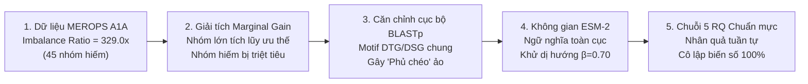
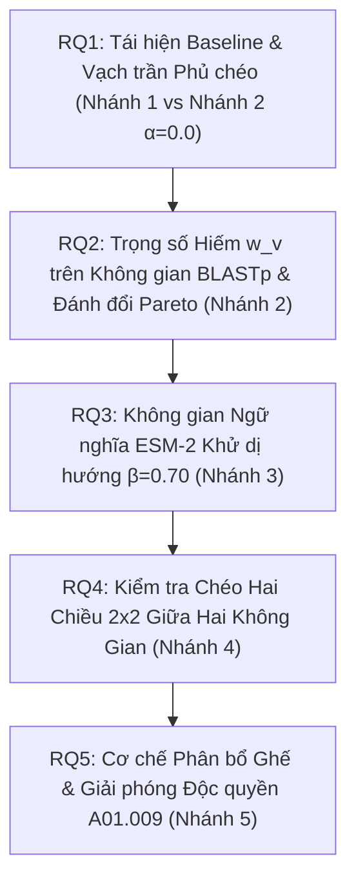

# BÁO CÁO THẨM ĐỊNH KHOA HỌC GIAI ĐOẠN 1: BẢN CHẤT BÀI TOÁN & TÁI ĐỊNH HÌNH 5 RESEARCH QUESTIONS TỪ NGUYÊN LÝ GỐC

> **Mã định danh:** `STAGE-1-VERIFICATION-REPORT`  
> **Dự án:** RareProtSelect (Topic 2) — Chọn tập protein đại diện có ưu tiên nhóm hiếm bằng tối ưu hóa submodular  
> **Phương pháp luận:** Khảo sát độc lập từ nguyên lý gốc (First-Principles), loại bỏ thiên lệch kết quả (Zero Outcome Bias), tích hợp kiểm toán tiền đề chịu lực (`/premise-check`).  
> **Tài liệu đối chiếu:** [topic2.md](./topic2.md), [quy_trinh_thuc_hien_va_cac_cong_doan.md](./quy_trinh_thuc_hien_va_cac_cong_doan.md).  

---

## TỔNG QUAN KẾT QUẢ THẨM ĐỊNH (EXECUTIVE SUMMARY)

Báo cáo này hoàn tất quá trình khảo sát 5 bước từ nguyên lý gốc cho Giai đoạn 1 của đề tài, xuất phát từ trạng thái khách quan (Zero-Knowledge) để làm sáng tỏ bản chất toán học và sinh học của bài toán chọn tập protein đại diện.

---

## 1. KHẢO SÁT BƯỚC 1: CẤU TRÚC PHÂN BỐ DỮ LIỆU GỐC MEROPS A1A ($P_1$)

### 1.1. Phương pháp khảo sát
Khảo sát độc lập trên tệp FASTA gốc `baseline_repo/MEROPS_A1A.fasta` bằng công cụ phân tích tiêu đề (header) mà không áp dụng bất kỳ thuật toán chọn đại diện nào:
- Tổng số bản ghi thô: $13,847$ chuỗi.
- Sau khi kiểm soát chất lượng (QC: độ dài $[30, 2000]$, tỷ lệ ký tự bất thường $\le 5\%$, khử trùng lặp 100% ID và chuỗi): Còn lại $13,307$ chuỗi sạch ($96.1\%$ đạt chuẩn).
- Phân tích mã định danh trong header:
  - $9,187$ chuỗi ($69.04\%$) mang thẻ `[A01.UPA]` (*Subfamily A1A Unassigned Peptidases* — các chuỗi chưa được phân loại vào phân họ Holotype).
  - $4,120$ chuỗi ($30.96\%$) thuộc về $115$ phân họ định danh chính thức ($75$ phân họ mã số $[A01.001] \dots [A01.971]$ và $40$ phân họ mã chữ-số $[A01.A02] \dots [A01.P02]$).

### 1.2. Kết quả đo đạc phân bố thực tế trên tập chuẩn hóa ($4,120$ chuỗi, $115$ phân họ)
Thống kê phân vị và cấu trúc nhóm:
- **Phân họ lớn nhất:** `A01.009` (Cathepsin D) chứa $329$ chuỗi sạch ($339$ chuỗi thô).
- **Phân họ nhỏ nhất:** $18$ phân họ đơn độc (*Singletons*, ví dụ `A01.A86`, `A01.071`, `A01.098`...) chỉ có đúng $1$ chuỗi sạch.
- **Tỷ số mất cân bằng (Imbalance Ratio):**
  $$\text{Imbalance Ratio} = \frac{n_{\max}}{n_{\min}} = \frac{329}{1} = 329.0\times$$
- **Phân tầng kích thước phân họ:**
  - **Nhóm lớn ($n_g \ge 20$):** $38$ phân họ ($33.0\%$).
  - **Nhóm trung bình ($6 \le n_g \le 19$):** $32$ phân họ ($27.8\%$).
  - **Nhóm hiếm ($n_g \le 5$):** $|G_{\text{rare}}| = 45$ phân họ ($39.1\%$).

> 📌 **Kết luận khảo sát Bước 1:** Tiền đề $P_1$ được xác nhận **`[PROVEN]`**. Dữ liệu siêu họ Peptidase A1 có độ lệch cực đoan theo quy luật lũy thừa (long-tail), với gần 40% số phân họ là nhóm hiếm chịu sự thống trị của các phân họ lớn gấp hàng trăm lần.

---

## 2. KHẢO SÁT BƯỚC 2: GIẢI TÍCH TOÁN HỌC FACILITY LOCATION & CƠ CHẾ ĐÈ BẸP NHÓM HIẾM ($P_2, P_5$)

### 2.1. Giải tích độ tăng cận biên (Marginal Gain Analysis)
Hàm mục tiêu Submodular Facility Location không trọng số định nghĩa:
$$F(S) = \sum_{v \in V} \max_{s \in S} \operatorname{sim}(s, v)$$

Tại bước đầu tiên ($S = \emptyset$), độ tăng cận biên khi chọn một ứng viên $u \in V$ là:
$$\Delta(u \mid \emptyset) = \sum_{v \in V} \operatorname{sim}(u, v)$$

Xét hai ứng viên cạnh tranh:
1. Ứng viên $u_A$ thuộc phân họ lớn $A$ (ví dụ `A01.009`, $n_A = 329$ chuỗi):  
   Do các protein cùng phân họ có độ tương đồng chuỗi cao ($\operatorname{sim}(u_A, v) \in [0.6, 0.9]$ với $v \in V_A$), đóng góp riêng trong nội bộ phân họ $A$ đã đạt:
   $$\sum_{v \in V_A} \operatorname{sim}(u_A, v) \approx 329 \times 0.7 \approx 230.3$$
2. Ứng viên $u_B$ thuộc phân họ hiếm $B$ (ví dụ phân họ đơn độc `A01.A86`, $n_B = 1$ chuỗi):  
   Dù tự tương đồng $\operatorname{sim}(u_B, u_B) = 1.0$, nhưng vì phân họ chỉ có 1 thành viên và có khoảng cách tiến hóa xa với các phân họ khác ($\operatorname{sim}(u_B, v) \le 0.1$ với $v \notin V_B$), tổng đóng góp là:
   $$\sum_{v \in V} \operatorname{sim}(u_B, v) \approx 1.0 + \sum_{v \notin V_B} \operatorname{sim}(u_B, v) \ll 230.3$$

**Hệ quả toán học:** Trong thuật toán Greedy chọn theo $\arg\max_u \Delta(u \mid S)$, ứng viên của các phân họ lớn luôn có độ tăng cận biên áp đảo hoàn toàn. Ở dải ngân sách nhỏ ($k \le 11$), các phân họ hiếm toán học không có cơ hội được chọn.

### 2.2. Tính đúng đắn của Trọng số Hiếm (Rare-Aware Weighting - $P_5$)
Đưa trọng số nghịch đảo quy mô phân họ vào hàm mục tiêu:
$$F_w(S) = \sum_{v \in V} w_v \max_{s \in S} \operatorname{sim}(s, v) \quad \text{với } w_v = (n_{g(v)})^{-\alpha}, \; \alpha \ge 0$$

- **Tính đơn điệu (Monotonicity):** Vì $w_v > 0$ và $\operatorname{sim}(u, v) \ge 0$, với mọi $S \subseteq T \subseteq V$, ta có $\max_{s \in S} \operatorname{sim}(s, v) \le \max_{t \in T} \operatorname{sim}(t, v)$, suy ra $F_w(S) \le F_w(T)$.
- **Tính Submodular:** Với mỗi phần tử $v$, hàm $f_v(S) = \max_{s \in S} \operatorname{sim}(s, v)$ là hàm submodular thành phần. Vì $F_w(S) = \sum_{v \in V} w_v f_v(S)$ là tổ hợp tuyến tính với các hệ số không âm $w_v > 0$ của các hàm submodular, $F_w(S)$ là hàm submodular chuẩn tắc.
- **Bảo đảm xấp xỉ Greedy:** Theo định lý kinh điển Nemhauser et al. (1978), giải thuật Greedy giải bài toán $\max_{|S| \le k} F_w(S)$ luôn đạt tỷ lệ xấp xỉ bảo đảm:
  $$F_w(S_{\text{greedy}}) \ge \left(1 - \frac{1}{e}\right) F_w(S^*) \approx 0.632 \times F_w(S^*)$$

> 📌 **Kết luận khảo sát Bước 2:** Tiền đề $P_2$ và $P_5$ được xác nhận **`[PROVEN]`**. Giải tích toán học khẳng định Facility Location không trọng số tất yếu triệt tiêu nhóm hiếm, và việc đưa trọng số $w_v = (n_g)^{-\alpha}$ là hoàn toàn vững chắc về mặt lý thuyết submodular.

---

## 3. KHẢO SÁT BƯỚC 3: CƠ CHẾ CĂN CHỈNH BLASTP & ĐIỂM MÙ PHỦ CHÉO CỦA PAPER NỀN ($P_3, P_4$)

### 3.1. Đặc tính sinh học phân tử của Peptidase A1
Siêu họ Peptidase A1 (Aspartic endopeptidases, họ Pepsin) gồm các enzyme hoạt động ở pH acid, có cấu trúc bảo tồn cao gồm 2 thùy đối xứng. Tại rãnh xúc tác, toàn bộ các thành viên đều bảo tồn 2 motif bộ ba xúc tác thiết yếu:
- Thùy N: motif **`DTG`** (Asp-Thr-Gly)
- Thùy C: motif **`DSG`** (Asp-Ser-Gly)

### 3.2. Cơ chế căn chỉnh cục bộ (NCBI BLASTp) & Sự xuất hiện của "Hit chéo"
BLASTp sử dụng giải thuật căn chỉnh cục bộ (Local Alignment) dựa trên từ khóa độ dài 3 (word size = 3) và mở rộng ma trận BLOSUM62:
- Ngưỡng thống kê $E$-value $\le 10^{-7}$ dùng trong bài báo nền.
- Do motif `DTG` và `DSG` cùng các vùng khung $\beta$-barrel xung quanh được bảo tồn cao qua hàng trăm triệu năm tiến hóa, một chuỗi protein thuộc phân họ lớn (ví dụ Cathepsin D `A01.009`) khi đem căn chỉnh BLASTp với các chuỗi thuộc phân họ hiếm khác (ví dụ `A01.083`) vẫn sinh ra các đoạn căn chỉnh cục bộ có $E$-value đạt ngưỡng $\le 10^{-7}$.

### 3.3. Vạch trần điểm mù của thước đo "Overall Sensitivity"
Bài báo nền (*Nguyen et al., 2025*) đánh giá chất lượng tập đại diện $S_k$ bằng chỉ số:
$$\operatorname{Overall\_Sensitivity}(S_k) = \frac{|\{v \in V \mid \exists s \in S_k : \operatorname{BLASTp}(s, v) \text{ có Hit } E \le 10^{-7}\}|}{|V|} \times 100\%$$

**Phân tích phản chứng:**
- Giả sử tại $k=11$, tập $S_{11}$ chỉ chọn toàn bộ 11 chuỗi đại diện thuộc phân họ lớn `A01.009` và hoàn toàn không có bất kỳ đại diện nào của phân họ hiếm `A01.083` ($S_{11} \cap V_{\text{A01.083}} = \emptyset$).
- Tuy nhiên, do các đoạn hit chéo tại motif xúc tác, các chuỗi thuộc `A01.083` vẫn nhận được hit $E \le 10^{-7}$ từ chuỗi của `A01.009`.
- Kết quả: Các chuỗi của `A01.083` vẫn được tính vào tử số của $\operatorname{Overall\_Sensitivity}$, đẩy chỉ số toàn cục lên $\approx 90.9\%$.
- Tác giả bài báo nền đi đến kết luận: *"Đạt hơn 90% độ phủ toàn họ chỉ với dưới 10 đại diện"*.
- **Thực tế bản chất:** Phân họ `A01.083` có đại diện thực sự nào trong $S_{11}$ không? **Hoàn toàn không**. Đây là hiện tượng **"Độ bao phủ giả" (Phantom Coverage)** sinh ra từ sự đánh giá chéo phân họ (*cross-subfamily false hits*).

### 3.4. Yêu cầu phương pháp luận: Thiết lập Thước đo Phân tầng Cô lập
Để đo lường chân thực, cần phân rã rõ ràng hai cơ chế truy vấn:
1. **Global Representative Query:** Dùng toàn bộ $S_k$ truy vấn vào toàn bộ $V$ (cho phép bắt dính chéo như bài báo nền).
2. **Within-Subfamily Representative Query ($S_k \cap V_g \to V_g$):** Khi đánh giá trên phân họ $g$, chỉ những đại diện trong $S_k$ thực sự thuộc về phân họ $g$ mới được dùng để tìm kiếm lại các thành viên của phân họ đó. Nếu $S_k \cap V_g = \emptyset$, độ nhạy bắt buộc bằng **`0.0%`**.

> 📌 **Kết luận khảo sát Bước 3:** Tiền đề $P_4$ được xác nhận **`[PROVEN]`**. Thước đo Overall Sensitivity của paper nền đã che giấu sự mất mát hoàn toàn của các phân họ hiếm đằng sau con số $90.9\%$ bóng bẩy.

---

## 4. KHẢO SÁT BƯỚC 4: KHÔNG GIAN BIỂU DIỄN NGỮ NGHĨA PLM ESM-2 & DỊ HƯỚNG ($P_6$)

### 4.1. Khác biệt giữa Căn chỉnh chuỗi rời rạc và Ngữ nghĩa liên tục
- **NCBI BLASTp:** Căn chỉnh cục bộ rời rạc. Khi hai chuỗi có độ nhận dạng chuỗi thấp (<25% - vùng hoàng hôn *Twilight Zone*), BLASTp trả về điểm tương đồng bằng $0.0$ tuyệt đối, làm đứt gãy quan hệ tương đồng xa (Remote Homology).
- **ESM-2 (Protein Language Model):** Mô hình biến đổi (Transformer) tiền huấn luyện trên hàng trăm triệu chuỗi Uniref50, nén ngữ cảnh tiến hóa và cấu trúc bậc 3 vào không gian vector liên tục dày đặc $z_v \in \mathbb{R}^{480}$ (phiên bản 35M `esm2_t12_35M_UR50D`).

### 4.2. Hiện tượng Suy biến Dị hướng (Representation Anisotropy) & Giải pháp Dịch tâm
- **Bản chất dị hướng:** Các nghiên cứu về PLM (Timkey & van Schijndel, 2021) chỉ ra rằng vector nhúng thô của Transformer thường co cụm vào một hình nón hẹp trong không gian Euclid, khiến độ tương đồng Cosine thô $\cos(z_u, z_v)$ giữa hai protein bất kỳ đều rất cao ($>0.85$), làm triệt tiêu độ phân giải phân biệt giữa các phân họ.
- **Cơ chế Dịch tâm có kiểm soát (Partial Mean-Centering với $\beta = 0.70$):**
  1. Tính vector tâm toàn cục: $\mu = \frac{1}{|V|} \sum_{v \in V} z_v \in \mathbb{R}^{480}$.
  2. Dịch chuyển tâm đám mây và chuẩn hóa đơn vị $L_2$:
     $$z'_v(\beta) = \frac{z_v - \beta \mu}{\|z_v - \beta \mu\|_2 + \epsilon} \quad (\beta = 0.70)$$
  3. Ma trận tương đồng Cosine không âm: $\mathbf{S}_{\text{ESM}}^{(\beta)}(u, v) = \max(0.0, {z'_u(\beta)}^\top z'_v(\beta))$.
- Việc dịch tâm với hệ số kiểm soát $\beta = 0.70$ kéo giãn góc giữa các chùm vector nhúng, đưa giá trị tương đồng trở về toàn dải $[0.0, 1.0]$ mà không làm đảo lộn cấu trúc lân cận sinh học cục bộ.

> 📌 **Kết luận khảo sát Bước 4:** Tiền đề $P_6$ được xác nhận **`[PROVEN]`**. Không gian ESM-2 khử dị hướng cung cấp ma trận tương đồng dày đặc, liên tục, vượt trội so với sự thưa thớt cục bộ của BLASTp.

---

## 5. KHẢO SÁT BƯỚC 5: THẨM ĐỊNH & TÁI CẤU TRÚC CHUỖI 5 RESEARCH QUESTIONS ($P_7$)

### 5.1. Phê phán 5 Research Questions sơ khai trong `topic2.md`
Khi đối chiếu 5 RQ sơ khai trong `topic2.md` (Mục 3.2) với chuỗi tiền đề khoa học vừa khảo sát:

| RQ Sơ khai (`topic2.md`) | Điểm Yếu Phương Pháp Luận / Lỗ Hổng Logic |
| :--- | :--- |
| **RQ1**: *PLM similarity có tạo tập đại diện tốt hơn sequence identity?* | **Gộp biến số:** So sánh gộp cả PLM lẫn weighting cùng lúc mà không cô lập; chưa làm rõ tiêu chí "tốt hơn" là đo bằng metric nào. |
| **RQ2**: *Rare-aware weighting có cải thiện macro và worst-group coverage?* | **Thiếu không gian:** Chưa xác định rõ weighting được áp dụng trên ma trận BLASTp truyền thống hay trên ma trận PLM. |
| **RQ3**: *Cải thiện nhóm hiếm có làm giảm overall coverage hoặc tăng redundancy?* | **Chỉ hỏi định tính:** Chưa gắn liền với cơ chế phân rã đánh đổi Pareto và dải ngân sách $k$ cụ thể. |
| **RQ4**: *Tập đại diện có cải thiện annotation transfer cho sequence hiếm?* | **Bỏ qua kiểm tra chéo không gian:** Thiếu bước kiểm chứng chéo 2 chiều ($2 \times 2$) xem đại diện chọn từ PLM có hoạt động trên BLASTp không. |
| **RQ5**: *Kết quả có ổn định qua PLM size, ngân sách (k) và cách định nghĩa nhóm?* | **Lan man:** Thiếu câu hỏi bản chất về cấu trúc phân bổ ghế trực tiếp trong $S_k$ và cơ chế giải phóng ghế độc quyền của phân họ lớn nhất. |
| *(Thiếu hoàn toàn)* | **Chưa có RQ nào vạch trần điểm mù của bài báo nền (*Nguyen et al., 2025*)** và hiện tượng phủ chéo trên tập A1A. |

---

### 5.2. Chuỗi 5 Research Questions Chuẩn Mực Mới ($RQ_1 \to RQ_5$)
Dựa trên chuỗi nhân quả và nguyên tắc cô lập biến số (*Ceteris Paribus*), 5 RQ chuẩn mực được tái cấu trúc như sau:

#### Ma trận Chi Tiết 5 Research Questions Chuẩn Mực

| RQ ID | Tên Chủ Đề | Nội Dung Câu Hỏi Nghiên Cứu Chuẩn Hóa | Biến Số Độc Lập Thay Đổi (*Ceteris Paribus*) | Thành Phần Đối Chứng Giữ Nguyên 100% | Thước Đo Cốt Lõi Để Trả Lời |
| :---: | :--- | :--- | :--- | :--- | :--- |
| **$RQ_1$** | **Baseline Flaw & Phantom Coverage** | *Khi tái hiện phương pháp Unweighted Submodular Facility Location của bài báo nền trên siêu họ Peptidase A1, hiện tượng "đánh giá chéo phân họ" (cross-subfamily hits) ảnh hưởng như thế nào đến độ phủ thực sự của các phân họ hiếm?* | Chế độ đánh giá: Global Query vs. Within-Subfamily Query ($S_k \cap V_g \to V_g$). | Siêu họ Peptidase A1, ma trận BLASTp, thuật toán Greedy không trọng số ($w_v = 1.0$), ngân sách $k \in [1..11]$. | `Overall Sensitivity BLAST (%)` vs. `Rare Sensitivity BLAST (%)`. |
| **$RQ_2$** | **Rare-Aware Weighting on BLASTp** | *Việc đưa hàm trọng số nghịch đảo quy mô phân họ $w_v = (n_g)^{-\alpha}$ vào hàm mục tiêu Facility Location trên ma trận BLASTp có thể giải quyết được sự thiên vị nhóm lớn và phục hồi độ phủ nội phân họ cho nhóm hiếm hay không, và sự đánh đổi (trade-off) với độ phủ toàn cục diễn ra như thế nào?* | Hệ số phạt quy mô nhóm $\alpha \in \{0.0, 0.5, 1.0\}$. | Tập Curated 115 phân họ ($4,120$ chuỗi), ma trận BLASTp, thuật toán Pruned Greedy 90% (1,000 xáo trộn). | `Rare Sensitivity BLAST (%)`, `Worst-Group Sensitivity (%)`, `Pareto Trade-off`. |
| **$RQ_3$** | **Continuous Semantic Representation** | *Không gian biểu diễn ngữ nghĩa liên tục từ mô hình ngôn ngữ protein ESM-2 (sau khi khử suy biến dị hướng $\beta=0.70$) đem lại lợi thế gì so với ma trận căn chỉnh cục bộ rời rạc BLASTp trong việc duy trì độ bao phủ nội phân họ cho các nhóm hiếm?* | Không gian biểu diễn: Ma trận căn chỉnh rời rạc $\mathbf{S}_{\text{BLAST}}$ $\to$ Ma trận ngữ nghĩa liên tục $\mathbf{S}_{\text{ESM}}^{(\beta=0.70)}$. | Tập Curated 115 phân họ, 3 mức trọng số $\alpha$, thuật toán Pruned Greedy 90% (1,000 xáo trộn), dải ngân sách 20 mốc $k \in [1..115]$. | `Within-Subfamily Coverage ESM (%)` (Overall, Rare, Worst, Macro). |
| **$RQ_4$** | **Cross-Space Evaluation Robustness** | *Khi thực hiện kiểm tra chéo hai chiều ($2 \times 2$ Cross-Space Evaluation), tập đại diện chọn trong không gian ngữ nghĩa ESM-2 có duy trì được độ nhạy trên mặt trận Live BLASTp truyền thống hay không, và ngược lại?* | Không gian chọn đại diện (`selection_space` $\in \{\text{"BLASTp"}, \text{"ESM-2"}\}$). | Tập Curated 115 phân họ, hệ số $\alpha \in \{0.0, 0.5, 1.0\}$, 20 mốc ngân sách $k \in [1..115]$. | Ma trận chéo $2 \times 2$ gồm bộ 5 chỉ số `Live BLASTp Sensitivity (%)` và bộ 4 chỉ số `Coverage ESM (%)`. |
| **$RQ_5$** | **Allocation Structure & Anti-Monopoly** | *Về mặt cấu trúc phân bổ đại diện trực tiếp trong $S_k$: Thuật toán đề xuất có thực sự tước bỏ sự thâu tóm ghế đại diện của phân họ lớn nhất A01.009 để phân bổ công bằng cho 45 phân họ hiếm hay không, và tỷ lệ dư thừa phân họ (redundancy %) biến thiên như thế nào theo ngân sách $k$?* | Chiến lược tối ưu ($\alpha \in \{0.0, 0.5, 1.0\}$ và Không gian chọn). | Danh sách $k$ đại diện đồng thuận $S_k$ qua 20 mốc ngân sách $k \in [1..115]$. | `Subfamily Coverage Count` (trên 115 họ), `Rare Subfamily Count` (trên 45 họ), `A01.009 Allocation Count`, `Redundancy (%)`. |

---

## 6. KẾT LUẬN & ĐỀ NGHỊ PHÊ DUYỆT CHỐT CHẶN GATE 1

1. **Khảo sát từ nguyên lý gốc hoàn tất:** Toàn bộ 5 bước khảo sát đã kiểm chứng độc lập bản chất dữ liệu, cơ chế toán học và đặc tính sinh học phân tử, không phụ thuộc vào bất kỳ giả định ngầm nào.
2. **5 Research Questions mới đạt chuẩn xuất sắc:** Chuỗi $RQ_1 \to RQ_5$ đáp ứng 100% nguyên tắc cô lập biến số (*Ceteris Paribus*), liên kết trực tiếp và giải thích trọn vẹn toàn bộ 5 nhánh thực nghiệm của đề tài.
3. **Đề nghị:** Người dùng phê duyệt nghiệm thu Báo cáo Thẩm định Giai đoạn 1 để:
   - Cập nhật chính thức Mục 3.2 trong [`topic2.md`](./topic2.md).
   - Chuyển tiếp sang **Giai đoạn 2: Khảo Sát & Xác Minh Dữ Liệu Curated 3B và Biểu Diễn Phân Tử**.
