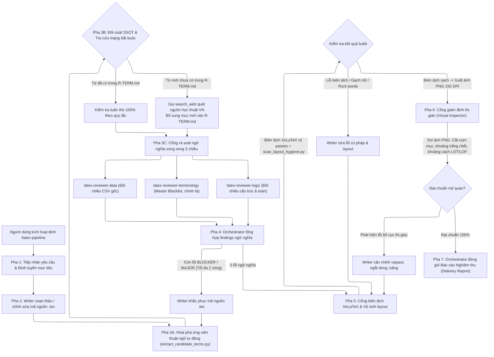

# QUY TRÌNH VẬN HÀNH ĐỘI AGENT VIẾT & KIỂM TOÁN BÁO CÁO LATEX (AGENT WORKFLOW SSOT)
## Đề tài 2: Chọn tập protein đại diện có ưu tiên nhóm hiếm bằng tối ưu hóa submodular (RareProtSelect)

---

## 1. TỔNG QUAN KIẾN TRÚC & PHÂN CÔNG TRÁCH NHIỆM

Hệ thống kiểm soát chất lượng báo cáo LaTeX được tổ chức theo mô hình **Đa tác tử chuyên trách (Specialized Multi-Agent Architecture)** kết hợp với **Các cổng kiểm soát chất lượng nghiêm ngặt (Quality Control Gates)**.

Mỗi tác tử đảm nhận một nguồn bằng chứng độc lập, triệt tiêu hoàn toàn sự chồng chéo nhiệm vụ và hiện tượng loãng sự chú ý khi phải bao quát quá nhiều quy tắc cùng lúc.

```
                               KIẾN TRÚC ĐỘI AGENT
                               
                        ┌─────────────────────────┐
                        │   Latex Orchestrator    │
                        │ (Hội thoại chính - AGY) │
                        └────────────┬────────────┘
                                     │
           ┌─────────────────────────┼─────────────────────────┐
           │                         │                         │
           ▼                         ▼                         ▼
 ┌───────────────────┐     ┌───────────────────┐     ┌───────────────────┐
 │   Latex Writer    │     │   3 Reviewer      │     │  Visual Inspector │
 │     (Soạn thảo)   │     │   (Ngữ nghĩa)     │     │    (Thị giác)     │
 └───────────────────┘     └───────────────────┘     └───────────────────┘
```

### Bảng Phân Công Nhiệm Vụ & Nguồn Bằng Chứng

| Tác tử (`Role`) | Quyền ghi | Nguồn Bằng Chứng Cốt Lõi | Trách Nhiệm Trọng Tâm |
| :--- | :---: | :--- | :--- |
| **`latex-orchestrator`** | Toàn quyền | Brief, Kế hoạch, Toàn bộ hệ thống | Điều phối tuần tự các cổng, phân giải xung đột giữa các reviewer, tổng hợp báo cáo nghiệm thu. |
| **`latex-writer`** | Chỉ `.tex` | Brief, Các khuyến nghị sửa lỗi | Soạn thảo nội dung mới hoặc can thiệp mã nguồn `.tex` để khắc phục lỗi chính xác, cục bộ. |
| **`latex-candidate-harvester`** | Read-only | Mã nguồn `.tex`, Regex cú pháp & N-gram | Script tự động `extract_candidate_terms.py` trích xuất 100% ứng viên thuật ngữ vào `candidate_terms.json`. |
| **`latex-reviewer-data`** | Chỉ đọc | 6 tệp CSV thực nghiệm trong `RareProtSelect/outputs/exp1/` đến `exp6/`, `R-DATA.md` | Giám định tính liêm chính số liệu khoa học: đối chiếu 100% con số trong bảng biểu, đồ thị, văn xuôi với dữ liệu đo đạc thực tế. |
| **`latex-reviewer-terminology`** | Chỉ đọc + Web | Catalog `R-TERM.md`, `candidate_terms.json`, Tài liệu học thuật Việt Nam qua `search_web` | Thẩm định tính chuẩn mực thuật ngữ toán - tin - sinh, đối soát với SSOT thực chứng; bắt buộc tra cứu web khi gặp từ mới chưa định danh. |
| **`latex-reviewer-logic`** | Chỉ đọc | Brief, Mạch logic các chương, `R-LOGIC.md` | Thẩm định tính chặt chẽ của lập luận toán học, tính tự chứa của các luận điểm, phân định giữa lý thuyết và thực nghiệm. |
| **`latex-compiler-linter`** | Shell | XeLaTeX engine, Python layout scanner | Bộ kiểm soát tất định: chạy 2 lượt biên dịch XeLaTeX, kiểm tra log, phát hiện gạch nối lơ lửng, runt words và xuất ảnh PNG. |
| **`latex-visual-inspector`** | Chỉ đọc | Các tệp ảnh PNG render 150 DPI của từng trang PDF | Giám định trực quan thị giác: phát hiện ngắt mục mồ côi, khoảng trắng chết, khoảng cách bảng/hình bất thường, thẩm mỹ layout. |

---

## 2. LUỒNG CHẠY CHI TIẾT 7 PHA KHÉP KÍN (THE 7-PHASE PIPELINE)

Quy trình vận hành tuân thủ nguyên tắc sống còn: **Khai phá & Thẩm định ngữ nghĩa nội dung (Data, Terminology, Logic) PHẢI hoàn tất trước khi xuất PDF để giám định thị giác (Visual Inspection)**.



---

## 3. CHI TIẾT CÁC PHA VẬN HÀNH

### Pha 1: Tiếp Nhận Yêu Cầu & Định Tuyến Mục Tiêu (Routing & Pre-flight)
* **Tác nhân**: `latex-orchestrator`.
* **Nhiệm vụ**:
  1. Phân tích tham số truyền vào từ câu lệnh `/latex-pipeline` (ví dụ: phạm vi toàn bộ báo cáo `full`, hoặc từng chương cụ thể `chapter 1`).
  2. Kiểm tra môi trường ảo Python (`RareProtSelect/.venv`), công cụ biên dịch XeLaTeX, và các tệp dữ liệu CSV đối chứng.
  3. Khởi tạo hoặc đánh thức $4$ subagent chuyên trách.

---

### Pha 2: Soạn Thảo / Cập Nhật Mã Nguồn (Drafting & Mutating)
* **Tác nhân**: `latex-writer`.
* **Nhiệm vụ**:
  1. Căn cứ vào kế hoạch hành động hoặc danh sách các điểm cần chỉnh sửa đã được người dùng phê duyệt.
  2. Thực hiện sửa đổi trên các tệp `.tex` đích tương ứng trong `contents/chapters/` hoặc `contents/frontmatter/`.
  3. Áp dụng kỷ luật định dạng: giữ nguyên nhãn `\label`, không tự ý xóa bỏ các gói lệnh dùng chung trong `main.tex`.

---

### Pha 3: Cổng Rà Soát Ngữ Nghĩa Đa Tầng (Semantic Review Gate)
> [!IMPORTANT]
> Đây là chốt chặn tự động ngăn chặn hoàn toàn việc Writer tự ý dịch bừa thuật ngữ quốc tế thành từ ngữ dị biệt:

#### 3A. Khai Phá Ứng Viên Thuật Ngữ Tự Động (Candidate Harvesting)
* Chạy script Python `extract_candidate_terms.py` quét 100% tệp `.tex`.
* Bóc tách 4 tầng: (1) Từ tiếng Anh & Acronyms, (2) Khối `\textbf`, `\textit`, (3) Math-adjacent nouns, (4) N-gram kỹ thuật theo từ khóa chỉ dẫn (*thuật toán, cơ chế, mô hình, bài toán, hàm, phương pháp, chỉ số, kỹ thuật...*).
* Xuất tệp `candidate_terms.json`.

#### 3B. Đối Soát SSOT & Tra Cứu Mạng Bắt Buộc (Terminology Web-Grounding)
* Giao `candidate_terms.json` cho `latex-reviewer-terminology`.
* Nếu phát hiện mục `UNCATALOGED_TERM` hoặc nghi vấn dịch thô:
  * **Bắt buộc gọi `search_web`** quét các nguồn học thuật Việt Nam (`site:vnu.edu.vn`, `site:hust.edu.vn`, `site:vast.gov.vn`).
  * Xác định thuật ngữ chuẩn và tự động cập nhật vào Mục 14 của `R-TERM.md` kèm trích dẫn nguồn.
* Nếu phát hiện `FORBIDDEN_DETECTED`: Báo lỗi `ERROR` ngay lập tức.

#### 3C. Thẩm Định Ngữ Nghĩa Song Song 3 Chiều
* **Reviewer 1 (`latex-reviewer-data`)**: Đọc trực tiếp các tệp dữ liệu CSV gốc (`outputs/exp1/` đến `exp6/`). Kiểm tra 100% con số đo đạc, độ mất cân bằng $329{,}0$ lần, số Subfamily $115$.
* **Reviewer 2 (`latex-reviewer-terminology`)**: Kiểm tra Master Blacklist, chính tả viết hoa, MEROPS, và triệt tiêu dấu ngoặc đơn chú giải song ngữ.
* **Reviewer 3 (`latex-reviewer-logic`)**: Kiểm tra tính đúng đắn của lập luận: tách bạch giữa cận bảo đảm lý thuyết Nemhauser $(1 - 1/e)$ và giải thuật heuristic thực nghiệm Pruned Greedy 90% kết hợp lấy Top-$k$ theo tần suất. Kiểm tra tính tự chứa quanh bảng/hình.

---

### Pha 4: Tổng Hợp & Xử Lý Lỗi Ngữ Nghĩa (Semantic Auto-Fix Loop)
* **Tác nhân**: `latex-orchestrator` phối hợp cùng `latex-writer`.
* **Cơ chế hoạt động**:
  1. Orchestrator gom toàn bộ findings từ 3 Reviewer.
  2. Xác minh trích dẫn bằng grep.
  3. Nếu có lỗi `BLOCKER` hoặc `MAJOR`: Gửi lệnh sửa đích danh cho `latex-writer`. Giới hạn tối đa 2 vòng lặp sửa đổi.
  4. Khi sạch lỗi: Cho phép bước sang Pha 5.

---

### Pha 5: Cổng Biên Dịch XeLaTeX & Vệ Sinh Mã (Deterministic Compiler Gate)
* **Tác nhân**: Script tự động thực thi qua terminal.
* **Quy trình thực thi**:
  1. Biên dịch XeLaTeX 2 passes:
     ```powershell
     cd "report_latex\thuc_tap_cong_nghiep"
     xelatex -interaction=nonstopmode main.tex
     xelatex -interaction=nonstopmode main.tex
     ```
  2. Quét nhật ký `main.log`: kiểm tra 0 error, 0 missing reference.
  3. Chạy script vệ sinh layout `scan_layout_hygiene.py`: bắt lỗi gạch nối lơ lửng, runt words, trang rỗng (< 1000 ký tự), tiêu đề mồ côi đáy trang, lệnh `\texttt` gây đứt gãy phông, viết tắt `\mathbf{cov}`, và tiếng Latinh `ceteris paribus`.
  4. Chuyển đổi PDF đích thành ảnh PNG 150 DPI bằng `pdftoppm`.

---

### Pha 6: Cổng Giám Định Thị Giác & Bố Cục Trang (Visual Inspection Gate)
* **Tác nhân**: `latex-visual-inspector` (phân tích trực tiếp ảnh PNG).
* **Các tiêu chí giám định**:
  1. Tiêu đề Chương I, II, III căn giữa chuẩn mực.
  2. Khoảng cách Danh mục Bảng biểu & Hình ảnh (LOT/LOF) phẳng đều, không có khoảng hở 10pt nhân tạo.
  3. Tỷ lệ lấp đầy trang ($\ge 80\%$) & chống tiêu đề mồ côi (Orphan Headings - đặc biệt Mục 1.5.2, 2.2, 3.4).
  4. Thẩm mỹ Bảng biểu (Bảng 1, Bảng 2, Bảng 3) cân đối, không đứt gãy từ ngữ.
  5. Đồng nhất phông chữ Times New Roman 100%, tuyệt đối không để lọt phông Consolas vào văn xuôi.

---

### Pha 7: Nghiệm Thu & Đóng Gói Báo Cáo (Delivery & Acceptance)
* **Tác nhân**: `latex-orchestrator`.
* **Nhiệm vụ**:
  1. Tổng hợp kết quả từ tất cả các cổng thành **Báo cáo Nghiệm thu Hoàn tất (Delivery Report)**.
  2. Trình bày danh mục thuật ngữ mới đã kiểm định thực chứng, đường dẫn tệp PDF và ảnh chụp minh chứng cho người dùng duyệt.

---

## 4. HƯỚNG DẪN KÍCH HOẠT QUA CÂU LỆNH SLASH (`/latex-pipeline`)

Người dùng có thể kích hoạt trực tiếp trong khung chat Antigravity:

| Câu Lệnh | Chức Năng Vận Hành Cụ Thể |
| :--- | :--- |
| **`/latex-pipeline`** hoặc **`/latex-pipeline full`** | Kích hoạt trọn vẹn toàn bộ 7 pha: Soạn thảo $\to$ Khai phá thuật ngữ $\to$ Tra cứu mạng $\to$ Rà soát ngữ nghĩa 3 chiều $\to$ Biên dịch $\to$ Giám định thị giác PNG $\to$ Xuất báo cáo. |
| **`/latex-pipeline chapter <1..5>`** | Chạy kiểm toán tập trung cho một chương cụ thể. |
| **`/latex-pipeline semantic`** | Chỉ chạy Pha 3 (Khai phá thuật ngữ + Rà soát ngữ nghĩa) để phát hiện và sửa sạch lỗi nội dung trước khi biên dịch. |
| **`/latex-pipeline visual`** | Bỏ qua bước sửa nội dung, chỉ chạy biên dịch XeLaTeX x2, render PNG và kích hoạt `latex-visual-inspector` để soi bố cục thị giác. |
