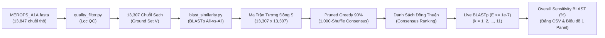
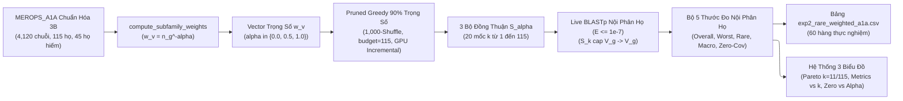
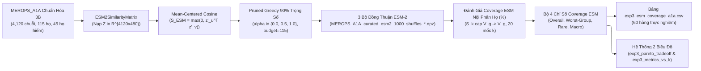
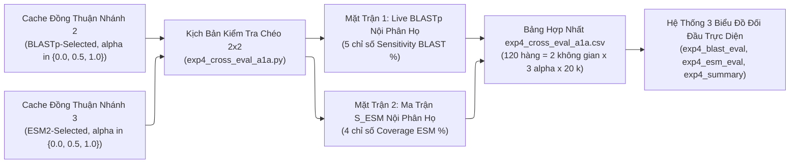
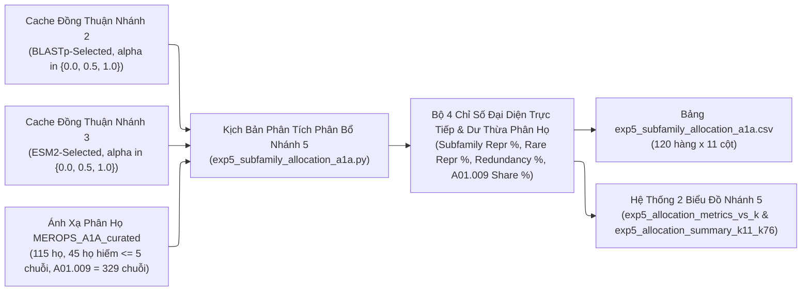
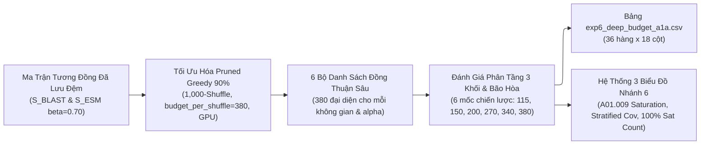

# TÀI LIỆU 2: THIẾT KẾ CODEBASE & KIẾN TRÚC HỆ THỐNG PHẦN MỀM (SSOT)
## Đề tài 2: Tái hiện Đối chuẩn Bài báo nền trên Siêu họ Peptidase A1 (MEROPS A1A)

> 📌 **VAI TRÒ CỦA TÀI LIỆU NÀY (BẢN THIẾT KẾ KỸ THUẬT & NGUỒN SỰ THẬT DUY NHẤT - SSOT)**:
> * Đây là tài liệu quy định **kiến trúc phần mềm, cấu trúc thư mục, thiết kế chi tiết từng tệp mã nguồn (class, hàm, tham số, kiểu dữ liệu)** để hiện thực hóa toàn bộ các công đoạn trong [**Tài liệu 1: Quy trình thực hiện & Các công đoạn nghiên cứu**](./quy_trinh_thuc_hien_va_cac_cong_doan.md).
> * **Tuân thủ triệt để nguyên tắc `/controlled-scientific-experiment`**: Toàn bộ codebase được tinh gọn, chỉ chứa duy nhất các module và kịch bản phục vụ cho Nhánh 1 (Tái hiện Hình 8 trên Peptidase A1). Toàn bộ các module không thuộc phạm vi đã được dọn sạch để đảm bảo không gây nhiễu biến số hay nhầm lẫn ý tưởng.
> * Trong mỗi tệp code thực tế, phần chú thích đầu tệp (Docstring) **bắt buộc phải ghi rõ: "Thực hiện Công đoạn X trong Tài liệu 1 và Module Y trong Tài liệu 2"**.

---

## MỤC LỤC BẢN THIẾT KẾ

- [1. Cấu Trúc Cây Thư Mục Toàn Dự Án](#sec-tree)
- [2. Môi Trường Thực Thi & Quản Lý Phụ Thuộc (`uv`)](#sec-env)
- [3. Thiết Kế Chi Tiết Từng Module Mã Nguồn (`src/`)](#sec-modules)
  - [3.1. Module Cấu hình (`src/config/`)](#module-config)
  - [3.2. Module Dữ liệu & Tiền xử lý (`src/data/`)](#module-data)
  - [3.3. Module Ma trận Tương đồng Chuỗi (`src/similarity/`)](#module-similarity)
  - [3.4. Module Chọn Tập Đại Diện Submodular (`src/selection/`)](#module-selection)
  - [3.5. Module Tiện ích & Xuất Báo Cáo (`src/utils/`)](#module-utils)
- [4. Thiết Kế Kịch Bản Thực Nghiệm Nhánh 1 (`experiments/` & `configs/`)](#sec-experiments)
- [5. Sơ Đồ Luồng Dữ Liệu Toàn Cục (Dataflow Pipeline)](#sec-dataflow)
- [6. Ma Trận Truy Vết 2 Chiều (Traceability Matrix)](#sec-traceability)
- [7. Quy Chuẩn Xác Minh Hai Bước (Two-Step Verification Protocol)](#sec-verify)

---

<a id="sec-tree"></a>
## 1. CẤU TRÚC CÂY THƯ MỤC TOÀN DỰ ÁN

```
Topic 2/                                   # Thư mục gốc dự án
├── GEMINI.md                              # Quy chuẩn hoạt động & điều phối AI
├── quy_trinh_thuc_hien_va_cac_cong_doan.md # [TÀI LIỆU 1] Quy trình nghiên cứu khoa học (SSOT)
├── thiet_ke_codebase_va_kien_truc_he_thong.md # [TÀI LIỆU 2] Thiết kế codebase & kiến trúc (SSOT)
├── bao_cao_ket_qua_chi_tiet_topic2.md     # Báo cáo số liệu đo đạc thực nghiệm tổng hợp Nhánh 1 -> Nhánh 4
├── tong_hop_cac_chi_so_danh_gia.md        # Tổng hợp hệ thống 13 chỉ số đánh giá (9 chỉ số Nhánh 1-4 + 4 chỉ số Nhánh 5)
├── doc_hieu_topic2_va_bai_bao_nen.md      # Tài liệu phân tích đọc hiểu bài báo nền
├── PROJECT.md                             # Tổng quan trạng thái dự án
├── topic2.md                              # Đề cương đề tài gốc
├── baseline_repo/                         # Thư mục lưu mã nguồn R gốc & tệp FASTA chuẩn
│   ├── Greedy.R                           # Script R gốc của Nguyen et al. (2025)
│   ├── Bidirectional_Greedy.R             # Script R đối chứng gốc
│   ├── MEROPS_A1A.fasta                   # 13,847 chuỗi Peptidase A1
│   ├── Thioesterases_Sequences.fasta      # 737 chuỗi TE
│   └── CE.fasta                           # 12,277 chuỗi Carboxylesterase
│
└── RareProtSelect/                        # THƯ MỤC CODEBASE CHÍNH CỦA DỰ ÁN (NHÁNH 1 -> NHÁNH 5)
    ├── .venv/                             # Môi trường ảo Python 3.12 tạo bởi uv
    ├── pyproject.toml                     # Cấu hình dự án và dependencies qua uv
    │
    ├── configs/                           # Cấu hình thực nghiệm YAML
    │   ├── config_exp1_baseline_a1a_calibration.yaml # Cấu hình cho Nhánh 1 (Baseline Fig 8)
    │   ├── config_exp2_rare_weighted_a1a.yaml         # Cấu hình cho Nhánh 2 (Rare-Aware Weighted FL trên BLASTp)
    │   ├── config_exp3_esm_coverage_a1a.yaml          # Cấu hình cho Nhánh 3 (Rare-Aware Weighted FL trên ESM-2 Mean-Centered Cosine)
    │   ├── config_exp4_cross_eval_a1a.yaml            # Cấu hình cho Nhánh 4 (Kiểm tra chéo 2x2 giữa BLASTp và ESM-2)
    │   ├── config_exp5_subfamily_allocation_a1a.yaml  # Cấu hình cho Nhánh 5 (Phân tích đại diện trực tiếp & dư thừa phân bổ phân họ)
    │   └── config_exp6_deep_budget_a1a.yaml          # Cấu hình cho Nhánh 6 (Khảo sát ngân sách sâu k in [115..380] & bão hòa phân họ lớn)
    │
    ├── tools/                             # Công cụ dòng lệnh ngoại vi tích hợp
    │   └── blast/bin/                     # blastp.exe, makeblastdb.exe
    │
    ├── src/                               # Mã nguồn lõi (Modularized Python Package)
    │   ├── __init__.py
    │   ├── config/                        # Module nạp cấu hình
    │   │   ├── __init__.py
    │   │   └── settings.py                # Dataclass ExperimentConfig & load_config
    │   ├── data/                          # Module đọc & tiền xử lý FASTA
    │   │   ├── __init__.py
    │   │   ├── fasta_parser.py            # Đọc FASTA thô thành ProteinRecord
    │   │   ├── quality_filter.py          # Lọc QC chuỗi rác/lỗi
    │   │   ├── annotation_mapper.py       # Ánh xạ header & phân họ
    │   │   └── dataset_loader.py          # Bộ nạp dữ liệu tích hợp DatasetBundle
    │   ├── similarity/                    # Module ma trận tương đồng chuỗi & ngữ nghĩa
    │   │   ├── __init__.py
    │   │   ├── blast_similarity.py        # NCBI BLASTp All-vs-All & Live BLAST
    │   │   └── dense_similarity.py        # ESM-2 Mean-Centered Cosine & ESM2SimilarityMatrix
    │   ├── selection/                     # Module chọn tập đại diện Submodular
    │   │   ├── __init__.py
    │   │   ├── base.py                    # SelectionResult & BaseSubmodularSelector
    │   │   ├── standard_greedy.py         # StandardGreedySolver (hỗ trợ prune_threshold=0.90)
    │   │   ├── pruned_greedy.py           # PrunedGreedySelector & compute_subfamily_weights (hỗ trợ sample_weights & tqdm)
    │   │   └── unweighted_selector.py     # UnweightedFLSelector (Nguyen et al., 2025)
    │   └── utils/                         # Module tiện ích hỗ trợ
    │       ├── __init__.py
    │       ├── timer.py                   # Bấm giờ chính xác cao
    │       └── exporter.py                # Xuất bảng CSV, JSON, Markdown
    │
    ├── experiments/                       # Kịch bản thực nghiệm
    │   ├── __init__.py
    │   ├── exp1_baseline_a1a_calibration.py # Kịch bản Nhánh 1: Tái hiện Hình 8 A1A (13,307 chuỗi toàn cục)
    │   ├── exp2_rare_weighted_a1a.py        # Kịch bản Nhánh 2: Khảo sát 3 mức alpha trên BLASTp (4,120 chuỗi, 115 phân họ, 20 mốc k đến 115, Truy vấn ngược nội phân họ)
    │   ├── exp3_esm_coverage_a1a.py         # Kịch bản Nhánh 3: Khảo sát 3 mức alpha trên ESM-2 Mean-Centered Cosine (4,120 chuỗi, 115 phân họ, 20 mốc k đến 115, Bao phủ nội phân họ)
    │   ├── exp4_cross_eval_a1a.py           # Kịch bản Nhánh 4: Kiểm tra chéo 2x2 giữa BLASTp và ESM-2 (120 dòng CSV & 3 biểu đồ)
    │   ├── exp5_subfamily_allocation_a1a.py # Kịch bản Nhánh 5: Phân tích cấu trúc đại diện trực tiếp & độ dư thừa phân họ trên 115 họ (120 dòng CSV & 2 biểu đồ)
    │   └── exp6_deep_budget_a1a.py          # Kịch bản Nhánh 6: Khảo sát động học bão hòa phân họ lớn & ngân sách sâu k in [115..380] (36 dòng CSV & 3 biểu đồ)
    │
    └── outputs/                           # Thư mục kết quả sinh ra tự động
        ├── embeddings_cache/              # Lưu vector nhúng ESM-2 (.npy)
        ├── similarity_cache/              # Lưu ma trận tương đồng (.npz) và consensus ranking các mức alpha (BLASTp & ESM-2)
        ├── figures/                       # Biểu đồ xuất bản (exp1_*, exp2_*, exp3_*, exp4_*, exp5_*, exp6_*)
        └── tables/                        # Bảng số liệu chuẩn & thực nghiệm (nguyen2025_fig8a_benchmark.csv, exp1_*.csv, exp2_*.csv, exp3_*.csv, exp4_*.csv, exp5_*.csv, exp6_deep_budget_a1a.csv)
```

---

<a id="sec-env"></a>
## 2. MÔI TRƯỜNG THỰC THI & QUẢN LÝ PHỤ THUỘC (`uv`)

* **Trình quản lý gói**: `uv` (`D:\uv\bin\uv.exe`).
* **Phiên bản Python**: Python 3.12 (`D:\uv\python\cpython-3.12.13-windows-x86_64-none\python.exe`).
* **Phần cứng tăng tốc**: GPU NVIDIA GeForce RTX 5060 Laptop (hỗ trợ PyTorch CUDA `torch==2.11.0+cu130` tăng tốc hoán vị và nhân ma trận).
* **Lệnh thực thi chính thức**:
  ```powershell
  cd "d:\programing\project\Topic 2\RareProtSelect"
  D:\uv\bin\uv.exe run python experiments/exp1_baseline_a1a_calibration.py --config configs/config_exp1_baseline_a1a_calibration.yaml
  ```

---

<a id="sec-modules"></a>
## 3. THIẾT KẾ CHI TIẾT TỪNG MODULE MÃ NGUỒN (`src/`)

### 3.1. Module Cấu hình (`src/config/`)
* **Tệp**: `settings.py`
* **Lớp chính**: `ExperimentConfig` (Dataclass chứa các trường tham số thực nghiệm: `dataset_name`, `fasta_path`, `output_dir`, `budget_k_list`, `prune_threshold`, `num_shuffles`, `seed`, `exclude_unknown_subfamilies: bool = False`).
* **Hàm chính**: `load_config(yaml_path: str | Path) -> ExperimentConfig`.

---

### 3.2. Module Dữ liệu & Tiền xử lý (`src/data/`)
* **Tệp `fasta_parser.py`**:
  - `ProteinRecord(id: str, sequence: str, header: str, length: int)`
  - `FastaParser.read_fasta(file_path: Path | str) -> list[ProteinRecord]`
* **Tệp `quality_filter.py`**:
  - `QualityFilter.filter_sequences(records: list[ProteinRecord]) -> QCResult`
  - Tiêu chuẩn lọc: $L \in [30, 2000]$, tỷ lệ ký tự lạ $\le 5\%$, khử trùng lặp hoàn toàn.
* **Tệp `annotation_mapper.py`**:
  - `AnnotationMapper.extract_merops_subfamily(header: str) -> str`: Sử dụng Regex `r"\[([A-Z]\d{2}\.(?!UPA)[A-Z0-9]{3})\]"` để thu nhận đầy đủ cả 75 phân họ mã số (`A01.001`..`A01.971`) và 40 phân họ mã chữ-số (`A01.A02`..`A01.P02`) thành tổng cộng 115 phân họ định danh; trả về `"A01.Unknown"` đối với thẻ chưa định danh `[A01.UPA]`.
  - `AnnotationMapper.is_unknown_label(label: str) -> bool`: Kiểm tra nhãn thuộc tập chưa định danh (`{"A01.Unknown", "F_Unknown", "TE_Unclassified", "UNKNOWN"}`).
  - `AnnotationMapper.map_annotations(...) -> AnnotationMapping`
* **Tệp `dataset_loader.py`**:
  - `DatasetBundle(records, cleaned_records, label_map, subfamily_counts, rare_subfamilies, qc_stats)`
  - `DatasetLoader.load_and_preprocess_dataset(config, ..., exclude_unknown_subfamilies: bool | None = None) -> DatasetBundle`: Khi `exclude_unknown_subfamilies = True` (Phương án 3B áp dụng cho Nhánh 2 $\to$ Nhánh 5), tự động lọc bỏ toàn bộ các chuỗi mang nhãn chưa định danh (`"A01.Unknown"` / `[A01.UPA]`), trả về tập chuẩn hóa $4,120$ chuỗi sạch thuộc $115$ phân họ định danh ($45$ họ hiếm $\le 5$ chuỗi, $0\%$ Unknown).

---

### 3.3. Module Ma trận Tương đồng Chuỗi & Ngữ nghĩa (`src/similarity/`)
* **Tệp `blast_similarity.py`**:
  - **Lớp chính**: `BLASTSimilarityMatrix`
  - **Các phương thức then chốt**:
    - `run_all_vs_all_blastp(fasta_path, output_tsv, use_db=True) -> Path`: Thực thi `blastp` All-vs-All với tham số nguyên bản của bài báo nền (`-evalue 0.05 -max_target_seqs 100 -word_size 3 -outfmt '6 qseqid sseqid pident'`).
    - `build_matrix_from_tsv(tsv_path, seq_ids) -> np.ndarray`: Đọc TSV, chuẩn hóa `pident / 100.0`, khử trùng lặp HSP, gán đường chéo 1.0, trả về ma trận đối xứng không âm $\mathbf{S}_{\text{BLAST}} \in \mathbb{R}^{N \times N}$ ($13,307 \times 13,307$ cho Nhánh 1; $4,120 \times 4,120$ cho Nhánh 2 $\to$ 5).
    - `get_similarity_matrix(...) -> np.ndarray`: Tự động nạp cache `.npz` nếu đã tồn tại, tránh tính lại tốn thời gian.
    - `build_blast_db(fasta_path, db_prefix) -> Path`: Tạo chỉ mục protein `makeblastdb`.
    - `retrieve_blast_hits(query_fasta, db_prefix, evalue=1e-7, max_target_seqs=999999) -> set[str]`: Thực thi Live BLAST truy xuất danh sách protein ID có hit thỏa $E \le 10^{-7}$ (dùng cho Nhánh 1).
    - `retrieve_blast_hit_pairs(query_fasta, db_prefix, evalue=1e-7, max_target_seqs=999999) -> set[tuple[str, str]]`: Thực thi Live BLAST trả về tập cặp `(qseqid, sseqid)` thỏa $E \le 10^{-7}$ để đánh giá chính xác **Truy vấn ngược nội phân họ** (`id_to_family[qseqid] == id_to_family[sseqid]`) ở Nhánh 2 và Nhánh 4.
* **Tệp `dense_similarity.py`**:
  - **Hàm `compute_mean_centered_cosine_matrix(raw_embeddings: np.ndarray, beta: float = 0.70) -> np.ndarray`**:
    - Dịch tâm có kiểm soát đám mây vector nhúng $z_v - \beta \mu$ ($\mu = \frac{1}{|V|}\sum_{v \in V} z_v$, $\beta = 0.70$), chuẩn hóa $L_2$ từng vector $z'_v(\beta) = \frac{z_v - \beta \mu}{\|z_v - \beta \mu\|_2}$, và tính ma trận tương đồng không âm $\mathbf{S}_{\text{ESM}}^{(\beta)}(u, v) = \max(0.0, {z'_u(\beta)}^\top z'_v(\beta)) \in [0.0, 1.0]$ với đường chéo $\mathbf{S}_{\text{ESM}}^{(\beta)}(v, v) = 1.0$ trên GPU PyTorch CUDA (hoặc NumPy), trả về kiểu `np.float32`.
  - **Lớp `ESM2SimilarityMatrix`**:
    - `load_or_extract_embeddings(records, dataset_name, force_recompute=False) -> np.ndarray`: Nạp ma trận vector nhúng ESM-2 (`shape=(4120, 480)`, `dtype=float32`) từ `outputs/embeddings_cache/{dataset_name}_{model_slug}.npy` hoặc trích xuất bằng mô hình HuggingFace `facebook/esm2_t12_35M_UR50D` trên GPU nếu chưa có cache.
    - `get_similarity_matrix(records, seq_ids, dataset_name, force_recompute=False) -> np.ndarray`: Nạp hoặc tính toán ma trận tương đồng Partial Mean-Centered Cosine ($\beta = 0.70$) $\mathbf{S}_{\text{ESM}} \in \mathbb{R}^{4,120 \times 4,120}$, kiểm tra khớp `center_shift_beta` trong metadata và lưu đệm tại `outputs/similarity_cache/{dataset_name}_esm2_mc_cosine_sim_matrix.npz`.

---

### 3.4. Module Chọn Tập Đại Diện Submodular (`src/selection/`)
* **Tệp `base.py`**:
  - `SelectionResult(selected_indices, selected_ids, marginal_gains, objective_history, total_evaluations, runtime_seconds)`
  - `BaseSubmodularSelector(ABC)`: Giao diện cơ sở trừu tượng với phương thức `select(budget_k: int) -> SelectionResult`.
* **Tệp `standard_greedy.py`**:
  - `StandardGreedySolver(BaseSubmodularSelector)`: Cài đặt thuật toán tham lam Submodular Facility Location với tham số cắt tỉa cứng `prune_threshold = 0.90` theo đúng Algorithm 1 của bài báo gốc.
* **Tệp `pruned_greedy.py`**:
  - `compute_subfamily_weights(seq_ids: list[str], id_to_family: dict[str, str], alpha: float) -> np.ndarray`: Tính toán vector trọng số mẫu $w_v = (n_{g(v)})^{-\alpha}$. Khi $\alpha=0.0 \implies w_v=1.0$; khi $\alpha=0.5 \implies w_v=1/\sqrt{n_g}$; khi $\alpha=1.0 \implies \sum_{v \in g} w_v = 1.0$.
  - `run_pruned_greedy_1000_shuffles(sim_matrix, seq_ids, prune_threshold=0.90, num_shuffles=1000, sample_weights=None, seed=42, budget_per_shuffle=115, ...) -> tuple[list[str], pd.DataFrame]`: Thuật toán 1,000-Shuffle Consensus Ranking hỗ trợ `sample_weights`, cập nhật lợi ích cận biên trực tiếp (Incremental Marginal Gain Update) trên GPU/CPU, kiểm tra tính hợp lệ `cached_budget_per_shuffle >= budget_per_shuffle` trong cache `.npz`, và tích hợp thanh tiến trình `tqdm`.
* **Tệp `unweighted_selector.py`**:
  - `UnweightedFLSelector`: Wrapper đóng gói phương pháp nền unweighted ($w_v = 1.0$).

---

### 3.5. Module Tiện ích & Xuất Báo Cáo (`src/utils/`)
* **Tệp `timer.py`**: Đo thời gian thực thi chính xác cao bằng `time.perf_counter()`.
* **Tệp `exporter.py`**: Xuất cấu trúc kết quả ra các tệp `.csv`, `.json`, `.md`.

---

<a id="sec-experiments"></a>
## 4. THIẾT KẾ KỊCH BẢN THỰC NGHIỆM

### 4.1. Tệp cấu hình Nhánh 1: `configs/config_exp1_baseline_a1a_calibration.yaml`
* Chứa các tham số điều khiển thuật toán tái hiện Hình 8 bài báo gốc (`prune_threshold: 0.90`, `num_shuffles: 1000`, `seed: 42`, `budget_k_list: [1..11]`, `exclude_unknown_subfamilies: false`) và khóa đường dẫn `published_benchmark_csv: "outputs/tables/nguyen2025_fig8a_benchmark.csv"` trỏ tới tệp CSV Nguồn sự thật.

### 4.2. Kịch bản thực thi Nhánh 1: `experiments/exp1_baseline_a1a_calibration.py`
* **Hàm `load_published_fig8a_benchmark(csv_path: Path) -> dict[int, float]`**: Đọc tệp CSV Nguồn sự thật `outputs/tables/nguyen2025_fig8a_benchmark.csv` chứa đủ 11 mốc ước lượng từ Hình 8 Panel A ($k = 1 \dots 11$: `[80.5, 83.5, 85.7, 86.7, 88.0, 88.1, 88.4, 89.0, 90.7, 90.8, 90.9]`).
* **Hàm `run_exp1_baseline_a1a_calibration(...) -> dict[str, object]`**: Thực thi đối chuẩn 11 mốc ngân sách của Nhánh 1 trên toàn tập $13,307$ chuỗi, ghép đủ 11 mốc từ `nguyen2025_fig8a_benchmark.csv` vào bảng `exp1_baseline_a1a_calibration.csv` và vẽ đường đối chuẩn 11 điểm trên `exp1_a1a_sensitivity_vs_k.png`/`.svg`.

### 4.3. Tệp cấu hình Nhánh 2: `configs/config_exp2_rare_weighted_a1a.yaml`
```yaml
experiment_name: "exp2_rare_weighted_a1a"
dataset_name: "MEROPS_A1A_curated"
fasta_path: "../baseline_repo/MEROPS_A1A.fasta"
output_dir: "outputs"

min_seq_len: 30
max_seq_len: 2000
max_ambiguous_ratio: 0.05
rare_threshold: 5
exclude_unknown_subfamilies: true

blast_bin_path: "tools/blast/bin/blastp.exe"
blast_similarity_matrix:
  evalue: 0.05
  max_target_seqs: 100
  word_size: 3
  num_threads: 24

algorithm_name: "Rare-Aware Pruned Greedy 90% (1,000-Shuffle Consensus, Within-Subfamily Query)"
prune_threshold: 0.90
num_shuffles: 1000
seed: 42
budget_per_shuffle: 115

# Dải 3 mốc alpha cốt lõi
alphas: [0.0, 0.5, 1.0]

# 20 mốc ngân sách chiến lược tiến tới tổng số 115 phân họ định danh
budget_k_list: [1, 2, 3, 4, 5, 6, 7, 8, 9, 10, 11, 15, 20, 25, 30, 40, 50, 60, 75, 115]

blast_live_coverage_evaluation:
  evalue: 1.0e-7
  max_target_seqs: 999999
  num_threads: 24
```

### 4.4. Kịch bản thực thi Nhánh 2: `experiments/exp2_rare_weighted_a1a.py`
* **Hàm `evaluate_rare_aware_representatives(...) -> dict[str, object]`**:
  - Thực hiện **Truy vấn ngược nội phân họ (`Within-Subfamily Representative Query`: $S_k \cap V_g \to V_g$)**: Một chuỗi thành viên $v \in V_g$ chỉ được tính là có hit hợp lệ nếu có ít nhất một đại diện $s \in S_k \cap V_g$ (cùng phân họ $g$) tạo hit `blastp` ($E \le 10^{-7}$) tới $v$ (`id_to_family[qseqid] == id_to_family[sseqid]`). Nếu $S_k \cap V_g = \emptyset \implies \operatorname{Sens}_g^{\text{within}}(S_k) = 0.0\%$.
* **Hàm `run_exp2_rare_weighted_a1a(config_path: str) -> dict[str, object]`**:
  - Điều phối toàn bộ quy trình: Nạp cấu hình $\to$ Nạp dữ liệu chuẩn hóa Phương án 3B ($4,120$ chuỗi sạch, $115$ phân họ, $45$ họ hiếm $\le 5$ chuỗi) $\to$ Nạp ma trận BLASTp ($4,120 \times 4,120$).
  - Vòng lặp `tqdm` qua 3 mốc $\alpha \in [0.0, 0.5, 1.0]$:
    1. Tính vector trọng số $w_v = (n_{g(v)})^{-\alpha}$ bằng `compute_subfamily_weights`.
    2. Chạy `run_pruned_greedy_1000_shuffles` với `sample_weights=weights` và `budget_per_shuffle=115`.
    3. Đánh giá Truy vấn ngược nội phân họ qua Live BLASTp trên 20 mốc $k \in [1..11, 15, 20, 25, 30, 40, 50, 60, 75, 115]$, tính 5 chỉ số: `overall_sensitivity_blast_pct`, `worst_group_sensitivity_blast_pct`, `rare_sensitivity_blast_pct`, `macro_sensitivity_blast_pct`, `zero_cov_subfamilies_count`.
  - Xuất duy nhất tệp CSV: `outputs/tables/exp2_rare_weighted_a1a.csv` ($3 \times 20 = 60$ hàng).
  - Vẽ và xuất 3 đồ thị đối chiếu $k=11$ và $k=115$: `exp2_pareto_tradeoff.png`/`.svg`, `exp2_metrics_vs_k.png`/`.svg`, `exp2_zero_cov_vs_alpha.png`/`.svg`.

### 4.5. Tệp cấu hình Nhánh 3: `configs/config_exp3_esm_coverage_a1a.yaml`
```yaml
experiment_name: "exp3_esm_coverage_a1a"
dataset_name: "MEROPS_A1A_curated"
fasta_path: "../baseline_repo/MEROPS_A1A.fasta"
output_dir: "outputs"
embeddings_cache_dir: "outputs/embeddings_cache"

min_seq_len: 30
max_seq_len: 2000
max_ambiguous_ratio: 0.05
rare_threshold: 5
exclude_unknown_subfamilies: true

esm_representation:
  model_name: "facebook/esm2_t12_35M_UR50D"
  normalization: "partial_mean_centered_cosine"
  center_shift_beta: 0.70
  batch_size: 16
  device: "auto"

algorithm_name: "Rare-Aware Pruned Greedy 90% on ESM-2 Partial Mean-Centered Cosine (beta=0.70, 1,000-Shuffle Consensus, Within-Subfamily Coverage)"
prune_threshold: 0.90
num_shuffles: 1000
seed: 42
budget_per_shuffle: 115

# Dải 3 mốc alpha cốt lõi đối chứng trực diện với Nhánh 2
alphas: [0.0, 0.5, 1.0]

# Dải 20 mốc ngân sách chiến lược tiến tới tổng số 115 phân họ định danh
budget_k_list: [1, 2, 3, 4, 5, 6, 7, 8, 9, 10, 11, 15, 20, 25, 30, 40, 50, 60, 75, 115]
```

### 4.6. Kịch bản thực thi Nhánh 3: `experiments/exp3_esm_coverage_a1a.py`
* **Hàm `evaluate_esm_coverage_representatives(...) -> dict[str, float | int]`**:
  - Tính trực tiếp điểm bao phủ ngữ nghĩa **nội phân họ** trên ma trận $\mathbf{S}_{\text{ESM}}^{(\beta=0.70)}$: với mỗi phân họ $g \in \{1..115\}$, nếu $S_k \cap V_g = \emptyset$ thì $c_v^{\text{within}}(S_k) = 0.0, \forall v \in V_g$; nếu $S_k \cap V_g \neq \emptyset$ thì $c_v^{\text{within}}(S_k) = \max_{s \in S_k \cap V_g} \mathbf{S}_{\text{ESM}}(v, s), \forall v \in V_g$.
  - Trả về chính xác 4 chỉ số phần trăm liên tục nội phân họ: `overall_coverage_esm_pct`, `worst_group_coverage_esm_pct`, `rare_coverage_esm_pct`, `macro_coverage_esm_pct`.
* **Hàm `run_exp3_esm_coverage_a1a(config_path: str) -> dict[str, object]`**:
  - Điều phối toàn bộ quy trình Nhánh 3: Nạp cấu hình $\to$ Nạp dữ liệu chuẩn hóa Phương án 3B ($4,120$ chuỗi, $115$ phân họ, $45$ họ hiếm) $\to$ Nạp vector nhúng ESM-2 & xây dựng ma trận Mean-Centered Cosine $\mathbf{S}_{\text{ESM}} \in \mathbb{R}^{4,120 \times 4,120}$.
  - Vòng lặp `tqdm` qua 3 mốc $\alpha \in [0.0, 0.5, 1.0]$:
    1. Tính vector trọng số $w_v = (n_{g(v)})^{-\alpha}$ bằng `compute_subfamily_weights`.
    2. Chạy `run_pruned_greedy_1000_shuffles` trên $\mathbf{S}_{\text{ESM}}$ với `budget_per_shuffle=115`, lưu đệm vào `MEROPS_A1A_curated_esm2_1000_shuffles_alpha_{alpha:.2f}.npz`.
    3. Tính 4 chỉ số `Coverage ESM (%)` nội phân họ trên 20 mốc $k \in [1..115]$.
  - Xuất duy nhất tệp CSV: `outputs/tables/exp3_esm_coverage_a1a.csv` ($3 \times 20 = 60$ hàng).
  - Vẽ và xuất 2 biểu đồ công bố khoa học (`.png` và `.svg`): `exp3_pareto_tradeoff.png`/`.svg` và `exp3_metrics_vs_k.png`/`.svg`.

### 4.7. Tệp cấu hình Nhánh 4: `configs/config_exp4_cross_eval_a1a.yaml`
```yaml
experiment_name: "exp4_cross_eval_a1a"
dataset_name: "MEROPS_A1A_curated"
fasta_path: "../baseline_repo/MEROPS_A1A.fasta"
output_dir: "outputs"
embeddings_cache_dir: "outputs/embeddings_cache"

min_seq_len: 30
max_seq_len: 2000
max_ambiguous_ratio: 0.05
rare_threshold: 5
exclude_unknown_subfamilies: true

blast_bin_path: "tools/blast/bin/blastp.exe"
blast_live_coverage_evaluation:
  evalue: 1.0e-7
  max_target_seqs: 999999
  num_threads: 24

esm_representation:
  model_name: "facebook/esm2_t12_35M_UR50D"
  normalization: "partial_mean_centered_cosine"
  center_shift_beta: 0.70
  batch_size: 16
  device: "auto"

algorithm_name: "2x2 Cross-Space Within-Subfamily Evaluation (BLASTp-Selected vs. ESM2-Selected, 1,000-Shuffle Consensus)"
prune_threshold: 0.90
num_shuffles: 1000
seed: 42
budget_per_shuffle: 115

selection_spaces: ["BLASTp", "ESM-2"]
alphas: [0.0, 0.5, 1.0]
budget_k_list: [1, 2, 3, 4, 5, 6, 7, 8, 9, 10, 11, 15, 20, 25, 30, 40, 50, 60, 75, 115]
```

### 4.8. Kịch bản thực thi Nhánh 4: `experiments/exp4_cross_eval_a1a.py`
* **Hàm `load_cached_consensus_ids(cache_file: Path, expected_budget: int = 115) -> list[str]`**:
  - Nạp danh sách đại diện đồng thuận 1,000 lần xáo trộn từ tệp `.npz` của Nhánh 2 (`MEROPS_A1A_curated_1000_shuffles_alpha_*.npz`) và Nhánh 3 (`MEROPS_A1A_curated_esm2_1000_shuffles_alpha_*.npz`), kiểm tra tính toàn vẹn `budget_per_shuffle >= expected_budget`.
* **Hàm `run_exp4_cross_eval_a1a(config_path: str, force_recompute: bool = False) -> dict[str, object]`**:
  - Điều phối quy trình Kiểm tra chéo $2 \times 2$ theo cơ chế Truy vấn ngược nội phân họ ($S_k \cap V_g \to V_g$):
    1. Nạp cấu hình, dữ liệu chuẩn hóa Phương án 3B ($4,120$ chuỗi, $115$ phân họ, $45$ phân họ hiếm), ma trận tương đồng $\mathbf{S}_{\text{ESM}}^{(\beta=0.70)}$ và cơ sở dữ liệu `MEROPS_A1A_curated_live_db`.
    2. Quét qua 2 không gian chọn `selection_space` $\in \{\text{"BLASTp"}, \text{"ESM-2"}\}$, 3 mức $\alpha \in \{0.0, 0.5, 1.0\}$ và 20 mốc $k \in [1..115]$ (tổng cộng $120$ cấu hình):
       - Tính/nạp đầy đủ **5 chỉ số `Live BLASTp Sensitivity (%)`** nội phân họ và **4 chỉ số `Coverage ESM (%)`** nội phân họ.
       - Kiểm định tự động (Sanity Check) 2 ô đường chéo khớp 100.00% với `exp2_rare_weighted_a1a.csv` và `exp3_esm_coverage_a1a.csv` ($60/60$ dòng).
    3. Xuất duy nhất tệp CSV hợp nhất: `outputs/tables/exp4_cross_eval_a1a.csv` ($120$ hàng).
    4. Vẽ và xuất 3 biểu đồ công bố khoa học (`.png` và `.svg`):
       - `exp4_blast_eval_comparison_vs_k.png`/`.svg`
       - `exp4_esm_eval_comparison_vs_k.png`/`.svg`
       - `exp4_cross_space_summary_k11_k76.png`/`.svg` (đối chiếu $k=11$ và $k=115$)

<a id="sec-exp5-config"></a>
### 4.9. Tệp cấu hình Nhánh 5: `configs/config_exp5_subfamily_allocation_a1a.yaml`
```yaml
experiment_name: "exp5_subfamily_allocation_a1a"
dataset_name: "MEROPS_A1A_curated"
fasta_path: "../baseline_repo/MEROPS_A1A.fasta"
output_dir: "outputs"

min_seq_len: 30
max_seq_len: 2000
max_ambiguous_ratio: 0.05
rare_threshold: 5
exclude_unknown_subfamilies: true
dominant_subfamily_id: "A01.009"

algorithm_name: "Direct Subfamily Representation & Allocation Redundancy Analysis (1,000-Shuffle Consensus)"
prune_threshold: 0.90
num_shuffles: 1000
seed: 42
budget_per_shuffle: 115

selection_spaces: ["BLASTp", "ESM-2"]
alphas: [0.0, 0.5, 1.0]
budget_k_list: [1, 2, 3, 4, 5, 6, 7, 8, 9, 10, 11, 15, 20, 25, 30, 40, 50, 60, 75, 115]
```

<a id="sec-exp5-script"></a>
### 4.10. Kịch bản thực thi Nhánh 5: `experiments/exp5_subfamily_allocation_a1a.py`
* **Chú thích đầu tệp (Docstring bắt buộc)**: `"Thực hiện Công đoạn 5.1, 5.2, 5.3 trong Tài liệu 1 và Mục 4.10 trong Tài liệu 2"`.
* **Các hàm thành phần chính (Type-Safe 100%, không sử dụng `any`)**:
  1. **`load_cached_consensus_ids(cache_file: Path, expected_budget: int = 115) -> list[str]`**:
     - Nạp danh sách đại diện đồng thuận 1,000 lần xáo trộn từ tệp `.npz` của Nhánh 2 (`MEROPS_A1A_curated_1000_shuffles_alpha_*.npz`) và Nhánh 3 (`MEROPS_A1A_curated_esm2_1000_shuffles_alpha_*.npz`), xác minh `budget_per_shuffle >= expected_budget` và `len(consensus_ids) >= expected_budget`.
  2. **`evaluate_subfamily_allocation_metrics(selected_ids: list[str], id_to_family: dict[str, str], total_subfamilies: int, rare_subfamilies_set: set[str], dominant_subfamily_id: str = "A01.009") -> dict[str, int | float]`**:
     - Đếm số ghế phân bổ cho từng phân họ $c_g(S_k) = |S_k \cap V_g|$ bằng `Counter` trên `selected_ids` ($k = \text{len(selected\_ids)}$).
     - Tính chính xác 4 chỉ số tỷ lệ `%` và 4 cột số đếm nguyên:
       - `subfamilies_represented_count`: $|\mathcal{G}(S_k)| = |\{g \in \{1..115\} \mid c_g(S_k) \ge 1\}|$
       - `subfamily_repr_rate_pct`: $\operatorname{round}\!\left(\frac{|\mathcal{G}(S_k)|}{115} \times 100.0, \; 2\right)$
       - `rare_subfamilies_represented_count`: $|\mathcal{G}_{\text{rare}}(S_k)| = |\mathcal{G}(S_k) \cap G_{\text{rare}}|$
       - `rare_repr_rate_pct`: $\operatorname{round}\!\left(\frac{|\mathcal{G}_{\text{rare}}(S_k)|}{45} \times 100.0, \; 2\right)$
       - `redundant_slots_count`: $\sum_{c_g \ge 2}(c_g - 1) = k - |\mathcal{G}(S_k)|$
       - `subfamily_redundancy_pct`: $\operatorname{round}\!\left(\frac{k - |\mathcal{G}(S_k)|}{k} \times 100.0, \; 2\right)$
       - `dominant_a01_009_count`: $c_{\text{A01.009}}(S_k) = |S_k \cap V_{\text{A01.009}}|$
       - `dominant_a01_009_share_pct`: $\operatorname{round}\!\left(\frac{c_{\text{A01.009}}(S_k)}{k} \times 100.0, \; 2\right)$
  3. **`verify_exp5_mathematical_invariants(df: pd.DataFrame, total_subfamilies: int = 115, total_rare: int = 45) -> None`**:
     - Kiểm định tự động 3 bất biến toán học trên toàn bộ $120$ dòng:
       - `subfamilies_represented_count + redundant_slots_count == budget_k`
       - Tại `budget_k == 115`: `abs((subfamily_repr_rate_pct + subfamily_redundancy_pct) - 100.0) <= 0.05`
       - `0 <= rare_subfamilies_represented_count <= min(total_rare, subfamilies_represented_count)` và `0 <= dominant_a01_009_count <= 1 + redundant_slots_count`
  4. **`plot_exp5_allocation_metrics_vs_k(df: pd.DataFrame, alphas: list[float], budget_k_list: list[int], output_png: Path, output_svg: Path) -> None`**:
     - Vẽ Hình 5.1 (1 ảnh 4 góc $2 \times 2$): Diễn tiến 4 chỉ số tỷ lệ `%` (`subfamily_repr_rate_pct`, `rare_repr_rate_pct`, `subfamily_redundancy_pct`, `dominant_a01_009_share_pct`) theo ngân sách $k \in [1..115]$ giữa `ESM-2 Selected` (nét liền) và `BLASTp Selected` (nét đứt) qua 3 mức $\alpha \in \{0.0, 0.5, 1.0\}$.
  5. **`plot_exp5_allocation_summary_k11_k76(df: pd.DataFrame, alphas: list[float], output_png: Path, output_svg: Path) -> None`**:
     - Vẽ Hình 5.2: Biểu đồ cột ghép đối chiếu trực diện 4 chỉ số tại $k = 11$ và $k = 115$ giữa `BLASTp Selected` và `ESM-2 Selected` qua 3 mức $\alpha \in \{0.0, 0.5, 1.0\}$, kèm nhãn `count (pct%)` trên đỉnh cột.
  6. **`run_exp5_subfamily_allocation_a1a(config_path: str | Path = "configs/config_exp5_subfamily_allocation_a1a.yaml") -> dict[str, object]`**:
     - Điều phối toàn bộ quy trình Nhánh 5, xuất duy nhất tệp CSV `outputs/tables/exp5_subfamily_allocation_a1a.csv` ($120$ hàng $\times$ $11$ cột: `selection_space`, `alpha`, `budget_k`, `subfamilies_represented_count`, `subfamily_repr_rate_pct`, `rare_subfamilies_represented_count`, `rare_repr_rate_pct`, `redundant_slots_count`, `subfamily_redundancy_pct`, `dominant_a01_009_count`, `dominant_a01_009_share_pct`) và 2 cặp tệp biểu đồ (`.png` và `.svg`).

<a id="sec-exp6-config"></a>
### 4.11. Tệp cấu hình Nhánh 6: `configs/config_exp6_deep_budget_a1a.yaml`
```yaml
experiment_name: "exp6_deep_budget_a1a"
description: "Khảo sát ngân sách sâu k in [115..380] để phân tích độ bão hòa 100% của 38 phân họ lớn và A01.009"

dataset_name: "MEROPS_A1A_curated"
fasta_path: "../baseline_repo/MEROPS_A1A.fasta"
output_dir: "outputs"
exclude_unknown_subfamilies: true
min_seq_len: 30
max_seq_len: 2000
max_ambiguous_ratio: 0.05
rare_threshold: 5

blast_bin_path: "tools/blast/bin/blastp.exe"

similarity_spaces:
  - name: "BLASTp"
    sim_matrix_cache: "outputs/similarity_cache/MEROPS_A1A_curated_blastp_sim_matrix.npz"
  - name: "ESM-2"
    sim_matrix_cache: "outputs/similarity_cache/MEROPS_A1A_curated_esm2_mc_cosine_sim_matrix.npz"

alphas: [0.0, 0.5, 1.0]

num_shuffles: 1000
prune_threshold: 0.90
budget_per_shuffle: 380
seed: 42

budget_k_list: [115, 150, 200, 270, 340, 380]

stratification:
  dominant_subfamily_id: "A01.009"
  large_threshold: 20
  medium_threshold: 6
  rare_threshold: 5

evaluation:
  evalue_threshold: 1.0e-7
  esm_saturation_threshold: 99.5
```

<a id="sec-exp6-script"></a>
### 4.12. Kịch bản thực thi Nhánh 6: `experiments/exp6_deep_budget_a1a.py`
* **Chú thích đầu tệp (Docstring bắt buộc)**: `"Thực hiện Công đoạn 6 trong Tài liệu 1 và Module 4.6 trong Tài liệu 2"`.
* **Các hàm thành phần chính (Type-Safe 100%, không sử dụng `any`)**:
  1. **`evaluate_deep_budget_metrics_for_k(...) -> dict[str, int | float | str]`**:
     - Đo đạc chính xác bộ 18 chỉ số phân tầng (ghế đại diện, độ dư thừa phân họ, số ghế & % độc chiếm của `A01.009`, độ nhạy & độ phủ nội họ của `A01.009`, độ nhạy 38 họ lớn, 32 họ trung bình, 45 họ hiếm, và số phân họ bão hòa 100% Live BLASTp và $\ge 99.5\%$ ESM Cov).
  2. **`plot_exp6_figures(df: pd.DataFrame, figures_dir: Path, alphas: list[float], dominant_subfamily_id: str = "A01.009") -> list[Path]`**:
     - Vẽ 3 biểu đồ xuất bản khoa học zoom trực diện vào trục hoành $k \in [115..380]$:
       - `exp6_dominant_a01_009_saturation_vs_k.png` & `.svg`
       - `exp6_stratified_coverage_vs_k.png` & `.svg`
       - `exp6_full_saturation_count_vs_k.png` & `.svg`
  3. **`run_deep_budget_experiment(config_path: str | Path = "configs/config_exp6_deep_budget_a1a.yaml") -> tuple[pd.DataFrame, list[Path]]`**:
     - Điều phối toàn bộ quy trình Nhánh 6, xuất duy nhất tệp CSV `outputs/tables/exp6_deep_budget_a1a.csv` (36 hàng $\times$ 18 cột) và 3 cặp tệp biểu đồ (`.png` và `.svg`).

---

<a id="sec-dataflow"></a>
## 5. SƠ ĐỒ LUỒNG DỮ LIỆU TOÀN CỤC (DATAFLOW PIPELINE)

### 5.1. Luồng dữ liệu Nhánh 1 (Baseline Replication)


### 5.2. Luồng dữ liệu Nhánh 2 (Rare-Aware Weighted Facility Location trên BLASTp — Phương án 3B & Truy vấn ngược nội phân họ)


### 5.3. Luồng dữ liệu Nhánh 3 (Rare-Aware Weighted Facility Location trên ESM-2 Mean-Centered Cosine — Phương án 3B & Bao phủ nội phân họ)


### 5.4. Luồng dữ liệu Nhánh 4 (Kiểm tra chéo 2x2 giữa BLASTp-Selected và ESM2-Selected theo Truy vấn ngược nội phân họ)


### 5.5. Luồng dữ liệu Nhánh 5 (Phân tích Cấu trúc Đại diện Trực tiếp & Độ Dư thừa Phân bổ Phân họ trong Tập $S_k$)


### 5.6. Luồng dữ liệu Nhánh 6 (Khảo sát Động học Bão hòa Phân họ Lớn & Dải Ngân sách Sâu $k \in [115..380]$)


---

<a id="sec-traceability"></a>
## 6. MA TRẬN TRUY VẾT 2 CHIỀU (TRACEABILITY MATRIX)

| Công đoạn trong [Tài liệu 1](./quy_trinh_thuc_hien_va_cac_cong_doan.md) | File Code đảm nhiệm | Class / Hàm chịu trách nhiệm chính |
| :--- | :--- | :--- |
| **Công đoạn 1: Đọc & Lọc QC FASTA** | `src/data/dataset_loader.py`, `src/data/annotation_mapper.py` | `DatasetLoader.load_and_preprocess_dataset()`, `AnnotationMapper.extract_merops_subfamily()` |
| **Công đoạn 2: Ma trận BLASTp All-vs-All** | `src/similarity/blast_similarity.py` | `BLASTSimilarityMatrix.get_similarity_matrix()` |
| **Công đoạn 3: Pruned Greedy 1,000 Shuffles (Baseline)** | `experiments/exp1_baseline_a1a_calibration.py` | `run_pruned_greedy_1000_shuffles()` |
| **Công đoạn 4: Live BLAST Sensitivity 11 mốc (Baseline)** | `experiments/exp1_baseline_a1a_calibration.py` | `run_exp1_baseline_a1a_calibration()` |
| **Công đoạn 5: Đối chuẩn Hình 8 & Xuất báo cáo (Baseline)** | `experiments/exp1_baseline_a1a_calibration.py` | `ResultExporter`, Matplotlib Figure 1-Panel |
| **Công đoạn 2.1: Tính trọng số nghịch đảo quy mô phân họ (115 họ)** | `src/selection/pruned_greedy.py` | `compute_subfamily_weights()` |
| **Công đoạn 2.2: Pruned Greedy có trọng số (budget=115, GPU Incremental)** | `src/selection/pruned_greedy.py` | `run_pruned_greedy_1000_shuffles(sample_weights=..., budget_per_shuffle=115)` |
| **Công đoạn 2.3: Đánh giá 5 thước đo Truy vấn ngược nội phân họ qua Live BLAST (20 mốc k)** | `experiments/exp2_rare_weighted_a1a.py` | `evaluate_rare_aware_representatives()` |
| **Công đoạn 2.4: Xuất CSV 60 hàng & 3 biểu đồ đối chiếu k=11 vs k=115** | `experiments/exp2_rare_weighted_a1a.py` | `run_exp2_rare_weighted_a1a()`, Matplotlib 3 Figures |
| **Công đoạn 3.1: Biểu diễn ESM-2 & Ma trận Mean-Centered Cosine (4,120x4,120)** | `src/similarity/dense_similarity.py` | `compute_mean_centered_cosine_matrix()`, `ESM2SimilarityMatrix` |
| **Công đoạn 3.2: Pruned Greedy 1,000 Shuffles trên không gian ESM-2 (budget=115)** | `src/selection/pruned_greedy.py` & `experiments/exp3_esm_coverage_a1a.py` | `run_pruned_greedy_1000_shuffles()` |
| **Công đoạn 3.3: Đánh giá 4 chỉ số Coverage ESM (%) nội phân họ trên 20 mốc k** | `experiments/exp3_esm_coverage_a1a.py` | `evaluate_esm_coverage_representatives()` |
| **Công đoạn 3.4: Xuất CSV 60 hàng & 2 biểu đồ công bố Nhánh 3** | `experiments/exp3_esm_coverage_a1a.py` | `run_exp3_esm_coverage_a1a()`, Matplotlib 2 Figures |
| **Công đoạn 4.1: Nạp 2 bộ đại diện đồng thuận cô lập Nhánh 2 & Nhánh 3** | `experiments/exp4_cross_eval_a1a.py` | `load_cached_consensus_ids()` |
| **Công đoạn 4.2: Đo đạc chéo 2 chiều nội phân họ trên bộ 9 chỉ số qua 20 mốc k** | `experiments/exp4_cross_eval_a1a.py` | `evaluate_rare_aware_representatives()`, `evaluate_esm_coverage_representatives()` |
| **Công đoạn 4.3: Xuất CSV 120 hàng & 3 biểu đồ đối đầu Nhánh 4** | `experiments/exp4_cross_eval_a1a.py` | `run_exp4_cross_eval_a1a()`, Matplotlib 3 Figures |
| **Công đoạn 5.1: Nạp 6 tệp cache đồng thuận & ánh xạ 115 phân họ MEROPS A1A** | `experiments/exp5_subfamily_allocation_a1a.py` | `load_cached_consensus_ids()`, `DatasetLoader.load_and_preprocess_dataset()` |
| **Công đoạn 5.2: Đo đạc Bộ 4 chỉ số đại diện trực tiếp & dư thừa phân họ (120 cấu hình)** | `experiments/exp5_subfamily_allocation_a1a.py` | `evaluate_subfamily_allocation_metrics()` |
| **Công đoạn 5.3: Kiểm định 3 bất biến toán học, xuất CSV 120x11 & 2 biểu đồ Nhánh 5** | `experiments/exp5_subfamily_allocation_a1a.py` | `verify_exp5_mathematical_invariants()`, `plot_exp5_allocation_metrics_vs_k()`, `plot_exp5_allocation_summary_k11_k76()`, `run_exp5_subfamily_allocation_a1a()` |
| **Công đoạn 6: Khảo sát ngân sách sâu ($k \in [115..380]$) & bão hòa phân họ lớn** | `experiments/exp6_deep_budget_a1a.py` | `evaluate_deep_budget_metrics_for_k()`, `plot_exp6_figures()`, `run_deep_budget_experiment()` |

---

<a id="sec-verify"></a>
## 7. QUY CHUẨN XÁC MINH HAI BƯỚC & CỔNG KIỂM CHỨNG (TWO-STEP VERIFICATION PROTOCOL)

1. **Bước 1: Cổng Chặn Kiểm Tra Đồng Bộ Đa Chiều (Cross-Check Verification Gate)**:
   - Rà soát kiểu dữ liệu nghiêm ngặt, tuyệt đối không dùng `any`.
   - Kiểm tra Docstring đầu file khớp với Công đoạn trong Tài liệu 1 và Module trong Tài liệu 2.
   - **Cổng kiểm chứng số 1 (Gate 1 - Data Curation 3B)**: Xác minh trực tiếp `AnnotationMapper` & `DatasetLoader` xuất ra đúng `13,307` chuỗi cho Nhánh 1 và đúng `4,120` chuỗi thuộc `115` phân họ (`75` mã số + `40` mã chữ-số, `45` họ hiếm $\le 5$ chuỗi, `0%` Unknown, họ lớn nhất `A01.009` = `329` chuỗi) cho Nhánh 2 $\to$ 6.
   - **Cổng kiểm chứng số 2 (Gate 2 - Within-Subfamily Query)**: Xác minh trực tiếp hàm đánh giá nội phân họ tại biên $k=1$ trả về `zero_cov_subfamilies_count == 114`, `rare_sensitivity_blast_pct == 0.0`, `rare_coverage_esm_pct == 0.0`, `worst_group == 0.0`, và tại biên chọn 1 đại diện singleton trả về độ phủ `100.0%`.
   - **Cổng kiểm chứng số 3 (Gate 3 - Deep Budget Conservation & Saturation Gate)**: Xác minh trên 36 dòng dữ liệu của Nhánh 6: (1) Bất biến bảo toàn ghế $\text{subfamilies\_represented\_count} + \text{redundant\_slots\_count} = k, \forall k \in [115..380]$; (2) Số ghế của `A01.009` đơn điệu không giảm khi $k$ tăng; (3) Khớp số liệu tại mốc neo $k=115$ với các nhánh trước.
2. **Bước 2: Chạy trực tiếp các kịch bản thực nghiệm (Direct Program Execution)**:
   - Chạy tuần tự `exp2_rare_weighted_a1a.py`, `exp3_esm_coverage_a1a.py`, `exp4_cross_eval_a1a.py`, `exp5_subfamily_allocation_a1a.py`, `exp6_deep_budget_a1a.py` trên terminal, xác minh kiểm định tự động đường chéo Nhánh 4 ($60/60$ dòng), 3 bất biến toán học Nhánh 5 ($120/120$ dòng), và bất biến bảo toàn ghế Nhánh 6 ($36/36$ dòng).